# AUTONOM — Multi-Agent System Architecture & Agent Catalog

## 1. Multi-Agent System Overview

AUTONOM operates a coordinated swarm of **24 specialized agents** organized under a hierarchical supervision model. Rather than running 24 continuous background processes or heavy concurrent LLM instances, agents represent **modular, activation-driven cognitive units** instantiated on demand by the **Supervisor Agent**.

```mermaid
flowchart TD
    User([User Intent / Advance Scope]) --> Supervisor[1. Supervisor Agent]

    subgraph Coordination["Core Coordination Tier"]
        Supervisor <--> Planning[2. Planning Agent]
        Supervisor <--> Router[3. Task Router Agent]
        Supervisor <--> Verification[4. Verification Agent]
        Supervisor <--> Recovery[5. Recovery Agent]
    end

    subgraph Recruitment["Job & Recruitment Tier"]
        Router --> Scout[6. Job Discovery Agent]
        Router --> Matcher[7. Job Matching Agent]
        Router --> Tailor[8. Resume Agent]
        Router --> Submitter[9. Application Agent]
        Router --> Comm[10. Recruitment Comm Agent]
        Router --> Prep[11. Interview Prep Agent]
    end

    subgraph ComputerUse["Computer Automation Tier"]
        Router --> Browser[12. Browser Agent]
        Router --> WinComp[13. Windows Computer Agent]
        Router --> VisGround[14. Visual Grounding Agent]
        Router --> StructUI[15. Structural UI Agent]
    end

    subgraph Extended["General-Purpose Tier"]
        Router --> Code[16. Coding Agent]
        Router --> Research[17. Research Agent]
        Router --> Doc[18. Document Agent]
        Router --> Sheet[19. Spreadsheet Agent]
        Router --> Slide[20. Presentation Agent]
        Router --> Creative[21. Creative & 3D Agent]
        Router --> Message[22. Messaging Agent]
        Router --> Market[23. Market Intelligence Agent]
        Router --> Workflow[24. Workflow Automation Agent]
    end

    Verification --> Supervisor
    Recovery --> Supervisor
```

---

## 2. Core Coordination Agents (1–5)

### Agent 1: Supervisor Agent

- **Purpose**: Top-level executive coordinator of the AUTONOM runtime. Deconstructs user goals, orchestrates agent lifecycles, arbitrates outputs, enforces safety policies, and manages user approval checkpoints.
- **Inputs**: User requests, scheduled cron triggers, approval resolutions, agent lifecycle telemetry.
- **Outputs**: High-level execution plans, user approval requests, status notifications, final task outcomes.
- **Allowed Tools**: `dispatch_agent`, `halt_agent`, `request_user_approval`, `log_audit_event`, `query_state`.
- **Permissions**: Full orchestration authority; cannot bypass security boundaries or human-in-the-loop gates.
- **Memory Access**: Read/Write to global task state, session context window, episodic memory, audit database.
- **Dependencies**: None (root agent).
- **Error Handling**: Invokes Recovery Agent upon specialist failure; escalates unrecoverable states to the user.
- **Verification Requirements**: Asserts that all plan dependencies are met before marking composite tasks complete.
- **Resource Limits**: Max context window: 16k tokens; max execution time per turn: 30s.
- **Escalation Policy**: Prompts user immediately for Tier 3 actions or unresolvable agent deadlocks.

### Agent 2: Planning Agent

- **Purpose**: Constructs formal Directed Acyclic Graphs (DAGs) of discrete, executable sub-tasks with typed inputs, outputs, and validation criteria.
- **Inputs**: High-level goal statement, current environment state, available tools, user constraints.
- **Outputs**: Formal Task Plan JSON containing ordered step sequence, dependencies, and verification predicates.
- **Allowed Tools**: `inspect_tool_registry`, `query_user_profile`, `estimate_plan_cost`.
- **Permissions**: Read-only access to capabilities and user constraints.
- **Memory Access**: Read-only access to episodic memory and past plan templates.
- **Dependencies**: Supervisor Agent.
- **Error Handling**: Synthesizes alternate paths if constraints cannot be satisfied.
- **Verification Requirements**: Plan DAG must have zero cycles and every step must have an explicit verification rule.
- **Resource Limits**: 8k tokens context; max planning duration: 15s.
- **Escalation Policy**: Escalates to Supervisor if goal cannot be decomposed with available tools.

### Agent 3: Task Router Agent

- **Purpose**: Assigns executable tasks from the plan DAG to the optimal specialist agent based on tool suitability, latency, cost, and availability.
- **Inputs**: Executable task specification, agent capability registry, agent operational statuses.
- **Outputs**: Agent assignment, task dispatch payloads, priority queue assignments.
- **Allowed Tools**: `assign_worker`, `check_worker_status`, `requeue_task`.
- **Permissions**: Agent lifecycle management within authorized scopes.
- **Memory Access**: Agent status table in SQLite.
- **Dependencies**: Supervisor Agent, Planning Agent.
- **Error Handling**: Reassigns task to secondary specialist or fails gracefully.
- **Verification Requirements**: Target agent must be idle and acknowledge task acceptance.
- **Resource Limits**: In-memory routing logic; latency < 100ms.
- **Escalation Policy**: Flags worker starvation or missing specialist capabilities to Supervisor.

### Agent 4: Verification Agent

- **Purpose**: Independent evaluation authority. Verifies that tool executions and specialist actions actually achieved the intended state change.
- **Inputs**: Pre-action state snapshot, post-action state snapshot, expected outcome criteria.
- **Outputs**: Verification verdict (`VERIFIED`, `FAILED`, `INDETERMINATE`), failure diagnostics, state diffs.
- **Allowed Tools**: `capture_screenshot`, `query_dom_state`, `query_uia_tree`, `diff_text`, `verify_checksum`.
- **Permissions**: Read-only inspection of application state, file system, and database records.
- **Memory Access**: Step execution records, visual frames, structural DOM/UIA trees.
- **Dependencies**: Task Router Agent, Specialist Workers.
- **Error Handling**: Flags ambiguous states as `INDETERMINATE` rather than guessing.
- **Verification Requirements**: Self-validating via deterministic rules or multi-modal cross-check.
- **Resource Limits**: Max verification latency: 5s per step.
- **Escalation Policy**: Sends failed verifications directly to the Recovery Agent.

### Agent 5: Recovery Agent

- **Purpose**: Autonomous diagnostic and self-healing agent. Formulates and executes recovery playbooks when steps fail.
- **Inputs**: Failed task context, error stack trace, pre/post state snapshots, attempt history.
- **Outputs**: Recovery strategy (`RETRY_WITH_BACKOFF`, `TRY_ALTERNATIVE_TOOL`, `REPLAN_BRANCH`, `ESCALATE_TO_USER`).
- **Allowed Tools**: `reset_environment_state`, `clear_cookies`, `kill_stuck_process`, `modify_task_parameters`.
- **Permissions**: Bounded operational recovery; cannot execute destructive actions without confirmation.
- **Memory Access**: Error taxonomy table, recovery playbook library, past failure episodic memory.
- **Dependencies**: Verification Agent, Supervisor Agent.
- **Error Handling**: Limits consecutive recovery attempts to 3 before aborting.
- **Verification Requirements**: Validates environment state is clean before resuming plan execution.
- **Resource Limits**: Max recovery duration: 30s.
- **Escalation Policy**: Halts workflow and alerts user if recovery threshold is exceeded.

---

## 3. Job Automation Agents (6–11)

### Agent 6: Job Discovery Agent

- **Purpose**: Scrapes, discovers, and aggregates job opportunities across job boards, ATS portals, and career sites matching user criteria.
- **Inputs**: User career preferences, search keywords, target locations, minimum compensation, blacklisted employers.
- **Outputs**: Normalized job listing records with deduplication hashes.
- **Allowed Tools**: `search_job_board`, `fetch_web_page`, `parse_job_html`, `insert_job_record`.
- **Permissions**: Network read access to public career portals; write access to `jobs` table in SQLite.
- **Memory Access**: Deduplication index, scraping cadence records.
- **Dependencies**: Task Router Agent.
- **Error Handling**: Respects rate limits, applies exponential backoff, rotates user agents.
- **Verification Requirements**: Assert job records contain valid URLs, titles, and non-empty descriptions.
- **Resource Limits**: Concurrency: max 2 active scraper sessions; network timeout: 15s.
- **Escalation Policy**: Alerts user if target platform requires manual login or CAPTCHA solve.

### Agent 7: Job Matching Agent

- **Purpose**: Computes multi-dimensional semantic compatibility scores between user profile and job listings, generating detailed gap analyses.
- **Inputs**: Normalized job description, user verified career profile.
- **Outputs**: Overall match score (0–100%), sub-scores (skills, experience, seniority), missing qualification report.
- **Allowed Tools**: `compute_embedding_similarity`, `match_skills_taxonomy`, `update_job_score`.
- **Permissions**: Read-only profile access; write access to `jobs.match_score`.
- **Memory Access**: User career profile, skills taxonomy vector index.
- **Dependencies**: Job Discovery Agent.
- **Error Handling**: Fallbacks to keyword heuristic matching if embedding service is offline.
- **Verification Requirements**: Score must be reproducible within +/- 1% on identical inputs.
- **Resource Limits**: Compute budget: < 2s per job evaluation.
- **Escalation Policy**: Flags jobs with critical negative criteria (e.g., citizenship requirement) as ineligible.

### Agent 8: Resume Agent

- **Purpose**: Factual tailoring and compilation of user resumes and cover letters for specific job opportunities.
- **Inputs**: Target job requirements, user career profile AST, base resume template.
- **Outputs**: Tailored resume AST, targeted cover letter, compiled PDF/DOCX document.
- **Allowed Tools**: `reorder_bullet_points`, `render_resume_pdf`, `compile_cover_letter`, `validate_factual_claims`.
- **Permissions**: Local document compilation in workspace; zero permission to invent claims.
- **Memory Access**: Verified achievements bank, past tailored resume versions.
- **Dependencies**: Job Matching Agent.
- **Error Handling**: Aborts tailoring if user profile lacks essential factual basis for a role.
- **Verification Requirements**: Strict anti-hallucination verification: 100% of statements must link to verified user achievements.
- **Resource Limits**: Memory: < 200MB; compilation time: < 10s.
- **Escalation Policy**: Requires user sign-off if significant bullet rephrasing occurs.

### Agent 9: Application Agent

- **Purpose**: Navigates application forms (Greenhouse, Lever, Workday), maps fields, uploads documents, and executes submission.
- **Inputs**: Job application URL, tailored resume file, user profile answer bank, advance authorization settings.
- **Outputs**: Completed form fields, pre-submission review snapshot, submission confirmation receipt.
- **Allowed Tools**: `browser_fill_form`, `browser_upload_file`, `browser_click_submit`, `capture_receipt_screenshot`.
- **Permissions**: Browser automation inside target ATS; submission bounded by authorization policy.
- **Memory Access**: Field semantics mapping, approved screening answer bank.
- **Dependencies**: Resume Agent, Browser Agent, Structural UI Agent.
- **Error Handling**: Pauses on unrecognized mandatory fields or validation errors.
- **Verification Requirements**: Captures and archives timestamped screenshot of post-submission confirmation screen.
- **Resource Limits**: Max session duration: 5 minutes per application.
- **Escalation Policy**: Mandatory user approval modal for final submission unless advance scope granted.

### Agent 10: Recruitment Communications Agent

- **Purpose**: Ingests and categorizes incoming recruitment emails and messages, updating application tracking statuses.
- **Inputs**: Email headers/bodies from connected IMAP/OAuth inbox, recruiter messages.
- **Outputs**: Application status transitions (`UNDER_REVIEW`, `INTERVIEW_REQUESTED`, `REJECTED`), draft replies.
- **Allowed Tools**: `fetch_email_threads`, `classify_email_intent`, `extract_calendar_links`, `draft_email_reply`.
- **Permissions**: Read email inbox; draft messages (sending requires explicit user approval).
- **Memory Access**: Connected email accounts, application status history.
- **Dependencies**: Supervisor Agent.
- **Error Handling**: Ambiguous emails are flagged for user review rather than misclassified.
- **Verification Requirements**: Matches recruiter email domain against company of active job application.
- **Resource Limits**: Polling interval: minimum 15 minutes; parse time: < 1s per thread.
- **Escalation Policy**: Escalates urgent interview invitations to Windows desktop notification.

### Agent 11: Interview Preparation Agent

- **Purpose**: Generates company research dossiers, role-specific technical/behavioral interview question flashcards, and mock interview guidance.
- **Inputs**: Job description, company name, user profile, interview stage details.
- **Outputs**: Comprehensive interview preparation briefing document, STAR behavioral answer frameworks.
- **Allowed Tools**: `research_company_profile`, `generate_qa_flashcards`, `compile_dossier_markdown`.
- **Permissions**: Web research and local document creation.
- **Memory Access**: Past interview questions, user project case studies.
- **Dependencies**: Research Agent.
- **Error Handling**: Graceful fallback to general industry questions if company data is sparse.
- **Verification Requirements**: Dossier must include recent news, executive leadership, and verified company culture facts.
- **Resource Limits**: Context: 16k tokens; compilation duration: < 45s.
- **Escalation Policy**: None.

---

## 4. Computer Automation Agents (12–15)

### Agent 12: Browser Agent

- **Purpose**: Dedicated web automation driver using Playwright, handling navigation, session storage, cookies, and single-page apps.
- **Inputs**: Target URL, navigation directives, form field values, download requests.
- **Outputs**: Page state, rendered DOM trees, downloaded files, visual screenshots.
- **Allowed Tools**: `playwright_navigate`, `playwright_click`, `playwright_fill`, `playwright_evaluate`.
- **Permissions**: Isolated browser context with user profile data persistence.
- **Memory Access**: Browser session cookies, local storage state.
- **Dependencies**: Task Router Agent.
- **Error Handling**: Auto-recovers from detached DOM nodes and network hiccups.
- **Verification Requirements**: Page load status must be `load` or `networkidle`.
- **Resource Limits**: Concurrency: 1 browser process; RAM: < 500MB.
- **Escalation Policy**: Immediately yields to human user upon detecting CAPTCHAs or MFA challenges.

### Agent 13: Windows Computer Agent

- **Purpose**: Native Windows OS automation controller injecting mouse and keyboard events via Windows `SendInput` API.
- **Inputs**: Target coordinates `(x, y)`, click type, text to type, keyboard shortcuts.
- **Outputs**: Completed input injection confirmation, post-action input state.
- **Allowed Tools**: `send_mouse_move_bezier`, `send_mouse_click`, `send_keyboard_keys`, `send_hotkey`.
- **Permissions**: Windows input injection within authorized desktop boundary masks.
- **Memory Access**: Multi-monitor geometry, input calibration profiles.
- **Dependencies**: Visual Grounding Agent.
- **Error Handling**: Aborts injection if cursor deviates from expected trajectory or target window loses focus.
- **Verification Requirements**: Verification Agent confirms resulting window focus and visual state change.
- **Resource Limits**: Input rate limited to human-like velocity (max 15 keystrokes/sec).
- **Escalation Policy**: Emergency kill-switch (`Ctrl+Shift+Esc`) disconnects agent instantly.

### Agent 14: Visual Grounding Agent

- **Purpose**: Multimodal perception agent translating high-level UI descriptions ("Submit button", "Email field") into pixel coordinates.
- **Inputs**: Raw desktop screenshot, target element description, optional region of interest.
- **Outputs**: Bounding box `[x1, y1, x2, y2]`, centroid coordinates `(x, y)`, detection confidence score.
- **Allowed Tools**: `run_vision_model_grounding`, `run_ocr_text_detection`, `run_template_matching`.
- **Permissions**: Read-only display frame buffer access.
- **Memory Access**: UI icon template library, display DPI scale table.
- **Dependencies**: Screen Capture Pipeline.
- **Error Handling**: Returns `NOT_FOUND` if detection confidence is below 80%.
- **Verification Requirements**: Centroid must lie within verified bounding box.
- **Resource Limits**: Latency < 1.5s per frame analysis; runs on GPU when available.
- **Escalation Policy**: Requests structural fallback if visual grounding confidence is low.

### Agent 15: Structural UI Agent

- **Purpose**: Windows UI Automation (UIA) COM client inspecting desktop accessibility trees and invoking deterministic control patterns.
- **Inputs**: Target window title / process ID, element criteria (AutomationId, Name, ControlType, XPath).
- **Outputs**: UIA element handle, control properties, supported patterns list, pattern invocation result.
- **Allowed Tools**: `uia_find_element`, `uia_invoke_pattern`, `uia_set_value_pattern`, `uia_get_tree`.
- **Permissions**: Windows UIA COM access across authorized non-elevated desktop windows.
- **Memory Access**: Accessibility tree cache with 500ms invalidation TTL.
- **Dependencies**: Task Router Agent.
- **Error Handling**: Graceful fallback to Visual Grounding Agent if UIA element is non-responsive.
- **Verification Requirements**: Asserts property change on the UIA element post-invocation.
- **Resource Limits**: Tree traversal timeout: 2.0s; memory < 50MB.
- **Escalation Policy**: Prohibits interaction with system-critical windows (Task Manager, Security).

---

## 5. General-Purpose Agents (16–24)

### Agent 16: Coding Agent

- **Purpose**: Software development, code editing, debugging, script authoring, and test execution within the user's local workspace.
- **Inputs**: Programming task specifications, error logs, codebase file paths.
- **Outputs**: Code diffs, new source files, test execution reports.
- **Allowed Tools**: `read_source_file`, `write_source_file`, `run_workspace_command`, `git_command`.
- **Permissions**: Restricted to configured workspace directory; cannot access OS system folders.
- **Memory Access**: Codebase symbol index, git history.
- **Dependencies**: Task Router Agent.
- **Error Handling**: Runs tests after edits; rolls back git working tree on persistent test failures.
- **Verification Requirements**: All modified files must pass syntax linter and existing test suites.
- **Resource Limits**: Process execution timeout: 60s; RAM: < 500MB.
- **Escalation Policy**: Escalates any destructive file deletions or force-push Git commands.

### Agent 17: Research Agent

- **Purpose**: Deep web research, literature synthesis, technology evaluations, and comprehensive report compiling.
- **Inputs**: Research question, scope, required depth, target citation format.
- **Outputs**: Markdown research report with executive summary, findings, and verified citations.
- **Allowed Tools**: `web_search`, `fetch_web_article`, `extract_pdf_text`, `summarize_text`.
- **Permissions**: Network read access to public search engines and academic archives.
- **Memory Access**: Research topic cache, citation database.
- **Dependencies**: Browser Agent.
- **Error Handling**: Discards dead links; flags unverified or sponsored claims.
- **Verification Requirements**: Every key assertion must have at least one primary source citation.
- **Resource Limits**: Context: 16k tokens; max web pages fetched per query: 10.
- **Escalation Policy**: None.

### Agent 18: Document Agent

- **Purpose**: Generates and edits structured Microsoft Word (`.docx`) and Adobe PDF (`.pdf`) documents with professional typography and layout.
- **Inputs**: Document outline, raw text content, styling template, metadata.
- **Outputs**: Formatted `.docx` and `.pdf` files.
- **Allowed Tools**: `create_docx_document`, `apply_document_styles`, `export_pdf_document`.
- **Permissions**: Filesystem write access inside workspace document folder.
- **Memory Access**: Document templates, corporate brand guidelines.
- **Dependencies**: Task Router Agent.
- **Error Handling**: Validates XML structure before saving; repairs corrupted styles.
- **Verification Requirements**: Document must open cleanly without repair prompts in Word/Acrobat.
- **Resource Limits**: Memory < 150MB; compilation duration: < 5s.
- **Escalation Policy**: None.

### Agent 19: Spreadsheet Agent

- **Purpose**: Generates, analyzes, and updates Microsoft Excel (`.xlsx`) workbooks with mathematical formulas, pivot tables, and charts.
- **Inputs**: Tabular data, calculation requirements, financial/analytical models.
- **Outputs**: Formatted `.xlsx` file, analytical summary statistics.
- **Allowed Tools**: `create_xlsx_workbook`, `insert_formula`, `format_cells`, `generate_chart`.
- **Permissions**: Filesystem write access inside workspace folder.
- **Memory Access**: Data schema dictionaries.
- **Dependencies**: Task Router Agent.
- **Error Handling**: Validates formula syntax (e.g., `#REF!`, `#VALUE!` prevention) prior to saving.
- **Verification Requirements**: Recalculates workbook engine and asserts zero formula errors.
- **Resource Limits**: Max rows: 100,000; compilation time: < 8s.
- **Escalation Policy**: None.

### Agent 20: Presentation Agent

- **Purpose**: Creates professional PowerPoint (`.pptx`) slide decks with structured slide layouts, speaker notes, and graphics.
- **Inputs**: Presentation brief, slide outline, brand color palette, audience profile.
- **Outputs**: Formatted `.pptx` presentation deck.
- **Allowed Tools**: `create_pptx_deck`, `add_slide_layout`, `insert_shape_or_image`, `format_slide_text`.
- **Permissions**: Filesystem write access inside workspace presentations folder.
- **Memory Access**: Slide templates and master layouts.
- **Dependencies**: Task Router Agent.
- **Error Handling**: Adjusts text bounding boxes dynamically to prevent font overflow.
- **Verification Requirements**: Verifies slide count and non-overlapping content boxes.
- **Resource Limits**: Memory < 150MB; duration: < 10s.
- **Escalation Policy**: None.

### Agent 21: Creative and 3D Agent

- **Purpose**: Orchestrates 2D graphics generation and headless Blender 3D automation for asset creation and rendering.
- **Inputs**: 3D asset prompt, scene parameters, Blender Python scripts, image dimensions.
- **Outputs**: Rendered 3D images, converted 3D models (`.glb`/`.obj`), 2D illustrations.
- **Allowed Tools**: `run_blender_script`, `convert_3d_format`, `render_threejs_preview`.
- **Permissions**: Execution of approved Blender CLI scripts within sandbox.
- **Memory Access**: 3D materials library, shader templates.
- **Dependencies**: Coding Agent.
- **Error Handling**: Graceful fallback to low-sample preview renders on VRAM pressure.
- **Verification Requirements**: Validates output render file is non-empty and matches target aspect ratio.
- **Resource Limits**: GPU VRAM: max 2 GB; render timeout: 120s.
- **Escalation Policy**: Prompts user if render task requires heavy GPU compute that could impact desktop responsiveness.

### Agent 22: Messaging Agent

- **Purpose**: Connects to messaging platforms (Telegram, WhatsApp Web, Slack, Discord) for status broadcasts and remote user interactions.
- **Inputs**: Outgoing alert messages, incoming user commands from authenticated chat channels.
- **Outputs**: Delivered chat notifications, parsed remote user commands.
- **Allowed Tools**: `send_telegram_message`, `send_slack_webhook`, `send_discord_webhook`.
- **Permissions**: Outbound communication strictly to verified user-configured channels.
- **Memory Access**: Channel credentials, remote authorization sessions.
- **Dependencies**: Supervisor Agent.
- **Error Handling**: Queues outgoing messages on network disconnection; retries with exponential backoff.
- **Verification Requirements**: Asserts HTTP 200 delivery confirmation from messaging gateway.
- **Resource Limits**: Rate limited to max 5 messages/minute to prevent spamming.
- **Escalation Policy**: Requires biometric/PIN confirmation for remote command execution.

### Agent 23: Market Intelligence Agent

- **Purpose**: Tracks industry hiring trends, compensation benchmarks, company funding rounds, and skill demand shifts.
- **Inputs**: Industry segment, job role, geographic market, timeframe.
- **Outputs**: Market intelligence brief, salary distribution histograms, emerging skill recommendations.
- **Allowed Tools**: `query_salary_benchmarks`, `scrape_company_funding`, `aggregate_skill_demand`.
- **Permissions**: Public market data querying.
- **Memory Access**: Historical compensation index, macroeconomic trend data.
- **Dependencies**: Research Agent.
- **Error Handling**: Normalizes compensation to standard annual USD equivalent.
- **Verification Requirements**: Verifies sample size exceeds minimum threshold for statistical significance.
- **Resource Limits**: Compute time: < 30s.
- **Escalation Policy**: None.

### Agent 24: Workflow Automation Agent

- **Purpose**: Interprets, manages, and executes user-defined recurring workflows, cron jobs, and multi-step custom automation recipes.
- **Inputs**: User workflow YAML/JSON definition, scheduling triggers, parameter inputs.
- **Outputs**: Workflow execution state, intermediate artifacts, run logs.
- **Allowed Tools**: `schedule_cron_job`, `execute_workflow_step`, `evaluate_conditional_branch`.
- **Permissions**: Executes user-defined routines within advance authorization boundaries.
- **Memory Access**: Workflow definitions table, execution run history.
- **Dependencies**: Supervisor Agent.
- **Error Handling**: Supports pause/resume on failure and step-level retry policies.
- **Verification Requirements**: Validates step inputs and outputs conform to workflow schema.
- **Resource Limits**: Max workflow step depth: 50 steps; timeout per workflow: 60 minutes.
- **Escalation Policy**: Prompts user immediately if any workflow step violates security policy.

---

## 4. Stage 13 Implementation Status & Architecture

As of **Stage 13**, all 24 agents have been formally instantiated within the runtime via `AgentManifest` schemas, registered in `AgentRegistry`, and backed by `SpecialistAgent` implementations and 32 granular capabilities in `CapabilityRegistry`:

- **Detailed Framework Specification**: See [docs/SPECIALIST_AGENT_FRAMEWORK.md](file:///e:/proooo/AUTO%20JOB/docs/SPECIALIST_AGENT_FRAMEWORK.md)
- **Detailed Agent Catalog**: See [docs/SPECIALIST_AGENT_CATALOG.md](file:///e:/proooo/AUTO%20JOB/docs/SPECIALIST_AGENT_CATALOG.md)
- **Manifest Schema & Context Policies**: See [docs/AGENT_MANIFESTS.md](file:///e:/proooo/AUTO%20JOB/docs/AGENT_MANIFESTS.md)
- **Model Profiles & Hardware Budgets**: See [docs/AGENT_MODEL_PROFILES.md](file:///e:/proooo/AUTO%20JOB/docs/AGENT_MODEL_PROFILES.md)
- **Recruitment Specialists**: See [docs/RECRUITMENT_AGENTS.md](file:///e:/proooo/AUTO%20JOB/docs/RECRUITMENT_AGENTS.md)
- **Computer & OS Operations**: See [docs/COMPUTER_AGENTS.md](file:///e:/proooo/AUTO%20JOB/docs/COMPUTER_AGENTS.md)
- **Productivity Specialists**: See [docs/PRODUCTIVITY_AGENTS.md](file:///e:/proooo/AUTO%20JOB/docs/PRODUCTIVITY_AGENTS.md)
- **Creative, Comms, Coding, & Automation**: See [docs/CREATIVE_AND_COMMUNICATION_AGENTS.md](file:///e:/proooo/AUTO%20JOB/docs/CREATIVE_AND_COMMUNICATION_AGENTS.md)
- **Agent Security & Isolation**: See [docs/AGENT_SECURITY.md](file:///e:/proooo/AUTO%20JOB/docs/AGENT_SECURITY.md)
- **Agent Testing & Verification**: See [docs/AGENT_TESTING.md](file:///e:/proooo/AUTO%20JOB/docs/AGENT_TESTING.md)
