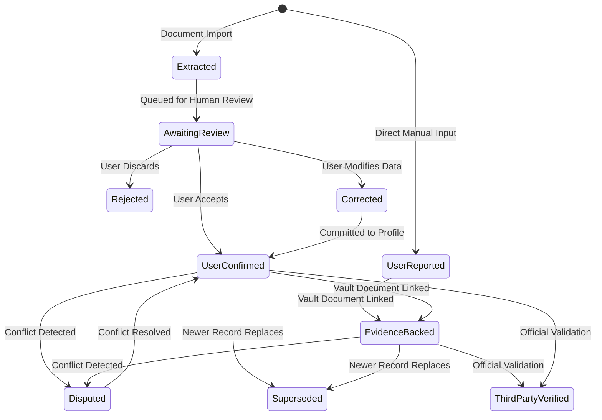

# AUTONOM Applicant Claim Registry & Verification Engine (Stage 21)

## 1. Atomic Claims Concept

To ensure absolute transparency and provenance, AUTONOM breaks down candidate resumes and profile records into **atomic, fine-grained factual claims** (`ApplicantClaim`).

An atomic claim represents a single verifiable assertion, such as:
- `"Degree: Master of Science in Computer Science from University of Texas at Austin (2018-2020)"`
- `"Employment: Lead Infrastructure Architect at Cloud Dynamics Inc (2020-Present)"`
- `"Skill: Kubernetes (Expert, 6 years)"`
- `"Project: HyperMesh Service Fabric in Rust"`

---

## 2. Claim Lifecycle and State Machine

### Verification States (`VerificationStatus`)
1. `USER_REPORTED`: Stated directly by the user in the form without supporting documents.
2. `EXTRACTED`: Parsed from a document; pending human review.
3. `USER_CONFIRMED`: Explicitly affirmed by the user.
4. `EVIDENCE_BACKED`: Linked to a valid document in the Evidence Vault with matching content.
5. `THIRD_PARTY_VERIFIED`: Confirmed via external authoritative integration (e.g. university clearinghouse, verified credential URL).
6. `SUPERSEDED`: Replaced by a more recent or updated version of the claim.
7. `REJECTED`: Discarded by user during review.

---

## 3. Conflict Detection and Resolution

### 3.1 Automated Conflict Detection
The `ClaimRegistry.detect_conflicts(profile_id)` engine analyzes active claims for contradictions:
- **Degree Conflicts**: Conflicting degree titles or institutions for the same degree assertion.
- **Timeline Overlaps**: Dates that contradict one another across sources.
- **Skill Inconsistencies**: Large discrepancies between years of experience claimed on a resume vs inferred from work dates.

### 3.2 Resolution Strategies
Users resolve conflicts via the desktop UI or `/api/v1/applicants/{profile_id}/conflicts/{conflict_id}/resolve`:
- `keep_a`: Keep Claim A, mark Claim B as rejected or superseded.
- `keep_b`: Keep Claim B, mark Claim A as rejected or superseded.
- `manual`: Specify an explicit corrected value that replaces both.
- `dismiss`: Mark conflict as reviewed and acknowledged without modifying records.
