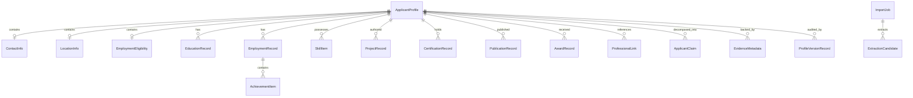

# AUTONOM Applicant Data Model Specification (Stage 21)

## 1. Entity-Relationship Overview

The Applicant Profile domain model represents the core entities required for recruitment intelligence in AUTONOM:

---

## 2. Core Schema Definitions

### 2.1 ApplicantProfile
- `id`: `str` — Unique profile identifier (`prof_<12hex>`)
- `owner_id`: `str` — Isolation tenant/user identity (default `"default_user"`)
- `display_label`: `str` — Human-friendly profile name
- `headline`: `Optional[str]` — Professional title / headline
- `summary`: `Optional[str]` — Executive career summary
- `status`: `str` — Lifecycle state (`active`, `draft`, `archived`)
- `version`: `int` — Monotonically increasing revision number for optimistic concurrency
- `preferred_language`: `str` — ISO 639-1 code (default `"en"`)
- `contact`: `ContactInfo`
- `location`: `LocationInfo`
- `eligibility`: `Optional[EmploymentEligibility]`
- `education`: `list[EducationRecord]`
- `experience`: `list[EmploymentRecord]`
- `skills`: `list[SkillItem]`
- `projects`: `list[ProjectRecord]`
- `certifications`: `list[CertificationRecord]`
- `publications`: `list[PublicationRecord]`
- `awards`: `list[AwardRecord]`
- `professional_links`: `list[ProfessionalLink]`
- `created_at` / `updated_at`: `datetime` (UTC)

### 2.2 ContactInfo & LocationInfo
- **ContactInfo**:
  - `legal_name`: Legal first, middle, last name
  - `preferred_name`: Preferred call name
  - `primary_email`: Authoritative contact email
  - `phone`: E.164 formatted phone number
  - `portfolio_url` / `linkedin_url` / `github_url`: Verified web addresses
- **LocationInfo**:
  - `city`, `state_province`, `postal_code`, `country`
  - `timezone`: IANA timezone string
  - `remote_preference`: `RemotePreference` enum (`remote_only`, `hybrid`, `onsite`, `flexible`)
  - `relocation_willing`: `bool`

### 2.3 EmploymentEligibility
- `authorized_countries`: `list[str]` — Countries where applicant possesses permanent work authorization
- `requires_sponsorship`: `bool` — Whether work visa sponsorship is needed
- `visa_status`: `Optional[str]` — Current visa category (e.g., F1-OPT, H-1B, TN, Green Card)
- `security_clearance`: `Optional[str]` — Clearance level (e.g., Secret, Top Secret, None)
- `notice_period_days`: `int` — Availability notice period
- `confirmed_by_user`: `bool` — Explicit human affirmation of legal eligibility

### 2.4 EducationRecord
- `id`: `str` (`edu_<8hex>`)
- `institution`: Institution name
- `degree`: Academic degree (e.g. "Bachelor of Science", "Master of Engineering")
- `field_of_study`: Major / discipline
- `start_date` / `end_date`: YYYY-MM or YYYY-MM-DD
- `academic_status`: `AcademicStatus` (`completed`, `in_progress`, `deferred`, `incomplete`)
- `gpa`: `Optional[float]`
- `gpa_scale`: `Optional[float]` (e.g. 4.0)
- `coursework`: `list[str]`
- `distinctions`: `list[str]` (Honors, Dean's List)
- `evidence_refs`: `list[str]`
- `verification_status`: `VerificationStatus`

### 2.5 EmploymentRecord
- `id`: `str` (`exp_<8hex>`)
- `employer`: Company or organization name
- `job_title`: Job role or designation
- `employment_type`: `EmploymentType` (`full_time`, `part_time`, `contract`, `internship`, `freelance`)
- `start_date` / `end_date`: YYYY-MM
- `is_current`: `bool`
- `location`: City, Country
- `work_arrangement`: `WorkArrangement` (`remote`, `hybrid`, `onsite`)
- `responsibilities`: `list[str]`
- `technologies`: `list[str]`
- `achievements`: `list[AchievementItem]` (metric statement, value, unit)
- `evidence_refs`: `list[str]`
- `verification_status`: `VerificationStatus`

### 2.6 SkillItem
- `id`: `str` (`skl_<8hex>`)
- `name`: Display name (e.g., "Python")
- `canonical_name`: Normalized taxonomy token (e.g., "python")
- `category`: `SkillCategory` (`programming_languages`, `frameworks_libraries`, `cloud_devops`, `databases`, `ai_ml`, `testing`, `development_tools`, etc.)
- `proficiency`: `ProficiencyLevel` (`beginner`, `intermediate`, `advanced`, `expert`)
- `years_experience`: `Optional[float]`
- `last_used`: `Optional[str]` (YYYY)
- `evidence_refs`: `list[str]`
- `verification_status`: `VerificationStatus`

### 2.7 ProjectRecord
- `id`: `str` (`prj_<8hex>`)
- `title`: Project title
- `description`: Overview and architectural objectives
- `category`: `ProjectCategory` (`personal`, `academic`, `open_source`, `commercial`)
- `technologies`: `list[str]`
- `applicant_contribution`: Specific authored modules and deliverables
- `repo_url`: Source code repository
- `live_url`: Deployed system link
- `results`: Quantifiable outcomes (stars, users, latency reductions)
- `evidence_refs`: `list[str]`
- `verification_status`: `VerificationStatus`
