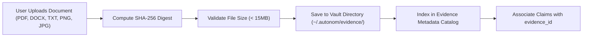

# AUTONOM Evidence Vault & Document Provenance (Stage 21)

## 1. Overview

The Evidence Library (`EvidenceMetadata` and the local encrypted vault) provides verifiable backing for all claims in the applicant's profile. When recruiters or automated ATS tools request proof of degree, certifications, or work authorization, AUTONOM links claims directly to cryptographic evidence.

---

## 2. Evidence Ingestion & Vault Architecture

### 2.1 File Ingestion Constraints
- **Supported Formats**: PDF (`pypdf`), DOCX (`python-docx`), TXT, Markdown, JSON, PNG, JPG.
- **Maximum File Size**: 15 MB (configurable via settings).
- **Integrity**: Every ingested file has its SHA-256 hash calculated immediately on receipt.

### 2.2 Evidence Metadata Schema
- `evidence_id`: Unique identifier (`evd_<12hex>`)
- `profile_id`: Parent applicant profile
- `filename`: Original user-facing filename
- `file_type`: Format extension (`pdf`, `docx`, `txt`, etc.)
- `file_size_bytes`: Exact byte count
- `content_hash`: Hex-encoded SHA-256 digest
- `storage_path`: Internal absolute path to protected vault storage
- `source_category`: Category (`resume`, `transcript`, `certificate`, `publication`, `other`)
- `privacy_classification`: Data privacy level (`CONFIDENTIAL`, `RESTRICTED`, `PUBLIC`)
- `linked_claim_ids`: List of atomic claims substantiated by this document
- `verification_status`: Status of proof
- `uploaded_at`: UTC timestamp

---

## 3. Cryptographic Verification & Tamper Detection

1. **Hash Verification**: When any evidence document is accessed or exported, its SHA-256 hash is re-evaluated against `content_hash`. If a discrepancy is found, an alarm is logged and claims revert to `DISPUTED`.
2. **Deletion & Cascade**: Deleting an evidence record removes the physical file from disk and disassociates linked claims, safely degrading their verification status from `EVIDENCE_BACKED` to `USER_REPORTED`.
