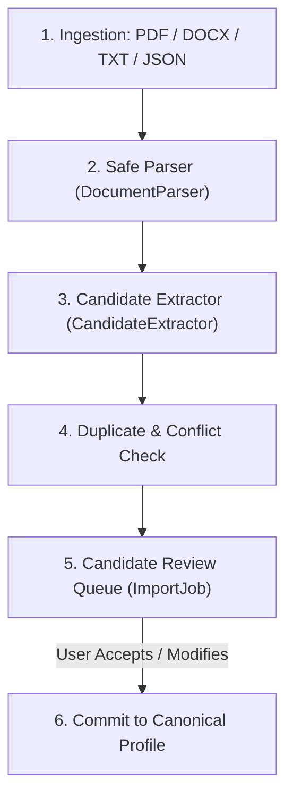

# AUTONOM Document Import Pipeline & Review Queue (Stage 21)

## 1. Overview

The Import Pipeline provides secure, reliable extraction of professional qualifications from legacy resumes, CVs, and documents. Rather than blindly applying parsed data directly to the user's canonical profile, AUTONOM implements a **deterministic foundation with human-in-the-loop review**.

---

## 2. Ingestion Pipeline Stages

### 2.1 Safe Parsing (`DocumentParser`)
- **PDF Extraction**: Uses `pypdf` to extract text streams across all pages while filtering out malicious embedded objects.
- **DOCX Extraction**: Uses `python-docx` to iterate across paragraphs, runs, and tables.
- **Plain Text / Markdown / JSON**: Clean UTF-8 normalization.
- **Safety Limits**: 15 MB file size boundary; invalid magic bytes reject unsupported formats immediately.

### 2.2 Extraction Engine (`CandidateExtractor`)
The extractor uses a two-tier strategy:
1. **High-Reliability Deterministic Extraction**:
   - Regular expression scanning for contact information (`EMAIL_REGEX`, `PHONE_REGEX`, `URL_REGEX`).
   - 100+ technology taxonomy dictionary matching (`KNOWN_SKILLS`).
   - Academic credential pattern matching (BS, MS, PhD, B.Tech, M.Tech, MBA).
   - Employment timelines and company name patterns.
2. **AI Gateway Structured Extraction (Optional/Progressive)**:
   - For unstructured narrative resumes, can invoke local or cloud LLMs via Stage 11–13 AI Gateway with strict JSON schemas.

### 2.3 Duplicate and Conflict Detection
Extracted candidates are cross-referenced with existing canonical profile entities:
- If a skill (e.g. "Kubernetes") is already present on the profile, it is flagged with `is_duplicate = True` and linked to `matched_existing_id`.
- If an extracted date contradicts an existing date for the same employer, `conflict_warning` is populated.

---

## 3. Human Review Queue Actions

Users review candidates in the **Imports** tab of the desktop workspace or via `POST /api/v1/applicants/{profile_id}/imports/{import_id}/candidates/{candidate_id}/review`:
- **Accept**: The extracted candidate is committed into the canonical profile as a verified record, and an atomic claim is created in the claim registry.
- **Modify / Correct**: The user edits the fields (e.g., corrects institution name or date) before committing.
- **Reject**: The candidate is discarded from the review queue and never enters the canonical profile.
