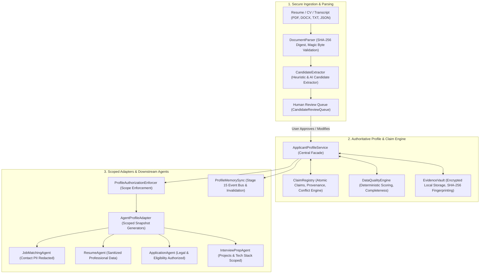

# AUTONOM Applicant Profile Architecture (Stage 21)

## 1. Overview and Mission

Stage 21 establishes the foundational **authoritative applicant identity and verified professional profile system** for the AUTONOM Windows 11 autonomous desktop platform, inaugurating **Phase 5: Recruitment Intelligence Foundation**.

Before Stage 21, AUTONOM established:
- Real local and cloud AI inference (Stages 11–13)
- Multi-agent orchestration and Supervisor (Stage 14)
- Granular authorization and safety enforcement (Stage 14)
- Persistent semantic and procedural memory (Stage 15)
- Multi-method browser, Windows structural, and visual automation (Stages 16–20)

Stage 21 provides downstream recruitment specialist agents (`JobMatchingAgent`, `ResumeAgent`, `ApplicationAgent`, `InterviewPrepAgent`) with an immutable, verified **Single Source of Truth** for applicant qualifications, work history, skills, and legal attestations, guaranteeing **zero hallucination**, explicit human review of extracted claims, cryptographic evidence provenance, and scoped PII redaction.

---

## 2. High-Level System Architecture

---

## 3. Core Architectural Principles

### 3.1 Single Source of Truth
All applicant facts originate from `ApplicantProfileService`. No recruitment agent is permitted to fabricate, assume, or synthesize unverified credentials, dates, or contact info.

### 3.2 Human-in-the-Loop Review Queue
Candidate claims parsed from uploaded resumes or external platforms remain in an `AWAITING_REVIEW` holding state. Only explicit user acceptance or modification transitions extracted entities into the canonical profile.

### 3.3 Evidence-Backed Provenance
Every atomic claim is tied to supporting documents stored in the local evidence vault, hashed via SHA-256 to ensure data integrity and tamper detection.

### 3.4 Scoped Privacy and Zero PII Leakage
Each downstream specialist agent receives only the subset of data permitted by its authorization policy:
- `JobMatchingAgent`: Skills, preferred roles, geographic locations, work arrangements. **Contact info (name, email, phone) is strictly omitted/redacted.**
- `ResumeAgent`: Full employment history, achievements, and degrees.
- `ApplicationAgent`: Authorized countries, work eligibility, and necessary contact coordinates for submission.
- `InterviewPrepAgent`: Project descriptions, technologies used, and architecture talking points.

### 3.5 Optimistic Concurrency and Immutable Audit History
Profile updates increment an integer `version` field. Mutating requests evaluate `expected_version` against the current profile state. Concurrent collisions trigger `ConcurrencyConflictError` (HTTP 409). Every change is persisted to `ProfileVersionRecord`.
