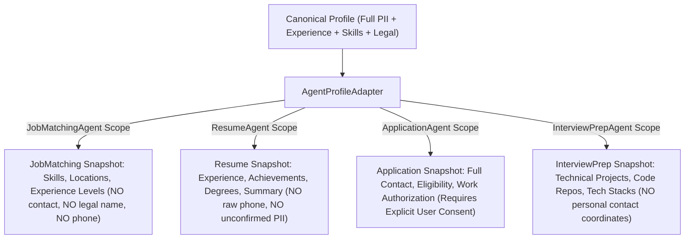

# AUTONOM Applicant Profile Security & Privacy (Stage 21)

## 1. Overview

Applicant data contains sensitive personally identifiable information (PII), including legal names, physical addresses, phone numbers, email addresses, and employment authorization records. Stage 21 implements enterprise-grade security and strict isolation.

---

## 2. Authorization Scopes (Stage 14 Integration)

All access to applicant profiles is guarded by `ProfileAuthorizationEnforcer` using granular permission scopes:

| Permission Scope | Purpose | Allowed Actors |
| :--- | :--- | :--- |
| `applicant.profile.read` | View basic profile metadata & summaries | Desktop user, Supervisor, Authorized agents |
| `applicant.profile.update` | Create or mutate profile fields | Desktop user, Admin |
| `applicant.profile.delete` | Delete profile and all associated data | Desktop user, Admin |
| `applicant.identity.read` | Access legal name and government info | ApplicationAgent, Desktop user |
| `applicant.contact.read` | Access email, phone, personal links | ResumeAgent, ApplicationAgent, Desktop user |
| `applicant.eligibility.read` | Access work authorization & visa status | ApplicationAgent, Desktop user |
| `applicant.education.read` | Access degrees, GPAs, coursework | ResumeAgent, PrepAgent, Desktop user |
| `applicant.experience.read` | Access employment history & metrics | ResumeAgent, PrepAgent, Desktop user |
| `applicant.skills.read` | Access skills taxonomy & proficiencies | JobMatchingAgent, ResumeAgent, Desktop user |
| `applicant.projects.read` | Access technical portfolio and code links | InterviewPrepAgent, Desktop user |
| `applicant.evidence.read` | View evidence metadata and hashes | Desktop user, Admin |
| `applicant.evidence.upload` | Upload supporting documents | Desktop user |
| `applicant.evidence.delete` | Delete supporting documents | Desktop user |
| `applicant.claims.confirm` | Approve extracted claims in review queue | Desktop user |
| `applicant.profile.export` | Export portable JSON package | Desktop user, Admin |

---

## 3. Downstream Agent Scoped Redaction

To prevent accidental PII leakage to third-party APIs or unprivileged agents, `AgentProfileAdapter` produces **custom, scoped, redaction-safe snapshots** (`ProfileSnapshot`):

### Critical Verification Test
In `services/api/tests/test_applicant_security.py` and `test_api_applicants.py`:
- `JobMatchingAgent` snapshot is explicitly asserted to NOT contain `"contact"`, `"primary_email"`, `"phone"`, or `"legal_name"`.
- This ensures that automated job scrapers and matching algorithms can evaluate skill fits without ever possessing candidate contact coordinates.
