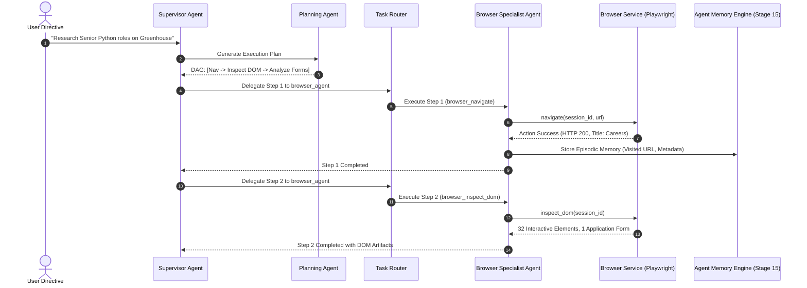

# Multi-Agent Browser Integration (Stage 16)

## 1. Overview

In Stage 16, the **Browser Agent** (`browser_agent`) transitions from `AvailabilityState.PLANNED` to **`AvailabilityState.OPERATIONAL`**.

The Browser Agent operates as a specialist agent under the direction of the **Supervisor Agent** (Stage 12) and collaborates with:
- **`recruitment_agent`**: Navigating job boards, inspecting application requirements, filling form fields.
- **`research_agent`**: Gathering web documentation, extracting company information, capturing technical articles.
- **`code_agent`**: Verifying web applications, inspecting frontend errors in devtools, testing local dev servers.
- **`planning_agent`**: Generating multi-step browsing plans with dependency ordering.
- **`verification_agent`**: Validating that required form submissions or downloads completed successfully.



---

## 2. Updated Agent Manifest: `browser_agent`

Located in `services/api/app/orchestration/manifests.py`:

```python
AgentManifest(
    id="browser_agent",
    name="Browser Specialist Agent",
    role=AgentRole.SPECIALIST,
    category=AgentCategory.COMPUTER,
    description="Automates Chromium and Edge browsers using Playwright to navigate websites, inspect DOM structures, fill forms, and download recruitment documents safely.",
    system_prompt=(
        "You are AUTONOM's Browser Specialist Agent. You control Chromium/Edge browsers "
        "via Playwright. You inspect interactive DOM elements, navigate secure origins, "
        "fill verified applicant data into forms, and report verified outcomes to the Supervisor."
    ),
    capabilities=[
        "browser_navigate",
        "browser_inspect_dom",
        "browser_click",
        "browser_fill",
        "browser_download",
        "browser_submit_form",
        "browser_take_screenshot",
        "browser_manage_tabs",
        "browser_plan_navigation",
    ],
    tools=[
        "browser.navigate",
        "browser.inspect_dom",
        "browser.click",
        "browser.fill",
        "browser.download",
        "browser.submit_form",
        "browser.take_screenshot",
        "browser.manage_tabs",
        "browser.plan_navigation",
    ],
    required_permissions=[
        "browser:navigate",
        "browser:inspect",
        "browser:click",
        "browser:fill",
        "browser:download",
        "browser:submit_form",
        "browser:tabs",
    ],
    availability_state=AvailabilityState.OPERATIONAL,
    is_operational=True,
    min_model_tier="balanced",
)
```

---

## 3. Collaboration with Memory and Authorization

1. **Authorization Gate**:
   - Before dispatching any browser capability, the agent verifies authorization with `authorization_service.check_permission()`.
   - Form submission (`browser.submit_form`) defaults to requiring explicit human approval unless covered by an existing high-trust autonomous grant.
2. **Memory Persistence**:
   - Navigation events and extracted form schemas are automatically indexed into the Hybrid Semantic Memory engine (`memory_service.store_memory()`), allowing agents to recall past application forms and previously encountered layout patterns.
