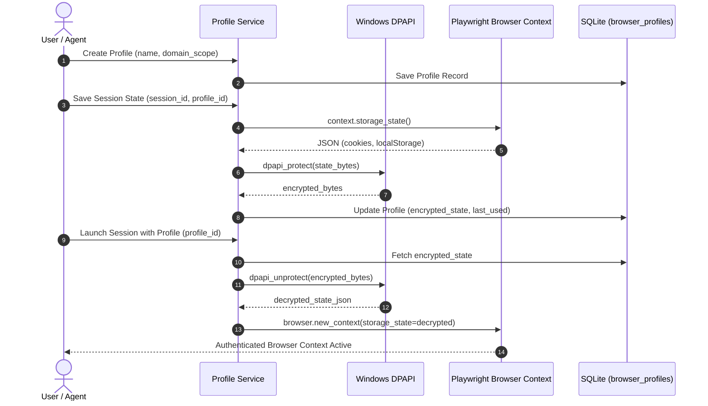

# Browser Authentication and Encrypted Profiles (Stage 16)

## 1. Overview and Security Model

Recruitment and web platforms frequently require persistent authentication sessions (e.g. LinkedIn, Greenhouse, Lever, Indeed, GitHub). Storing authentication cookies and local storage tokens in plaintext creates severe security risks.

AUTONOM Stage 16 introduces **Encrypted Browser Profiles** backed by **Windows Data Protection API (DPAPI)** (`services/api/app/browser/security/authentication.py`).



---

## 2. Windows DPAPI Protection

The `dpapi_protect` and `dpapi_unprotect` functions utilize the Windows operating system master key tied to the current logged-in Windows user account:

- **Hardware and OS Bound**: The encrypted bytes cannot be decrypted on another machine, nor can another user on the same machine decrypt them without the current user's credentials.
- **Zero Plaintext Storage**: Storage states are converted to bytes, immediately passed to Windows DPAPI, and persisted either in the SQLite `browser_profiles` table or in protected profile storage files (`%LOCALAPPDATA%\autonom\browser\profiles\`).

---

## 3. Domain Scoping and Access Rules

Profiles can be configured with strict domain boundaries:
- `domain_scope: ["linkedin.com", "github.com"]`: The profile storage state is only loaded if the requested session navigation matches one of the scoped domains.
- If an agent attempts to use a scoped profile on an untrusted or mismatched domain, the request is rejected with an authorization exception.

---

## 4. Database Schema: `browser_profiles`

```sql
CREATE TABLE browser_profiles (
    id VARCHAR(64) PRIMARY KEY,
    name VARCHAR(128) NOT NULL,
    domain_scope JSON,
    is_ephemeral BOOLEAN NOT NULL DEFAULT 0,
    encrypted_state BLOB,
    created_at TIMESTAMP NOT NULL,
    last_used_at TIMESTAMP
);
```

### Profile Operations
- `create_profile(name, domain_scope, is_ephemeral)`: Provisions a new profile slot.
- `save_session_state(session_id, profile_id)`: Extracts current context cookies and localStorage, encrypts with DPAPI, and updates the profile.
- `load_profile_state(profile_id)`: Decrypts DPAPI bytes and returns the Playwright-compliant `StorageState` dictionary.
- `delete_profile(profile_id)`: Securely erases the record and associated state.
