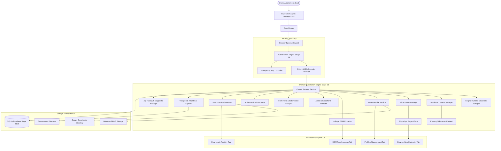

# Browser Automation Architecture (Stage 16)

## 1. Overview and System Context

AUTONOM Stage 16 introduces the **Production-Oriented Browser Automation Engine**, inaugurating **Phase 4: Computer and Browser Automation**. Built on Microsoft Playwright and integrated into AUTONOM's Windows 11 desktop assistant runtime, this engine provides safe, permission-controlled, multi-agent web automation.

The browser automation architecture connects with AUTONOM's prior architectural foundations:
- **Supervisor & Multi-Agent Orchestration (Stage 12 & 13)**: The `browser_agent` is upgraded from planned to **Operational**, executing browser capabilities via task delegation.
- **Authorization Engine & Emergency Stop (Stage 14)**: Every browser operation (navigation, click, fill, download, form submission) is governed by granular policy checks and fails closed if Emergency Stop is active.
- **Persistent Memory Engine (Stage 15)**: Browser tasks, visited URLs, page structures, and execution traces are recorded as episodic and procedural memory.
- **FastAPI Backend Services & SQLite Database**: Persistent session records, tabs, actions, profiles, and downloads stored with full transactional integrity.
- **Windows DPAPI Security**: Authentication credentials, cookies, and storage states are protected using Windows DPAPI encryption before disk storage.
- **React 18 + Vite Desktop Workspace**: High-performance UI controller in `apps/desktop/src/features/computer/browser/` offering real-time viewport previews, DOM tree exploration, download telemetry, and profile management.

---

## 2. Core Architectural Principles

1. **Strictly Zero Fake Data**: Browser operations execute in genuine Playwright browser contexts against real Web standards (HTML5/DOM/CSS/JS). No simulated or mocked responses are presented as real browser actions.
2. **Fail-Closed Security & Isolation**:
   - `file://`, `javascript:`, and internal RFC-1918 addresses (`10.0.0.0/8`, `172.16.0.0/12`, `192.168.0.0/16`, `127.0.0.1`, `localhost`) are blocked by default.
   - Cloud metadata IP endpoints (`169.254.169.254`, `metadata.google.internal`) are blocked unconditionally to protect against SSRF and credential extraction.
   - Every active browser session is instantly killed when Emergency Stop is activated.
3. **Robust Element Resolution & Verification**:
   - Locators support multi-strategy smart resolution: ARIA roles, text contents, placeholders, labels, test IDs, CSS, and XPath.
   - Every state-modifying action (click, fill, navigate) triggers a post-action verification pass assessing URL changes, DOM mutations, or element visibility.
4. **Token-Aware DOM Compaction**:
   - Instead of feeding massive raw HTML strings to LLMs, the DOM extractor scans interactive elements, produces a hierarchical clean representation, and estimates token consumption for agent prompt injection.
5. **Session & Profile State Protection**:
   - Browser profiles store cookies, localStorage, and session tokens encrypted at rest via Windows Data Protection API (DPAPI).
