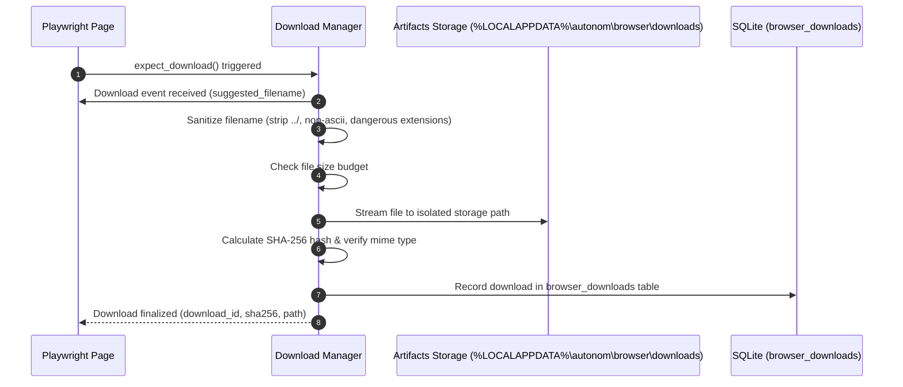

# Browser Downloads and Artifact Storage (Stage 16)

## 1. Overview

Autonomous browser workflows often involve downloading files: job offer letters, PDF job descriptions, application receipts, sample assignments, or resume templates.

Allowing arbitrary browser downloads poses serious risks:
- Disk exhaustion from unbounded downloads.
- Path traversal vulnerabilities if remote filenames contain directory separators (`../`).
- Malicious executable downloads (`.exe`, `.bat`, `.vbs`, `.ps1`).

Stage 16 implements the **Safe Download Manager** (`services/api/app/browser/artifacts/downloads.py`) with strict isolation, size limits, SHA-256 integrity verification, and database auditing.



---

## 2. Safety Controls & File Sanitization

1. **Path Sanitization**:
   - `os.path.basename` strips leading paths and traversal attempts.
   - Remote filenames with `..` or illegal Windows characters (`< > : " / \ | ? *`) are replaced with clean identifiers.
2. **Quota Enforcement**:
   - Maximum single download size defaults to 50 MB (`MAX_DOWNLOAD_SIZE_BYTES = 52428800`).
   - Downloads exceeding this limit are aborted immediately.
3. **Cryptographic Integrity**:
   - A streaming SHA-256 checksum is calculated while writing the file to disk.
   - The hash is permanently stored in the database record for provenance and auditability.
4. **Isolated Storage**:
   - All downloaded artifacts reside in `%LOCALAPPDATA%\autonom\browser\downloads\`, segregated from user document folders and system binaries.

---

## 3. Database Schema: `browser_downloads`

```sql
CREATE TABLE browser_downloads (
    id VARCHAR(64) PRIMARY KEY,
    session_id VARCHAR(64) REFERENCES browser_sessions(id) ON DELETE SET NULL,
    filename VARCHAR(255) NOT NULL,
    original_url TEXT,
    content_type VARCHAR(128),
    size_bytes BIGINT NOT NULL,
    sha256_hash VARCHAR(64) NOT NULL,
    file_path TEXT NOT NULL,
    created_at TIMESTAMP NOT NULL,
    status VARCHAR(32) NOT NULL DEFAULT 'completed'
);
```

---

## 4. REST API & UI Integration

- `GET /api/v1/browser/downloads`: Fetches download history with filenames, file sizes, MIME types, and SHA-256 hashes.
- `GET /api/v1/browser/downloads/{id}/file`: Safely streams the downloaded file to the user or agent.
- `BrowserDownloadsTab.tsx`: Interactive desktop tab displaying download status, size badges, and one-click copy for SHA-256 hashes.
