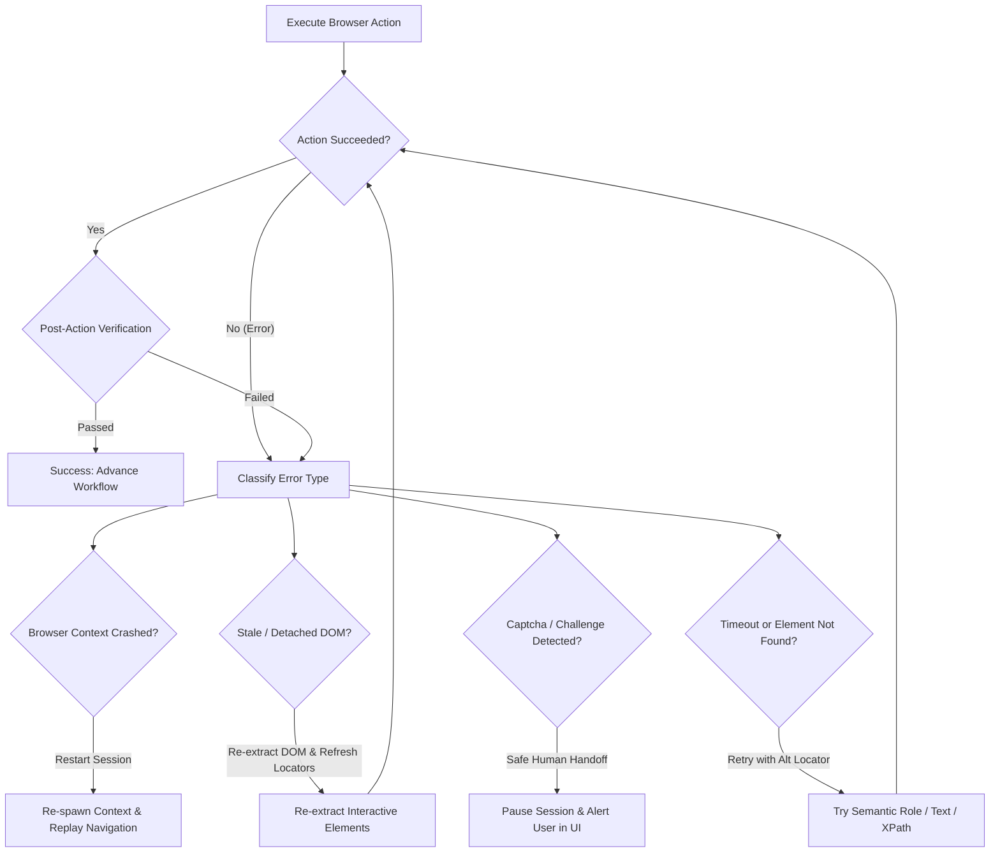

# Browser Execution Recovery and Self-Healing (Stage 16)

## 1. Overview and Failure Modes

Web automation in dynamic environments encounters frequent transient and structural failures:
- **Element Detached / Stale Reference**: DOM re-renders while the agent is resolving an element.
- **Overlay & Modal Interception**: Cookie banners, newsletter prompts, or modal dialogs obscuring the target button.
- **Page Load Timeouts**: Slow networks, infinite spinner SPAs, or hung analytics scripts.
- **Bot Verification / Cloudflare Challenges**: Captchas, proof-of-work gates, or Turnstile challenges.
- **Browser Process Crashes**: Out-of-memory errors or GPU driver faults on Windows.

Stage 16 integrates browser execution with AUTONOM's **Recovery Agent** and **Verification Engine** (Stage 12).

---

## 2. Recovery Strategies

### Strategy 1: Multi-Locator Fallback
If an element cannot be found with a primary locator (e.g. `role=button[name='Next']`), the `LocatorResolver` automatically attempts alternative strategies:
1. ARIA Role + Name
2. Normalized Visible Text (`text=Next`)
3. Placeholder or Associated Label
4. Specific CSS ID or Name attribute
5. Scoped XPath within parent form container

### Strategy 2: Stale Element Re-Query
Single-Page Applications (React, Vue) frequently detach and re-mount nodes during state updates. If Playwright throws an `ElementHandle is detached from document` error, the Action Executor re-evaluates the locator with a fresh DOM snapshot and retries up to 3 times with exponential backoff.

### Strategy 3: Modal & Cookie Banner Dismissal
If an element click fails due to an overlay intercepting pointer events, the Action Executor checks for standard dismiss triggers:
- `button[id*='cookie']`, `button[class*='consent']`
- `button[aria-label='Close']`, `.modal-close`
It dismisses the overlay and re-attempts the original action.

### Strategy 4: Captcha & Bot Gate Protocol
In strict adherence to AUTONOM's core safety guidelines:
- AUTONOM never attempts to bypass, solve, or click through CAPTCHAs, Cloudflare Turnstile, or anti-bot challenges via automated means.
- When a challenge is detected on the page, the `BrowserService` transitions the session to `paused`, emits a notification, and allows the user to solve it directly in the headed browser or UI preview.
