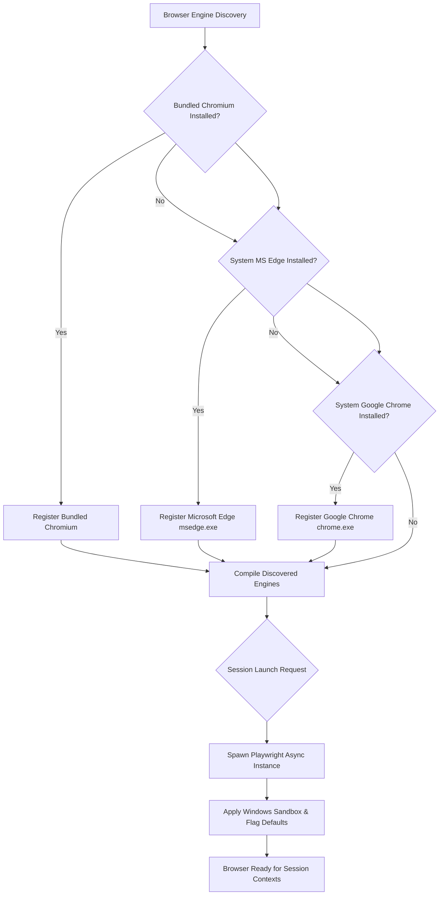

# Browser Runtime and Engine Discovery (Stage 16)

## 1. Runtime Manager Overview

The Browser Runtime Manager (`services/api/app/browser/runtime/manager.py`) provides lifecycle control over Playwright browser processes on Windows 11. It dynamically discovers installed browser binaries, manages concurrent browser instances, configures process arguments, and enforces resource governance.

---

## 2. Windows Browser Discovery

The runtime automatically scans default Windows 11 installation paths:

| Engine | Channel / Path | Discovery Logic |
| :--- | :--- | :--- |
| **Bundled Chromium** | `%LOCALAPPDATA%\ms-playwright\chromium-*\chrome-win\chrome.exe` | Detected via Playwright driver inspection |
| **Microsoft Edge** | `C:\Program Files (x86)\Microsoft\Edge\Application\msedge.exe` | Verified via filesystem existence check |
| **Google Chrome** | `C:\Program Files\Google\Chrome\Application\chrome.exe` | Verified via filesystem existence check |

### Default Fallback & Priority
1. Bundled Chromium (isolated from user personal browser data)
2. Microsoft Edge (`msedge` channel)
3. Google Chrome (`chrome` channel)

---

## 3. Launch Arguments and Security Flags

Browser instances launched by AUTONOM enforce privacy, performance, and automation compatibility:

- `--no-first-run`: Skips initial onboarding flows.
- `--no-default-browser-check`: Suppresses default browser prompts.
- `--disable-blink-features=AutomationControlled`: Enhances compatibility with web standards and prevents false-positive rendering anomalies.
- Custom User-Agent: Configurable per session or profile to avoid bot classification on recruitment platforms.
- Viewport Dimensions: Default `1280x800` (customizable per session).
- Headless vs Headed: Controlled via session configuration; defaults to headless in background automation and headed when interactive user supervision is desired.

---

## 4. Lifecycle & Process Cleanup

- **Async Context Management**: All Playwright calls execute asynchronously using `asyncio` inside the FastAPI service lifecycle.
- **Graceful Shutdown**: On application shutdown, all open pages, browser contexts, and browser instances are sequentially closed, preventing orphaned `chrome.exe` or `msedge.exe` processes on Windows.
- **Crash Recovery**: If a browser process crashes unexpectedly, the Runtime Manager flags the session as `crashed` and notifies the Recovery Agent.
