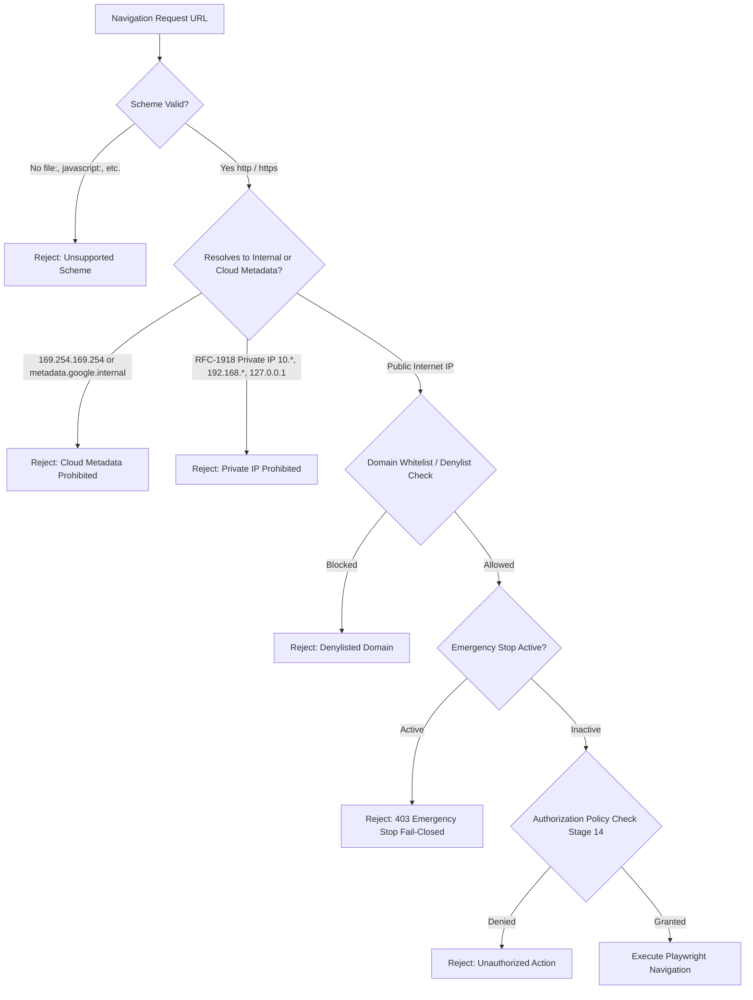

# Browser Security, Origin Controls, and Sandboxing (Stage 16)

## 1. Threat Model & Security Posture

Autonomous web browsing introduces serious security challenges:
- **Server-Side Request Forgery (SSRF)**: Malicious web pages redirecting the browser to local network services or cloud metadata endpoints.
- **Credential & State Extraction**: Untrusted scripts accessing stored cookies, tokens, or local credentials.
- **Dangerous Scheme Exploitation**: Navigation to `file://`, `javascript:`, or `vbscript:` schemes to execute malicious code or read local files.
- **Unauthorized Actions**: Agents submitting forms, spending money, or applying to unintended targets without user authorization.

To protect against these threats, AUTONOM enforces strict layered defenses:

---

## 2. Origin & URL Security Validator

Implemented in `services/api/app/browser/security/origins.py`:

### Prohibited Schemes
- `file:` (Strictly forbidden to prevent reading local files or system configuration)
- `javascript:` (Forbidden to prevent arbitrary script execution in location bars)
- `data:` (Blocked for primary navigation)
- `blob:` (Restricted)
- `vbscript:`, `about:blank` (Except as initial tab state)

### Cloud Metadata & Localhost Defense
The following addresses are blocked unconditionally:
- `169.254.169.254` (AWS, Azure, GCP metadata service)
- `metadata.google.internal` (GCP metadata host)
- `100.100.100.200` (Alibaba metadata service)
- `127.0.0.1`, `localhost`, `0.0.0.0`, `::1` (Local loopback)
- RFC 1918 Private Subnets: `10.0.0.0/8`, `172.16.0.0/12`, `192.168.0.0/16`
- Carrier-Grade NAT: `100.64.0.0/10`

---

## 3. Emergency Stop Integration

Browser operations are directly coupled to the `EmergencyStopController` (Stage 14):
- If Emergency Stop is triggered via the UI header, backend API, or global hotkey:
  1. The central `BrowserService` immediately rejects any new navigation or action with HTTP 403.
  2. All running browser sessions and contexts are forcefully closed.
  3. No background tabs or automation routines remain active.

---

## 4. Submission & Financial Boundaries

- Any action categorized as a form submission (`browser.submit_form`) or payment/financial transaction requires explicit user approval unless explicitly covered by a valid preauthorized grant (Stage 14).
- If unapproved, the engine pauses the action, creates a `PendingApproval` record, and notifies the user in the Approvals workspace.
