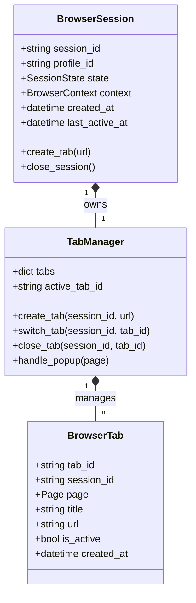

# Browser Sessions and Tab Management (Stage 16)

## 1. Session Isolation Model

In AUTONOM, a **Browser Session** represents an isolated `BrowserContext` within Playwright. Each session maintains independent:
- Cookie jars
- LocalStorage and SessionStorage stores
- Cache and IndexedDB state
- Active tabs (pages)
- Network proxies and user-agent settings
- Profile bindings

This guarantees complete isolation between multi-agent tasks. For example, a `RecruitmentAgent` exploring job boards cannot collide with or leak state into a `ResearchAgent` gathering documentation.



---

## 2. Session Lifecycle States

A browser session transitions through five discrete states:

1. **`initializing`**: Playwright context is being created, DPAPI storage states decrypted and applied, viewport configured.
2. **`active`**: Context and initial tab are ready for interaction; action dispatch is enabled.
3. **`paused`**: Session execution is halted for user review or human-in-the-loop approval.
4. **`closed`**: Context closed cleanly; final screenshots and trace files persisted.
5. **`crashed`**: Process failure or unexpected disconnection detected; session preserved for post-mortem analysis.

---

## 3. Tab and Popup Management

The `TabManager` (`services/api/app/browser/runtime/tabs.py`) controls all pages within a context:

- **Primary Page**: Automatically opened when a session launches.
- **Popup Interception**: When links trigger `target="_blank"` or JavaScript `window.open()`, the `context.on("page")` listener captures the new page, registers it with a unique `tab_id`, and stores metadata in `browser_tabs`.
- **Deduplication**: Built-in deduplication ensures pages are not double-registered during fast window opening sequences.
- **Active Tab Tracking**: The manager tracks the currently focused tab for automated action execution, while allowing the caller or desktop UI to switch between tabs at will.
- **Auto-Cleanup**: Closing a session systematically closes all associated tabs in reverse order.

---

## 4. Database Schema: `browser_sessions` & `browser_tabs`

```sql
CREATE TABLE browser_sessions (
    id VARCHAR(64) PRIMARY KEY,
    profile_id VARCHAR(64) REFERENCES browser_profiles(id),
    engine VARCHAR(32) NOT NULL,
    headless BOOLEAN NOT NULL DEFAULT 1,
    status VARCHAR(32) NOT NULL DEFAULT 'active',
    created_at TIMESTAMP NOT NULL,
    last_active_at TIMESTAMP NOT NULL,
    metadata JSON
);

CREATE TABLE browser_tabs (
    id VARCHAR(64) PRIMARY KEY,
    session_id VARCHAR(64) NOT NULL REFERENCES browser_sessions(id) ON DELETE CASCADE,
    title VARCHAR(512),
    url TEXT,
    is_active BOOLEAN NOT NULL DEFAULT 0,
    created_at TIMESTAMP NOT NULL,
    closed_at TIMESTAMP
);
```
