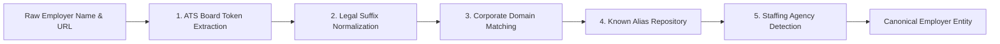

# Canonical Employer Identity Resolution (Stage 27)

## Overview
Employer identity resolution in AUTONOM reconciles various name formats, trading names, holding companies, and staffing agency representations into unified canonical employers.

## 5-Stage Identity Resolution Pipeline

### Stage 1: ATS Board Token Extraction
Extracts subdomains or path tokens from authorized job boards:
- `boards.greenhouse.io/{board_token}/jobs/*`
- `jobs.lever.co/{board_token}/*`
- `jobs.ashbyhq.com/{board_token}/*`

### Stage 2: Legal Suffix Stripping & Normalization
Applies regular expression normalization removing trailing punctuation and corporate designations:
- Matches suffixes: `Inc.`, `LLC`, `Corp.`, `Ltd.`, `Limited`, `Corporation`, `Technologies`, `Group`.
- Example: `"Stripe, Inc."` -> Normalized Name: `"stripe"`.

### Stage 3: Corporate Domain Matching
- Hostnames from third-party feed aggregators (`techjobs.example`) are rejected as corporate domains.
- Career pages and direct employer sites (`stripe.com`) are verified against `employer_verified_domains`.

### Stage 4: Known Alias Repository
Maintains verified multi-brand mappings in `employer_aliases`:
- Example: `Alphabet Inc.` -> `Google`, `Google LLC`.

### Stage 5: Staffing Agency & Intermediary Classification
Classifies third-party recruiting agencies (`Robert Half`, `TEKsystems`, `Apex Systems`, `Insight Global`) into `OrganizationType.STAFFING_AGENCY`.
Direct hiring companies are categorized as `OrganizationType.DIRECT_EMPLOYER`.
