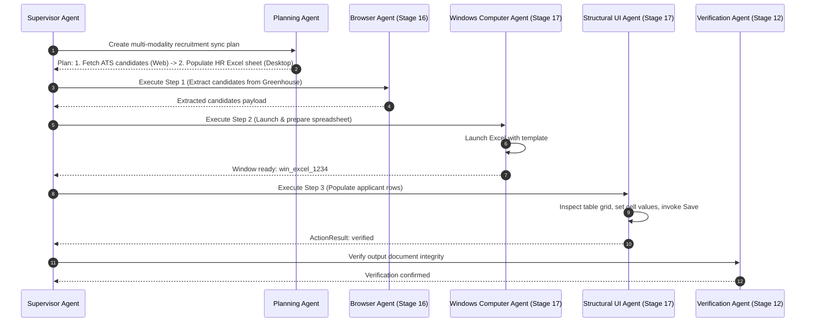

# Multi-Agent Computer Control & Agent Integration (Stage 17)

## 1. Computer Control Specialist Roles

Stage 17 promotes the planned computer agents from Stage 13 to **fully operational** status:

| Agent Identifier | Category | Operational State | Responsibility |
| :--- | :--- | :--- | :--- |
| **`browser_agent`** | `AgentCategory.COMPUTER` | `OPERATIONAL` (Stage 16) | Autonomous web navigation, form completion, and DOM inspection via Playwright. |
| **`windows_computer_agent`** | `AgentCategory.COMPUTER` | `OPERATIONAL` (Stage 17) | Operating-system-level application management, multi-window workflows, file organization, and desktop coordination. |
| **`structural_ui_agent`** | `AgentCategory.COMPUTER` | `OPERATIONAL` (Stage 17) | Accessibility tree inspection, element locating, pattern execution, and verification. |
| **`visual_grounding_agent`** | `AgentCategory.COMPUTER` | `LIMITED` (Future Stage 18) | Computer vision spatial grounding and screenshot validation. |

---

## 2. Multi-Agent Dual-Modality Collaboration

In enterprise recruiting, agents collaborate across both browser and desktop modalities:

---

## 3. Registered Desktop Capabilities in the Capability Registry

Nine new atomic capabilities are registered in `app/orchestration/capabilities/registry.py`:

1. `desktop.list_applications`: Discovers running desktop executables and PIDs.
2. `desktop.list_windows`: Enumerates active top-level windows on the interactive desktop.
3. `desktop.inspect_window`: Inspects window bounds, title, and state.
4. `desktop.inspect_tree`: Traverses and compiles bounded UI Automation tree.
5. `desktop.find_elements`: Queries accessible controls by locator.
6. `desktop.invoke`: Triggers buttons, links, or menu items via `InvokePattern`.
7. `desktop.set_value`: Sets text in editable controls via `ValuePattern`.
8. `desktop.manage_window`: Activates, minimizes, maximizes, restores, or closes windows.
9. `desktop.execute_action`: Executes complex typed desktop action with post-action mutation verification.
