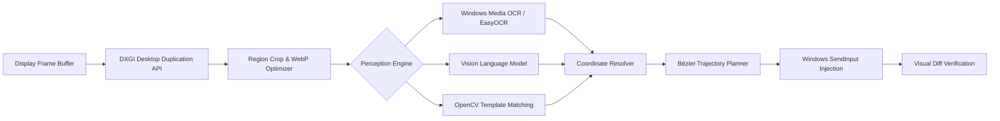
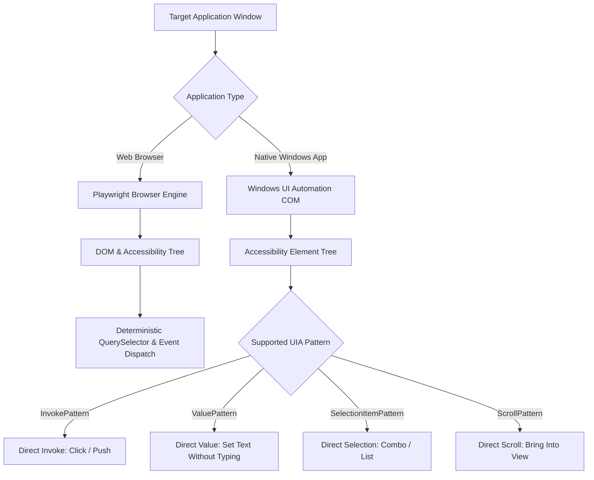
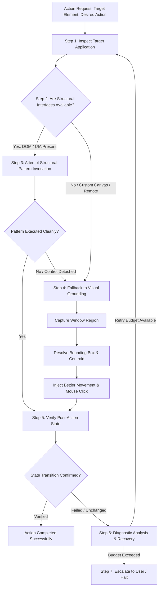

# AUTONOM — Dual-Modality Computer Control & Hybrid Automation Specification

## 1. Overview & Operational Philosophy

AUTONOM operates a dual-modality computer interaction engine designed for high reliability across desktop applications and web browsers. Real-world applications span modern web SPAs, native Win32/UWP controls, legacy dialogs, and non-standard custom canvas surfaces. No single interaction method succeeds across all software.

Therefore, AUTONOM integrates:

1. **Method A — Visual Interaction**: Multi-monitor screen capture, OCR, vision-model visual grounding, Bézier mouse movement, and Windows `SendInput` event injection.
2. **Method B — Structural Interaction**: Deterministic programmatic control via Windows UI Automation (UIA) COM accessibility trees, browser Document Object Models (DOM), and native application APIs.
3. **Hybrid Control Router**: An intelligent arbiter that inspects the target application, prefers deterministic structural patterns, falls back to visual grounding when necessary, and verifies post-action state changes.

---

## 2. Method A — Visual Interaction Architecture

### 2.1 Screen Capture & Display Pipeline

- **API**: Windows Graphics Capture (WGC) and DXGI Desktop Duplication for hardware-accelerated, tearing-free capture directly from the desktop frame buffer.
- **Multi-Monitor Coordinate Normalization**: Translates virtual desktop coordinates (spanning multiple displays with differing DPI scales) into standard absolute pixel coordinates.
- **Adaptive Capture Rates**:
  - _Idle / Polling Mode_: 0.5 FPS (1 frame every 2 seconds) to minimize CPU/GPU load.
  - _Active Planning Mode_: Single on-demand capture of the target window rect.
  - _Execution / Verification Mode_: 2 to 5 FPS burst to observe transition states.
  - Continuous 30+ FPS video streaming is intentionally avoided to preserve hardware resources.

### 2.2 Visual Grounding & Perception

- Translates natural language element descriptions (e.g., "Blue 'Submit Application' button on bottom right") into target pixel coordinates `(x, y)`:
  - **Text Detection**: Native Windows Media OCR resolves bounding boxes for visible text in < 50ms.
  - **Vision Model Inference**: Bounding box prediction via local or cloud vision models.
  - **Template Matching**: Fast pixel-exact matching for standard operating system and browser controls.

### 2.3 Input Injection & Trajectory Controller

- **Windows `SendInput` Wrapper**: Low-level Win32 input injection simulating hardware events without synthetic flags that anti-cheat/anti-bot systems flag.
- **Bézier Trajectory Generation**: Mouse movements follow cubic Bézier curves with randomized micro-jitter, velocity ramps, and natural deceleration toward the target.
- **Realistic Keystroke Cadence**: Keyboard typing injects variable inter-key delays (50ms–180ms) and natural typographical variance.

---

## 3. Method B — Structural Interaction Architecture

### 3.1 Windows UI Automation (UIA) Engine

- Connects directly to the Windows `IUIAutomation` COM interface.
- Locates controls by robust structural identifiers: `AutomationId`, `Name`, `ClassName`, `ControlType`, and hierarchical tree paths.
- Invokes control patterns directly:
  - `IUIAutomationValuePattern::SetValue`: Fills text boxes instantly without moving the mouse or focusing the window.
  - `IUIAutomationInvokePattern::Invoke`: Clicks buttons deterministically in background windows.
  - `IUIAutomationTogglePattern::Toggle`: Toggles checkboxes and radio buttons.

### 3.2 Playwright Browser Engine

- Controls Chromium/Edge instances with full DOM introspection.
- Locates elements via CSS selectors, XPath, ARIA roles, and text selectors.
- Supports file uploads, multi-tab contexts, cookie persistence, and stealth evasions.

---

## 4. Hybrid Action Router

### 4.1 Action Execution States

Every computer interaction action traverses a defined state machine:

1. `PRE_ACTION_INSPECTION`: Target window and boundary verification.
2. `MODALITY_SELECTION`: Scoring structural vs. visual confidence.
3. `ACTION_DISPATCH`: Programmatic invocation or input injection.
4. `POST_ACTION_VERIFICATION`: Differential visual/structural state assertion.
5. `CONFIRMED`: State change asserted; ready for next step.
6. `RECOVERY`: Failure detected; invoking recovery playbook.

### 4.2 Failure Categories & Recovery Playbooks

| Failure Category        | Root Cause                                                          | Automatic Recovery Action                                                                |
| :---------------------- | :------------------------------------------------------------------ | :--------------------------------------------------------------------------------------- |
| `ELEMENT_NOT_FOUND`     | DOM selector stale; UIA tree not rendered; visual occlusion.        | Wait 1.5s for dynamic load; expand parent container; scroll window; switch modality.     |
| `WINDOW_NOT_FOCUSED`    | Target application lost foreground focus.                           | Programmatically bring window to foreground via Win32 `SetForegroundWindow`.             |
| `UNEXPECTED_MODAL`      | Pop-up dialog, cookie banner, or notification obscuring target.     | Identify dismissal control (`Close`, `Accept`, `Cancel`); dismiss and re-attempt.        |
| `ACTION_WITHOUT_EFFECT` | Click registered but target UI did not change state.                | Click with alternative pattern; check disabled state; verify button hit-box coordinates. |
| `CAPTCHA_OR_MFA`        | Bot detection challenge or multi-factor authentication prompt.      | **IMMEDIATE PAUSE**: Alert user via desktop notification; hand off to human.             |
| `FORBIDDEN_ZONE_BREACH` | Attempted coordinates fall outside target application bounding box. | **HARD REJECT**: Discard input event; re-evaluate target window position.                |

---

## 5. Safety Guardrails & Forbidden Zones

1. **Target Window Confinement Mask**: All mouse clicks and typing coordinates are clipped against the target window's client rectangle. Any action targeting coordinates outside this mask is dropped immediately.
2. **Prohibited System Controls**:
   - Windows Taskbar, Start Button, and System Tray are globally masked out from automated clicking.
   - Window Close (`X`) buttons on non-target applications are protected.
   - Elevated administrator dialogs (UAC) are never interacted with automatically.
3. **Emergency Disengage Hotkey**: Pressing `Ctrl+Shift+Esc` or user-configured emergency hotkey globally unhooks input simulators, pauses all agent loops, and releases mouse/keyboard control back to the user in < 50ms.
