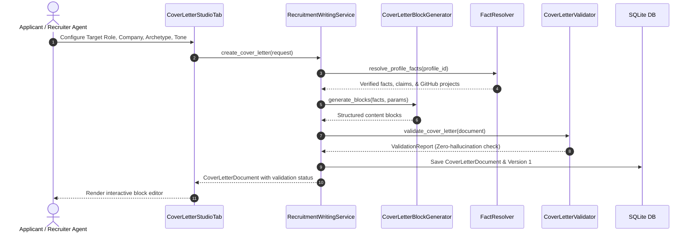

# Cover Letter Generation Subsystem

## AUTONOM Stage 24 — Recruitment Writing Intelligence Engine

---

### Overview

The Cover Letter Generation Subsystem produces tailored, evidence-backed application letters rooted exclusively in verified applicant profile facts. Rather than relying on generic LLM fluff, AUTONOM structures cover letters as a sequence of discrete content blocks, each anchored to verified canonical claims, GitHub project evidence, or approved resume bullets.

---

### Supported Letter Archetypes

| Archetype | Identifier | Primary Audience | Core Focus |
|---|---|---|---|
| **Role-Specific** | `role_specific` | Standard corporate hiring managers | Aligns verified skills and work experience with key requirements of the target role. |
| **Experienced** | `experienced` | Senior, Staff, Principal, and Executive roles | Highlights technical leadership, cross-functional impact, architectural milestones, and verified business outcomes. |
| **Internship / Graduate** | `internship` | Students, new graduates, junior candidates | Emphasizes academic achievements, foundational coursework, verified GitHub projects, hackathons, and growth potential. |
| **Academic / Research** | `research` | R&D labs, academic institutions, fellowships | Details publications, research methodologies, experimental findings, grants, and scholarly citations. |
| **Short / Concise** | `short` | High-volume recruiters, executive summaries | 3-paragraph condensed format delivering immediate signal on skills, key achievements, and availability. |
| **General** | `general` | Open networking, speculative inquiries | Broad professional narrative summarizing core expertise and verified career progression. |

---

### Block-Based Modular Architecture

A cover letter is stored and processed as a sequence of typed blocks (`CoverLetterContentBlock`):

1. **`header`**: Applicant contact info, target employer, date, and formal postal/email headers.
2. **`salutation`**: Formal addressing (e.g. "Dear Hiring Team at Stripe" or named recruiter).
3. **`opening`**: States the target role, source/context of application, and enthusiastic thesis statement.
4. **`qualifications`**: Synthesizes verified skills, employment tenure, and education.
5. **`evidence_example`**: Deep-dive narrative following the **STAR** framework (Situation, Task, Action, Result) referencing specific verified projects or achievements.
6. **`motivation`**: Explains genuine alignment with the company's mission and technical stack.
7. **`closing`**: Reaffirms interest, states availability, and requests an interview.
8. **`signature`**: Professional sign-off with applicant name and contact references.

---

### Grounding and Evidence Attribution

Each block contains an array of `WritingSourceReference` objects:

```json
{
  "source_entity_id": "proj_01",
  "source_type": "project",
  "claim_id": "claim_9421",
  "verification_status": "verified",
  "attribution_text": "Built real-time telemetry processing 40k events/sec in Rust",
  "evidence_url": "https://github.com/autonom/telemetry-core"
}
```

If an applicant edits a block manually, `is_user_edited` is marked `true`. The validation engine checks user edits against canonical profile facts to flag any ungrounded assertions.

---

### Tone and Length Configuration

- **Tone Settings**:
  - `professional`: Confident, objective, formal.
  - `confident`: Proactive, assertively highlights verified achievements.
  - `conversational`: Warm, approachable, collaborative.
  - `academic`: Analytical, rigorous, methodology-focused.
  - `enthusiastic`: High energy, emphasizes passion for mission and innovation.
  - `concise`: Minimalist, high density of verified facts.
- **Length Settings**:
  - `short`: 150 – 250 words (ideal for modern tech recruiters).
  - `standard`: 250 – 400 words (single-page standard).
  - `detailed`: 400 – 600 words (deep technical or executive letters).

---

### Generation Workflow


