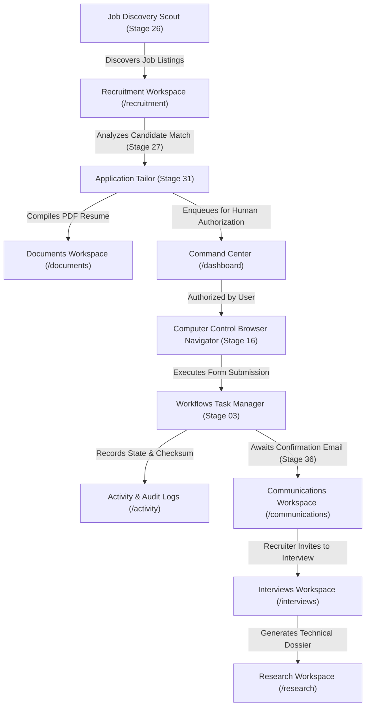

# AUTONOM — Cross-Module Autonomous Workflows (Stage 09)

## 1. Overview

AUTONOM achieves autonomous desktop operations by chaining specialist modules into coherent workflows. A user supervises the process through the Command Center and module workspaces rather than manually performing each micro-step.

---

## 2. Flagship End-to-End Workflow: Autonomous Recruitment

### Step 1: Autonomous Opportunity Discovery (`/recruitment`)

- **Agent**: `job-discovery` (Stage 26).
- **Execution**: Runs in background worker pool (`/workflows`), polling configured ATS portals (LinkedIn, Greenhouse, Lever, Indeed).
- **Persistence**: Persists new positions into SQLite `job_listings` table with anti-deduplication checks.

### Step 2: Match Scoring & Career Evidence Verification (`/recruitment/recommended`)

- **Agent**: `application-tailor` (Stage 31).
- **Execution**: Evaluates applicant profile evidence against job requirements.
- **Rule**: Pure grounded evidence only; no synthetic credentials or fabricated work history permitted.

### Step 3: Material Generation & Artifact Storage (`/documents`)

- **Agent**: `document-generator` (Stage 42) + `application-tailor`.
- **Execution**: Generates tailored ATS-friendly PDF resume and context-specific cover letter.
- **Persistence**: Persists output to encrypted application storage, recording SHA-256 checksum and metadata in SQLite `artifacts` table.

### Step 4: Human-in-the-Loop Authorization Gate (`/dashboard`)

- **Agent**: `safety-guardrail` (Stage 13).
- **Execution**: Application transitions to `waiting_auth` state.
- **Rule**: Autonomous submission cannot occur without explicit human approval.

### Step 5: Autonomous Submission & Execution Attempt (`/computer`)

- **Agent**: `browser-navigator` (Stage 16) + `uia-driver` (Stage 18).
- **Execution**: Automates Chromium CDP browser navigation, completes application fields, uploads compiled PDF artifact, and verifies successful submission receipt.
- **Persistence**: Inserts record into SQLite `application_attempts` with unique idempotency key to prevent accidental duplicate submissions.

### Step 6: Recruiter Response Monitoring & Interview Staging (`/communications` & `/interviews`)

- **Agent**: `recruiter-outreach` (Stage 36) + `interview-prep-coach` (Stage 39).
- **Execution**: Monitors recruiter communications, detects interview scheduling invitations, adds rounds to interview calendar, and drafts STAR-method prep dossiers.
