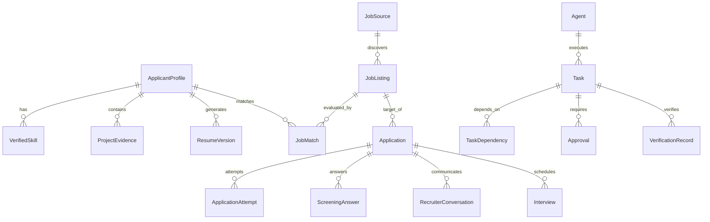
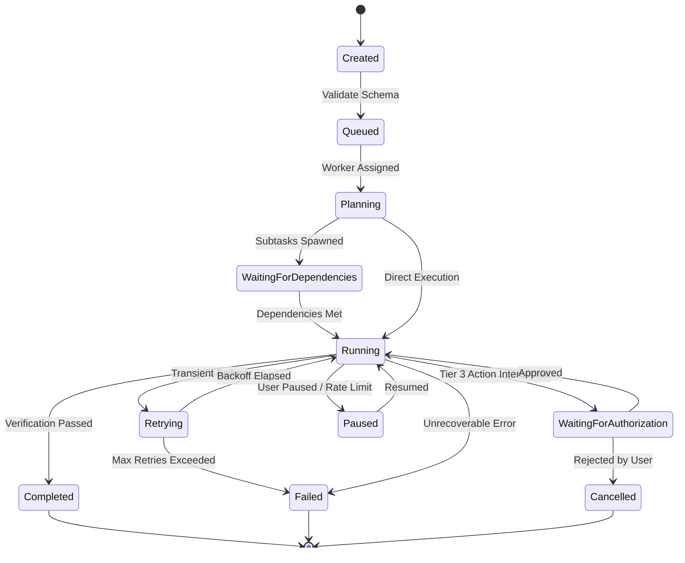

# AUTONOM — Database Architecture & Entity Design

## 1. Persistence Overview & Principles

AUTONOM utilizes an embedded **SQLite 3** relational database engine managed via `aiosqlite` in Python.

### Core Database Configuration

- **Journal Mode**: Write-Ahead Logging (`PRAGMA journal_mode = WAL;`) allowing concurrent reads while writes occur.
- **Synchronous Setting**: Normal (`PRAGMA synchronous = NORMAL;`) ensuring durability while maximizing write IOPS.
- **Referential Integrity**: Foreign keys strictly enforced (`PRAGMA foreign_keys = ON;`).
- **Full-Text Search**: SQLite FTS5 virtual tables for high-speed keyword searching across job descriptions and resume content.
- **Encrypted Vault**: Sensitive columns (credentials, tokens) stored as ciphertext encrypted via Windows DPAPI / AES-256-GCM.
- **Zero Daemon Requirement**: Zero requirement for Postgres, Docker, or Redis to launch the application.

---

## 2. Entity-Relationship Diagram



---

## 3. Flagship Career Operations Domain Models

### 3.1 `applicant_profiles` (ApplicantProfile)

Stores the single source of verified truth for the candidate. Falsification is architecturally prevented.

```sql
CREATE TABLE applicant_profiles (
    id TEXT PRIMARY KEY,
    full_name TEXT NOT NULL,
    email TEXT NOT NULL,
    phone TEXT,
    location_city TEXT NOT NULL,
    location_state TEXT,
    location_country TEXT NOT NULL,
    linkedin_url TEXT,
    github_url TEXT,
    portfolio_url TEXT,
    target_job_titles TEXT NOT NULL, -- JSON array of strings
    target_min_salary INTEGER,
    target_currency TEXT NOT NULL DEFAULT 'USD',
    work_authorization_status TEXT NOT NULL, -- e.g. "US_CITIZEN", "GREEN_CARD", "NEEDS_VISA"
    is_actively_searching BOOLEAN NOT NULL DEFAULT 1,
    created_at TIMESTAMP DEFAULT CURRENT_TIMESTAMP,
    updated_at TIMESTAMP DEFAULT CURRENT_TIMESTAMP
);
```

### 3.2 `verified_skills` (VerifiedSkill)

Catalog of verified technical and professional skills with provenance.

```sql
CREATE TABLE verified_skills (
    id TEXT PRIMARY KEY,
    profile_id TEXT NOT NULL,
    name TEXT NOT NULL,
    category TEXT NOT NULL, -- e.g. "LANGUAGE", "FRAMEWORK", "DATABASE", "TOOL"
    years_experience REAL NOT NULL,
    proficiency_level TEXT NOT NULL, -- e.g. "EXPERT", "PROFICIENT", "FAMILIAR"
    last_used_year INTEGER NOT NULL,
    verified_by_user BOOLEAN NOT NULL DEFAULT 1,
    FOREIGN KEY (profile_id) REFERENCES applicant_profiles(id) ON DELETE CASCADE
);
CREATE INDEX idx_verified_skills_name ON verified_skills(name);
```

### 3.3 `project_evidence` (ProjectEvidence)

Concrete work experience items, publications, metrics, and repository proofs.

```sql
CREATE TABLE project_evidence (
    id TEXT PRIMARY KEY,
    profile_id TEXT NOT NULL,
    title TEXT NOT NULL,
    organization TEXT NOT NULL,
    role_title TEXT NOT NULL,
    start_date TEXT NOT NULL,
    end_date TEXT, -- NULL if current
    bullet_points TEXT NOT NULL, -- JSON array of string statements
    verified_metrics TEXT, -- JSON map of verified metrics (e.g., {"latency_reduction": "40%"})
    code_repository_url TEXT,
    live_url TEXT,
    FOREIGN KEY (profile_id) REFERENCES applicant_profiles(id) ON DELETE CASCADE
);
```

### 3.4 `resume_versions` (ResumeVersion)

Compiled resume instances generated for general distribution or tailored for specific jobs.

```sql
CREATE TABLE resume_versions (
    id TEXT PRIMARY KEY,
    profile_id TEXT NOT NULL,
    version_name TEXT NOT NULL,
    target_role_type TEXT,
    file_format TEXT NOT NULL, -- "PDF", "DOCX", "MARKDOWN"
    file_path TEXT NOT NULL,
    file_hash_sha256 TEXT NOT NULL,
    content_ast_json TEXT NOT NULL, -- Structured AST representation
    is_base_template BOOLEAN NOT NULL DEFAULT 0,
    created_at TIMESTAMP DEFAULT CURRENT_TIMESTAMP,
    FOREIGN KEY (profile_id) REFERENCES applicant_profiles(id) ON DELETE CASCADE
);
```

### 3.5 `job_sources` (JobSource)

Configured scrapers and integration sources for job discovery.

```sql
CREATE TABLE job_sources (
    id TEXT PRIMARY KEY,
    name TEXT NOT NULL UNIQUE, -- "LinkedIn", "Indeed", "Greenhouse", "Lever", "Workday"
    source_type TEXT NOT NULL, -- "AGGREGATOR", "ATS_DIRECT", "CAREER_SITE"
    base_url TEXT NOT NULL,
    is_enabled BOOLEAN NOT NULL DEFAULT 1,
    rate_limit_per_minute INTEGER NOT NULL DEFAULT 10,
    last_scraped_at TIMESTAMP,
    consecutive_failures INTEGER NOT NULL DEFAULT 0
);
```

### 3.6 `job_listings` (JobListing)

Normalized job opportunities discovered across all sources.

```sql
CREATE TABLE job_listings (
    id TEXT PRIMARY KEY,
    source_id TEXT NOT NULL,
    external_job_id TEXT,
    title TEXT NOT NULL,
    company_name TEXT NOT NULL,
    location_raw TEXT NOT NULL,
    remote_type TEXT NOT NULL, -- "REMOTE", "HYBRID", "ONSITE"
    salary_min INTEGER,
    salary_max INTEGER,
    salary_currency TEXT DEFAULT 'USD',
    apply_url TEXT NOT NULL UNIQUE,
    ats_platform TEXT, -- "Greenhouse", "Lever", "Workday", "iCIMS", "Unknown"
    description_text TEXT NOT NULL,
    raw_html_path TEXT,
    posted_date TEXT,
    discovered_at TIMESTAMP DEFAULT CURRENT_TIMESTAMP,
    is_active BOOLEAN NOT NULL DEFAULT 1,
    FOREIGN KEY (source_id) REFERENCES job_sources(id)
);
CREATE INDEX idx_job_listings_company ON job_listings(company_name);
CREATE INDEX idx_job_listings_remote ON job_listings(remote_type);

-- Full-Text Search Virtual Table for Job Listings
CREATE VIRTUAL TABLE job_listings_fts USING fts5(
    title,
    company_name,
    description_text,
    content='job_listings',
    content_rowid='rowid'
);
```

### 3.7 `job_matches` (JobMatch)

Multi-dimensional evaluation of a job against the candidate profile.

```sql
CREATE TABLE job_matches (
    id TEXT PRIMARY KEY,
    profile_id TEXT NOT NULL,
    job_id TEXT NOT NULL,
    overall_score REAL NOT NULL, -- 0.0 to 100.0
    skills_score REAL NOT NULL,
    experience_score REAL NOT NULL,
    seniority_score REAL NOT NULL,
    compensation_score REAL NOT NULL,
    matching_skills TEXT NOT NULL, -- JSON array of matched skill names
    missing_skills TEXT NOT NULL,  -- JSON array of missing required skills
    gap_analysis_summary TEXT NOT NULL,
    recommended_action TEXT NOT NULL, -- "APPLY_NOW", "TAILOR_FIRST", "SKIP_NOT_ELIGIBLE"
    evaluated_at TIMESTAMP DEFAULT CURRENT_TIMESTAMP,
    FOREIGN KEY (profile_id) REFERENCES applicant_profiles(id) ON DELETE CASCADE,
    FOREIGN KEY (job_id) REFERENCES job_listings(id) ON DELETE CASCADE,
    UNIQUE(profile_id, job_id)
);
CREATE INDEX idx_job_matches_score ON job_matches(overall_score DESC);
```

### 3.8 `applications` (Application)

Core state record for an application pipeline entry.

```sql
CREATE TABLE applications (
    id TEXT PRIMARY KEY,
    profile_id TEXT NOT NULL,
    job_id TEXT NOT NULL,
    resume_version_id TEXT,
    current_status TEXT NOT NULL DEFAULT 'QUEUED',
    -- 'QUEUED', 'TAILORING', 'READY_TO_SUBMIT', 'PENDING_APPROVAL', 'SUBMITTING', 'SUBMITTED', 'UNDER_REVIEW', 'INTERVIEWING', 'OFFER_EXTENDED', 'REJECTED', 'WITHDRAWN'
    submission_mode TEXT NOT NULL DEFAULT 'AUTONOMOUS_APPROVED', -- 'MANUAL', 'AUTONOMOUS_APPROVED', 'AUTONOMOUS_FULL'
    applied_at TIMESTAMP,
    portal_username TEXT,
    last_status_check TIMESTAMP,
    notes TEXT,
    created_at TIMESTAMP DEFAULT CURRENT_TIMESTAMP,
    updated_at TIMESTAMP DEFAULT CURRENT_TIMESTAMP,
    FOREIGN KEY (profile_id) REFERENCES applicant_profiles(id),
    FOREIGN KEY (job_id) REFERENCES job_listings(id),
    FOREIGN KEY (resume_version_id) REFERENCES resume_versions(id)
);
CREATE INDEX idx_applications_status ON applications(current_status);
```

### 3.9 `application_attempts` (ApplicationAttempt)

Execution log of automated submission attempts.

```sql
CREATE TABLE application_attempts (
    id TEXT PRIMARY KEY,
    application_id TEXT NOT NULL,
    attempt_number INTEGER NOT NULL,
    started_at TIMESTAMP DEFAULT CURRENT_TIMESTAMP,
    ended_at TIMESTAMP,
    outcome TEXT NOT NULL, -- "SUCCESS", "FAILED_VERIFICATION", "BLOCKED_CAPTCHA", "TIMED_OUT"
    receipt_screenshot_path TEXT,
    error_message TEXT,
    session_recording_path TEXT,
    FOREIGN KEY (application_id) REFERENCES applications(id) ON DELETE CASCADE
);
```

### 3.10 `screening_answers` (ScreeningAnswer)

Bank of verified answers to recurring recruiter screening questions.

```sql
CREATE TABLE screening_answers (
    id TEXT PRIMARY KEY,
    profile_id TEXT NOT NULL,
    question_pattern TEXT NOT NULL, -- Normalized regex or semantic embedding key
    question_example TEXT NOT NULL,
    answer_text TEXT NOT NULL,
    is_sensitive BOOLEAN NOT NULL DEFAULT 0, -- Salary history, legal status, diversity
    approved_by_user BOOLEAN NOT NULL DEFAULT 1,
    last_used_at TIMESTAMP,
    FOREIGN KEY (profile_id) REFERENCES applicant_profiles(id) ON DELETE CASCADE
);
```

### 3.11 `recruiter_conversations` (RecruiterConversation)

Thread tracking communications with talent acquisition.

```sql
CREATE TABLE recruiter_conversations (
    id TEXT PRIMARY KEY,
    application_id TEXT NOT NULL,
    recruiter_name TEXT,
    recruiter_email TEXT NOT NULL,
    channel TEXT NOT NULL, -- "EMAIL", "LINKEDIN", "SMS"
    subject TEXT,
    last_message_snippet TEXT,
    sentiment TEXT, -- "POSITIVE", "NEUTRAL", "REJECTION"
    next_action_due TIMESTAMP,
    updated_at TIMESTAMP DEFAULT CURRENT_TIMESTAMP,
    FOREIGN KEY (application_id) REFERENCES applications(id) ON DELETE CASCADE
);
```

### 3.12 `interviews` (Interview)

Scheduled interview stages and prep dossier links.

```sql
CREATE TABLE interviews (
    id TEXT PRIMARY KEY,
    application_id TEXT NOT NULL,
    stage_name TEXT NOT NULL, -- "RECRUITER_SCREEN", "TECHNICAL_1", "SYSTEM_DESIGN", "BEHAVIORAL", "ONSITE"
    scheduled_at TIMESTAMP NOT NULL,
    duration_minutes INTEGER NOT NULL DEFAULT 45,
    meeting_url TEXT,
    interviewer_names TEXT,
    dossier_path TEXT,
    status TEXT NOT NULL DEFAULT 'SCHEDULED', -- "SCHEDULED", "COMPLETED", "CANCELLED", "RESCHEDULED"
    FOREIGN KEY (application_id) REFERENCES applications(id) ON DELETE CASCADE
);
```

### 3.13 `authorization_policies` (AuthorizationPolicy)

Configurable advance approval scopes.

```sql
CREATE TABLE authorization_policies (
    id TEXT PRIMARY KEY,
    scope_name TEXT NOT NULL UNIQUE,
    tier INTEGER NOT NULL, -- 1 (Auto), 2 (Auto with notify), 3 (Approval required)
    is_advance_granted BOOLEAN NOT NULL DEFAULT 0,
    expires_at TIMESTAMP,
    trusted_domains TEXT, -- JSON array of approved domain suffixes
    max_applications_per_day INTEGER DEFAULT 25,
    daily_spend_limit_usd REAL DEFAULT 0.0,
    created_at TIMESTAMP DEFAULT CURRENT_TIMESTAMP
);
```

---

## 4. Task, Agent & Workflow State Model



### 4.1 `tasks` (Task)

```sql
CREATE TABLE tasks (
    id TEXT PRIMARY KEY,
    parent_task_id TEXT,
    workflow_id TEXT,
    agent_id TEXT NOT NULL,
    task_type TEXT NOT NULL,
    priority INTEGER NOT NULL DEFAULT 5, -- 1 (highest) to 10 (lowest)
    status TEXT NOT NULL DEFAULT 'Created',
    -- 'Created', 'Queued', 'Planning', 'WaitingForDependencies', 'Running', 'WaitingForAuthorization', 'Paused', 'Retrying', 'Completed', 'Failed', 'Cancelled'
    idempotency_key TEXT UNIQUE,
    parameters_json TEXT NOT NULL,
    result_json TEXT,
    error_message TEXT,
    retry_count INTEGER NOT NULL DEFAULT 0,
    max_retries INTEGER NOT NULL DEFAULT 3,
    timeout_seconds INTEGER NOT NULL DEFAULT 300,
    created_at TIMESTAMP DEFAULT CURRENT_TIMESTAMP,
    started_at TIMESTAMP,
    completed_at TIMESTAMP,
    FOREIGN KEY (parent_task_id) REFERENCES tasks(id) ON DELETE CASCADE
);
CREATE INDEX idx_tasks_status ON tasks(status);
CREATE INDEX idx_tasks_agent ON tasks(agent_id);
```

### 4.2 `task_dependencies` (TaskDependency)

Expresses DAG edges between subtasks.

```sql
CREATE TABLE task_dependencies (
    task_id TEXT NOT NULL,
    depends_on_task_id TEXT NOT NULL,
    PRIMARY KEY (task_id, depends_on_task_id),
    FOREIGN KEY (task_id) REFERENCES tasks(id) ON DELETE CASCADE,
    FOREIGN KEY (depends_on_task_id) REFERENCES tasks(id) ON DELETE CASCADE
);
```

### 4.3 `verification_records` (VerificationRecord)

```sql
CREATE TABLE verification_records (
    id TEXT PRIMARY KEY,
    task_id TEXT NOT NULL,
    step_index INTEGER NOT NULL,
    verification_rule TEXT NOT NULL,
    pre_state_hash TEXT,
    post_state_hash TEXT,
    verdict TEXT NOT NULL, -- "VERIFIED", "FAILED", "INDETERMINATE"
    diagnostic_info TEXT,
    created_at TIMESTAMP DEFAULT CURRENT_TIMESTAMP,
    FOREIGN KEY (task_id) REFERENCES tasks(id) ON DELETE CASCADE
);
```

### 4.4 `approvals` (Approval)

```sql
CREATE TABLE approvals (
    id TEXT PRIMARY KEY,
    task_id TEXT NOT NULL,
    agent_id TEXT NOT NULL,
    tier INTEGER NOT NULL DEFAULT 3,
    action_type TEXT NOT NULL,
    target_resource TEXT NOT NULL,
    summary TEXT NOT NULL,
    details_json TEXT,
    status TEXT NOT NULL DEFAULT 'pending', -- 'pending', 'approved', 'rejected', 'expired'
    created_at TIMESTAMP DEFAULT CURRENT_TIMESTAMP,
    resolved_at TIMESTAMP,
    resolved_by TEXT,
    FOREIGN KEY (task_id) REFERENCES tasks(id) ON DELETE CASCADE
);
CREATE INDEX idx_approvals_status ON approvals(status);
```

### 4.5 `audit_logs` (AuditLog)

```sql
CREATE TABLE audit_logs (
    id INTEGER PRIMARY KEY AUTOINCREMENT,
    timestamp TIMESTAMP DEFAULT CURRENT_TIMESTAMP,
    agent_id TEXT NOT NULL,
    task_id TEXT,
    action TEXT NOT NULL,
    target_resource TEXT,
    pre_state_hash TEXT,
    post_state_hash TEXT,
    metadata_json TEXT
);
CREATE INDEX idx_audit_logs_timestamp ON audit_logs(timestamp);
```

### 4.6 `credentials` (Encrypted DPAPI Store)

```sql
CREATE TABLE credentials (
    id TEXT PRIMARY KEY,
    service_name TEXT NOT NULL UNIQUE,
    account_identifier TEXT NOT NULL,
    encrypted_blob BLOB NOT NULL, -- Protected by Windows DPAPI + AES-256-GCM
    created_at TIMESTAMP DEFAULT CURRENT_TIMESTAMP,
    updated_at TIMESTAMP DEFAULT CURRENT_TIMESTAMP
);
```

---

## 5. Database Migration Strategy

Migrations are executed deterministically on backend startup:

1. A metadata table `schema_migrations (version INTEGER PRIMARY KEY, applied_at TIMESTAMP)` tracks schema level.
2. Migrations are written as discrete Python modules or SQL scripts with `up()` and `down()` operations.
3. On application startup, the `DatabaseManager` runs all unapplied migrations inside a single transaction before unlocking application services.
