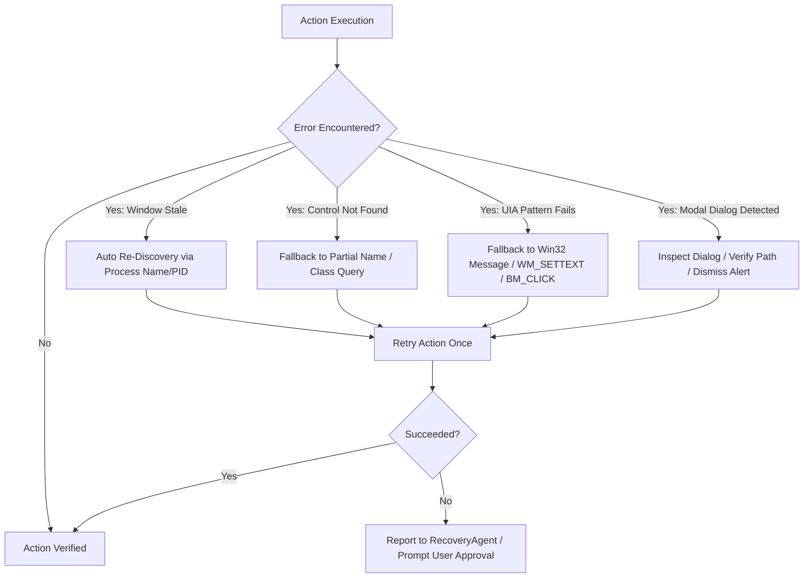

# Desktop Automation Failure Recovery & Self-Healing (Stage 17)

## 1. Transient Failures in Desktop Automation

Desktop automation encounters transient failures far more often than web environments due to:
- Modal dialogs blocking main application windows.
- Windows displaying "Not Responding" during heavy background processing.
- Focus-stealing prevention by the Windows Desktop Window Manager (DWM).
- Dynamic UI element reconstruction during live re-rendering.

---

## 2. Recovery Strategies

### 1. Stale HWND & Window Re-Discovery
When a window reference becomes invalid because an application re-created its top-level window frame (common in Electron and modern packaged apps during navigation):
1. The engine catches `ValueError: Window reference invalid`.
2. It queries `window_discovery_manager` for other top-level windows matching the same `process_name` and title pattern.
3. If a matching window is found, the engine updates the task reference and resumes execution.

### 2. Pattern Fallback to Win32 Native Messages
If an application control does not support modern UI Automation patterns (such as legacy VB6, MFC, or older Win32 controls that return `E_NOINTERFACE` for `IUIAutomationValuePattern` or `IUIAutomationInvokePattern`):
1. `PatternExecutor` transfers the request to `Win32CompatibilityAdapter`.
2. The adapter retrieves the native HWND for the control using `IUIAutomationElement.CurrentNativeWindowHandle`.
3. It dispatches direct Win32 messages:
   - For buttons: `user32.SendMessageW(hwnd, BM_CLICK, 0, 0)`
   - For text edits: `user32.SendMessageW(hwnd, WM_SETTEXT, 0, text_buffer)`
   - For dropdowns: `user32.SendMessageW(hwnd, CB_SETCURSEL, index, 0)`

### 3. Focus Stealing & Activation Recovery
Windows Vista+ implements focus-stealing prevention, causing background `SetForegroundWindow` calls to flash the taskbar button rather than bringing the window to the front.
`FocusManager` overcomes this safely:
1. Calls `user32.ShowWindow(hwnd, SW_RESTORE)` if the window is minimized.
2. Calls `user32.AttachThreadInput` to temporarily bind the input queue of AUTONOM's thread to the target window's thread.
3. Calls `user32.SetForegroundWindow(hwnd)`.
4. Calls `user32.SetFocus(hwnd)`.
5. Detaches the input thread queue cleanly via `AttachThreadInput(..., FALSE)`.
