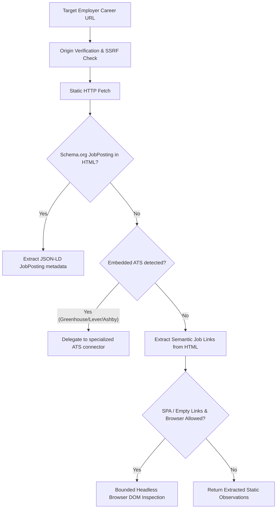

# Employer Career Discovery and ATS Detection (Stage 26)

## Overview
Many companies host branded career portals on custom domains (e.g. `careers.stripe.com`, `netflix.jobs`, `openai.com/careers`). AUTONOM's `CareerPageConnector` extracts opportunities from approved origins using progressive discovery:

## ATS Platform Heuristics
The `ats_detection` subsystem inspects URL structures, redirects, and inline script tags:
- **Greenhouse**: `boards.greenhouse.io/{token}` or `greenhouse.io/embed`.
- **Lever**: `jobs.lever.co/{site}` or `api.lever.co`.
- **Ashby**: `jobs.ashbyhq.com/{token}` or `ashby_embed`.
- **Workday**: `*.myworkdayjobs.com` -> parses Schema.org JobPosting.
- **SmartRecruiters**: `jobs.smartrecruiters.com` -> parses structured JSON-LD.
