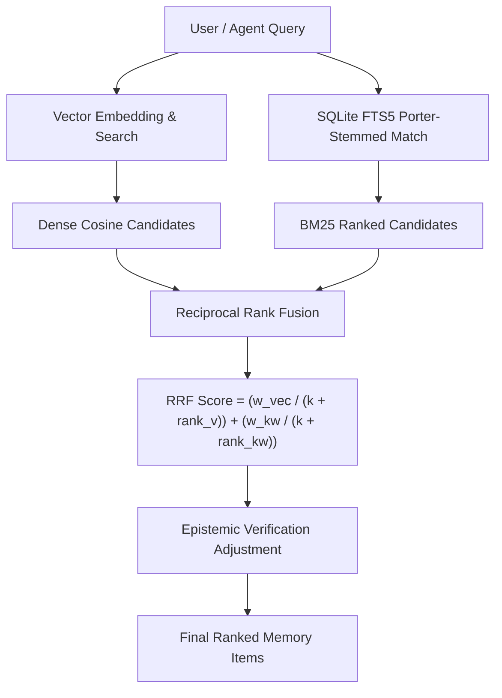

# AUTONOM Hybrid Retrieval Engine (Stage 15)

## 1. Retrieval Pipeline

The Hybrid Retrieval Engine (`services/api/app/memory/retrieval/hybrid.py`) merges the precision of full-text keyword matching with the semantic generalization of dense vector embeddings:

---

## 2. Reciprocal Rank Fusion (RRF)

To combine dissimilar raw scores (cosine similarity $0.0 \dots 1.0$ vs SQLite BM25 logarithmic rank), AUTONOM uses Reciprocal Rank Fusion:

$$\text{RRF Score}(d) = \sum_{m \in \{\text{vec}, \text{kw}\}} \frac{w_m}{k + \text{rank}_m(d)}$$

Where:
- $k = 60.0$ (standard smoothing constant).
- In `HYBRID` mode: $w_{\text{vec}} = 0.6$, $w_{\text{kw}} = 0.4$.
- In `SEMANTIC` mode: $w_{\text{vec}} = 1.0$, $w_{\text{kw}} = 0.0$.
- In `KEYWORD` mode: $w_{\text{vec}} = 0.0$, $w_{\text{kw}} = 1.0$.

---

## 3. Epistemic Verification Weighting

Factual confidence is layered on top of lexical/semantic match scores:
- `verified` / `user_confirmed`: $+0.10$ bonus.
- `evidence_supported`: $+0.05$ bonus.
- `unverified`: $-0.05$ penalty.
- `conflicted` / `rejected`: $-0.20$ penalty.
- `superseded`: Automatically excluded from standard queries when `exclude_superseded=True`.
