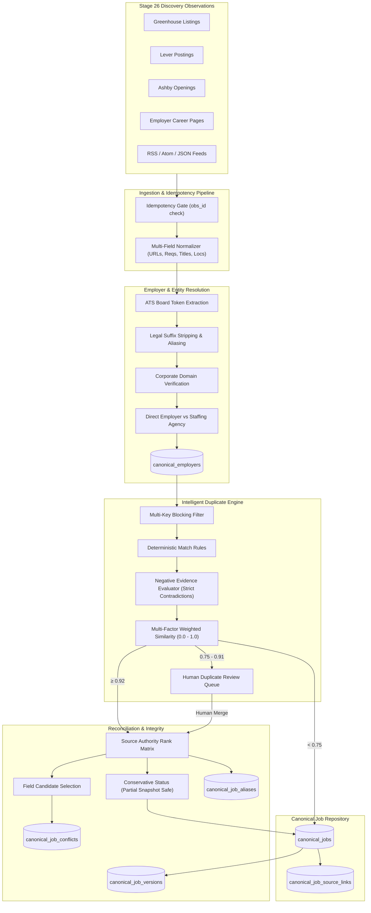

# Multi-Source Job Aggregation & Canonical Database Architecture (Stage 27)

## Executive Overview
Stage 27 of the AUTONOM 50-stage roadmap establishes the **Canonical Job Aggregation Engine**, bridging disparate Stage 26 job board observations into a reliable, authoritative, source-backed canonical job repository.

Its mission is to reconcile multi-source postings, resolve employer identities across legal aliases and staffing agencies, detect duplicates with negative match prevention, manage field-level conflicts, and maintain immutable version snapshots and alias supersession chains.

## Core Architectural Invariants
1. **Zero Automated Application Submissions**: Strictly reserved for Stage 31+ with human authorization.
2. **Deterministic Precedence over Heuristics**: Requisition numbers and verified employer career pages outrank third-party aggregators.
3. **Negative Evidence Dominance**: Conflicting requisition IDs under the same employer or differing seniority/employment types strictly prohibit automatic merging.
4. **Partial Snapshot Non-Closure**: Missing items from incomplete or interrupted feeds remain `possibly_active` rather than `closed`.
5. **Atomic Version Auditing**: Every merge, split, or field override appends an immutable revision to `canonical_job_versions`.
