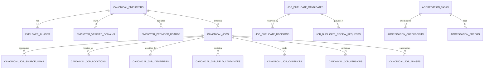

# Job Aggregation Database Architecture & SQLite Schema (Stage 27)

## Overview
Stage 27 introduces 25 database models into AUTONOM's relational SQLite backend. All tables are created under SQLite WAL mode with foreign key enforcement and busy timeouts.

## Entity-Relationship Diagram

## Table Catalog
1. `canonical_employers`: Authoritative employer entities.
2. `employer_aliases`: Alternate names, brand spellings, and trade styles.
3. `employer_verified_domains`: Official email and careers domains.
4. `employer_provider_boards`: ATS tokens (Greenhouse, Lever, Ashby).
5. `employer_relationships`: Corporate hierarchies and staffing classifications.
6. `employer_identity_decisions`: Audit trail for employer matching.
7. `canonical_jobs`: Authoritative vacancy records.
8. `canonical_job_source_links`: Source-to-canonical provenance links.
9. `canonical_job_locations`: Office locations and remote arrangements.
10. `canonical_job_identifiers`: Requisitions and cross-source job IDs.
11. `canonical_job_field_candidates`: Multi-source candidate values.
12. `canonical_job_conflicts`: Field discrepancies and manual resolutions.
13. `canonical_job_relationships`: Similar, pooled, or related roles.
14. `canonical_job_versions`: Immutable audit history snapshots.
15. `canonical_job_aliases`: Supersession redirects for merged jobs.
16. `job_duplicate_candidates`: Duplicate pairs and similarity metrics.
17. `job_duplicate_decisions`: Audit log of merge or separate decisions.
18. `job_duplicate_review_requests`: Human queue review records.
19. `job_merge_operations`: Transactional merge execution logs.
20. `job_split_operations`: Transactional split execution logs.
21. `aggregation_tasks`: Batch sync and aggregation runs.
22. `aggregation_checkpoints`: Resumption states and offsets.
23. `aggregation_errors`: Isolated error logs during batch processing.
24. `aggregation_outbox_events`: Transactional outbox for event dispatch.
25. `aggregation_settings`: Configurable thresholds and policy flags.
