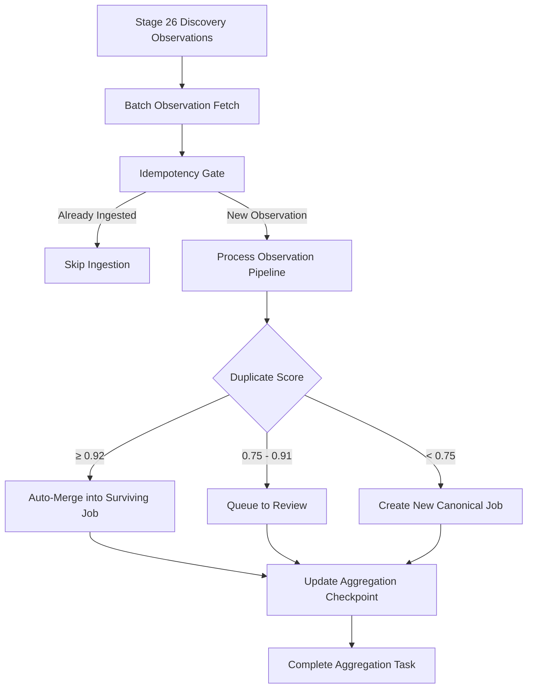

# Job Aggregation Synchronization & Batch Checkpointing (Stage 27)

## Overview
The aggregation engine synchronizes observations from Stage 26 through an idempotent, batch-oriented pipeline equipped with checkpointing and error isolation.

## Synchronization Pipeline

## Fault Tolerance & Checkpoint Architecture
- **Task Model (`aggregation_tasks`)**: Tracks execution status (`pending`, `running`, `completed`, `failed`), total observations, processed counts, and performance metrics.
- **Checkpoint Model (`aggregation_checkpoints`)**: Persists `last_processed_observation_id` and processing counts, allowing large batch aggregation tasks to safely resume after process restarts or network interruptions.
- **Error Model (`aggregation_errors`)**: Isolates individual observation errors without failing entire aggregation batches.
