# Multi-Source Job Discovery Architecture (Stage 26)

## Executive Overview
The **Multi-Source Job Discovery Engine** establishes AUTONOM's capability to safely, reliably, and politely discover employment opportunities from authorized external providers, official Applicant Tracking System (ATS) public APIs, structured feeds, and verified employer career websites.

Discovered listings are ingested into a provider-neutral observation layer (`job_source_observations`) that preserves complete field provenance, extraction timestamps, and raw source references without guessing undisclosed compensation or synthesizing fake vacancies.

```mermaid
flowchart TD
    subgraph Sources["Authorized Discovery Sources"]
        GH["Greenhouse Job Board API"]
        LV["Lever Published API"]
        AB["Ashby Public Postings API"]
        USA["USAJOBS Search API"]
        RSS["RSS / Atom Feeds"]
        JSON["Structured JSON Feeds"]
        CP["Employer Career Pages"]
        UI["User URL / Manual Import"]
    end

    subgraph Security["Security & Network Governance"]
        SSRF["SSRF Defense & IP Validation"]
        RL["Sliding Window Rate Limiter"]
        CACHE["Conditional HTTP Cache"]
        SAN["HTML Sanitization & Prompt Injection Defusal"]
    end

    subgraph Extraction["Extraction & Normalization"]
        SCHEMA["Schema.org JSON-LD Parser"]
        COMP["Compensation Parser (No Guessing)"]
        LOC["Structured Location & Remote Parser"]
        PROV["Field Provenance Tracker"]
    end

    subgraph Coordinator["Discovery Coordinator & Sync"]
        TASK["Discovery Task Orchestrator"]
        SYNC["Incremental Sync & Change Detection"]
        INV["Partial Snapshot Safety Invariant"]
        POLICY["Stage 25 Policy Pre-Filter"]
    end

    subgraph Storage["Observation Repository"]
        OBS[("job_source_observations")]
        SNAP[("job_source_snapshots")]
        HEALTH[("job_source_health")]
    end

    Sources --> Security
    Security --> Extraction
    Extraction --> Coordinator
    Coordinator --> Storage
```

## Architectural Principles
1. **Official and Permissible Discovery Only**: AUTONOM connects strictly through official public APIs, published board feeds, or explicit user-imported links. It strictly prohibits stealth crawling, CAPTCHA bypassing, or violating commercial terms of service.
2. **Provider-Neutral Observation Model**: Discovered opportunities are stored as raw source observations (`JobSourceObservation`) rather than immediate canonical vacancies. Aggregation, deduplication, and cross-source identity resolution are strictly delegated to Stage 27.
3. **Safety Invariants**:
   - **Partial Snapshot Invariant**: Partial, interrupted, or rate-limited snapshots must NEVER mark missing postings as closed. Postings are only transitioned to `closed` when a snapshot completes with 100% verified coverage.
   - **Zero Compensation Guessing**: Compensation figures are extracted only when explicitly published by the employer.
   - **Prompt Injection Containment**: All raw job descriptions are scrubbed of HTML script tags, event handlers, and disarmed against LLM prompt injection attempts.
4. **Tight Stage 25 Integration**: Opportunities are evaluated at discovery time against the active recruitment strategy (`strat_backend_01`), annotating each posting with `prefilter_status` (`accepted`, `rejected`, or `needs_review`).
