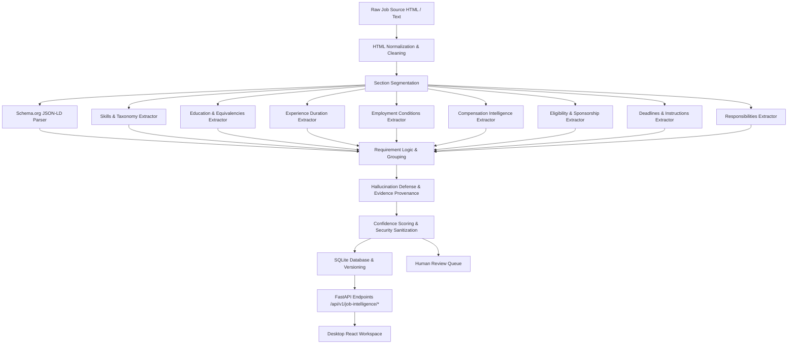

# Job Intelligence Architecture (Stage 28)

## 1. Overview
The **Job Requirement Intelligence Engine** transforms raw, multi-source job postings into structured, evidence-backed `JobIntelligenceRecord` models. It bridges Phase 6 Multi-Source Job Discovery (Stage 26) and Canonical Job Aggregation (Stage 27) with applicant scoring and matching (Stage 29).

## 2. Core Architectural Principles
1. **Deterministic-First Extraction**: Regex and Schema.org JSON-LD structured data extraction run before calling AI models, providing 100% deterministic reproducibility and offline fallback capability.
2. **Strict Mandatory vs. Preferred Separation**: Qualifications found under preferred sections are never promoted to mandatory.
3. **Complex Boolean Semantics**: Preserves logical relationships (`AND`, `OR`, `AtLeastN`, `EquivalentAlternative`, `Conditional`, `NOT`).
4. **Verbatim Provenance & Hallucination Defense**: Every extracted atomic requirement retains the exact text span (`start_char`, `end_char`, quote hash), verified against the source text.
5. **Zero Synthetic Guessing**: Compensation, visa sponsorship, and degree requirements are recorded as undisclosed when absent; synthetic assumptions are prohibited.
6. **Multi-Source Reconciliation**: Conflicting statements between disparate source observations are flagged and queued for human operator review.

## 3. Component Architecture

## 4. Subsystem Layout
- `services/api/app/recruitment/intelligence/`
  - `contracts.py`: Pydantic data schemas, enums, and DTO contracts.
  - `preprocessing/`: HTML cleaning, section segmentation, and source character span mapping.
  - `extraction/`: Deterministic parsers for skills, education, experience, employment, compensation, eligibility, deadlines, and AI extraction fallbacks.
  - `validation/`: Hallucination defense, prompt injection safety, and confidence scoring.
  - `reconciliation/`: Multi-source conflict detection and source authority ranking.
  - `lifecycle/`: Content hash versioning, reanalysis triggers, and review queue resolutions.
  - `service.py`: `JobIntelligenceService` master singleton.
  - `capabilities.py`: Internal agent capabilities (`job.intelligence.*`).
