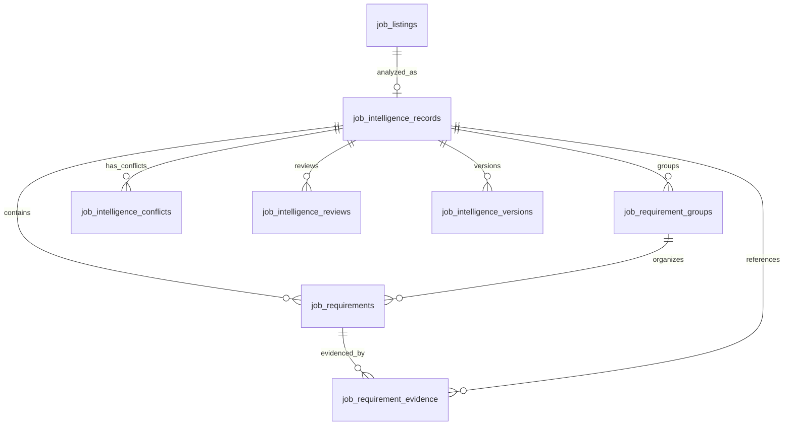

# Job Intelligence Database & Schema Design (Stage 28)

## 1. Overview
The Stage 28 Job Intelligence Engine extends SQLite persistent storage with normalized entities representing requirement groups, atomic qualifications, evidence spans, multi-source conflicts, versions, and review items.

## 2. Entity-Relationship Diagram

## 3. Core Tables

### `job_intelligence_records`
| Column | Type | Description |
|---|---|---|
| `id` | VARCHAR(36) | Primary Key (UUID) |
| `canonical_job_id` | VARCHAR(36) | Foreign Key to `job_listings.id` (Unique, Index) |
| `canonical_job_version` | INTEGER | Version number of canonical listing (default 1) |
| `description_hash` | VARCHAR(64) | SHA-256 digest of cleaned job description |
| `extractor_version` | VARCHAR(32) | Version of intelligence extractor ("1.0.0") |
| `analysis_status` | VARCHAR(32) | Status (Completed, NeedsReview, PartiallyAnalyzed, etc.) |
| `job_title` | VARCHAR(256) | Cleaned job title |
| `role_family` | VARCHAR(128) | Inferred or declared role family |
| `seniority` | VARCHAR(64) | Seniority level (Staff, Senior, Entry, Lead) |
| `overall_confidence` | FLOAT | Confidence score (0.0 to 1.0) |
| `responsibilities_json`| JSON | Array of day-to-day duties |
| `employment_conditions_json` | JSON | Workplace, schedule, and travel conditions |
| `compensation_json` | JSON | Base salary min/max, currency, period, bonus, equity |
| `eligibility_json` | JSON | Work auth, visa sponsorship, citizenship, clearance |
| `deadlines_json` | JSON | Application deadline, rolling status, required docs |
| `data_quality_warnings_json`| JSON | Warnings, potential prompt injections, ambiguities |
| `review_status` | VARCHAR(32) | Review state (NOT_NEEDED, PENDING, APPROVED) |
| `created_at` | DATETIME | Timestamp of creation (UTC) |
| `updated_at` | DATETIME | Timestamp of last modification (UTC) |

### `job_requirement_groups`
| Column | Type | Description |
|---|---|---|
| `id` | VARCHAR(36) | Primary Key (UUID) |
| `intelligence_id` | VARCHAR(36) | FK to `job_intelligence_records.id` |
| `parent_group_id` | VARCHAR(36) | Optional FK to parent `job_requirement_groups.id` |
| `operator` | VARCHAR(32) | Boolean operator (`AND`, `OR`, `AtLeastN`, `EquivalentAlternative`) |
| `min_count` | INTEGER | Minimum matching count for `AtLeastN` |
| `description` | VARCHAR(256) | Human-readable node description |

### `job_requirements`
| Column | Type | Description |
|---|---|---|
| `id` | VARCHAR(36) | Primary Key (UUID) |
| `intelligence_id` | VARCHAR(36) | FK to `job_intelligence_records.id` |
| `group_id` | VARCHAR(36) | Optional FK to `job_requirement_groups.id` |
| `category` | VARCHAR(32) | `Mandatory`, `Preferred`, `Optional`, `Conditional` |
| `qualification_type`| VARCHAR(32) | `TECHNICAL_SKILL`, `EDUCATION`, `EXPERIENCE`, etc. |
| `name` | VARCHAR(256) | Display name (e.g. "Python", "Bachelor's Degree") |
| `normalized_value` | VARCHAR(128) | Canonical identifier (e.g. "python", "exp_5y") |
| `raw_text` | TEXT | Raw line or bullet text from source |
| `min_years` | FLOAT | Extracted minimum duration requirement |
| `max_years` | FLOAT | Extracted maximum duration requirement |
| `is_negated` | BOOLEAN | True if requirement is explicitly negated |
| `confidence` | VARCHAR(32) | `EXPLICIT_VERIFIED_SOURCE`, `AMBIGUOUS`, etc. |
| `confidence_score` | FLOAT | Numeric confidence score (0.0 to 1.0) |
| `needs_review` | BOOLEAN | Flag for human operator review queue |
| `review_notes` | TEXT | Review reason or notes |

### `job_requirement_evidence`
| Column | Type | Description |
|---|---|---|
| `id` | VARCHAR(36) | Primary Key (UUID) |
| `requirement_id` | VARCHAR(36) | FK to `job_requirements.id` |
| `intelligence_id` | VARCHAR(36) | FK to `job_intelligence_records.id` |
| `section_name` | VARCHAR(64) | Section where evidence was located |
| `supporting_text` | TEXT | Verbatim supporting quote |
| `start_char` | INTEGER | Character start index in cleaned text |
| `end_char` | INTEGER | Character end index in cleaned text |
| `quote_hash` | VARCHAR(64) | SHA-256 digest of normalized quote |
| `extraction_method`| VARCHAR(32) | Method (`DETERMINISTIC_RULES`, `AI_EXTRACTION`) |
| `verified_in_source`| BOOLEAN | True if verbatim match succeeded |
