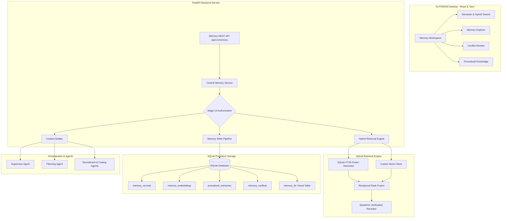

# AUTONOM Memory Engine Architecture (Stage 15)

## 1. Overview

Stage 15 delivers the **Persistent Agent Memory & Hybrid Retrieval Engine** for AUTONOM, serving as the foundational cognitive knowledge layer for Phase 3 (AI Intelligence Engine). The memory subsystem bridges episodic workflow outcomes, verified user profile facts, reusable procedures, and ephemeral task context into an explainable, secure, and privacy-aware system.

Rather than treating every task or workflow as a cold start, AUTONOM continuously learns from successful executions, detects recurring pitfalls, and enriches agent prompts with bounded, verified evidence.

---

## 2. Core Service Boundaries

The memory engine resides in `services/api/app/memory/` and is partitioned into dedicated modular domains:

1. **Contracts & Schemas (`contracts.py`)**:
   Defines strict Pydantic models, data transfer objects, epistemic statuses (`verified`, `user_confirmed`, `evidence_supported`, `unverified`, `conflicted`, `superseded`, `expired`, `rejected`), risk levels, and memory scopes.
2. **Embedding Infrastructure (`embeddings/`)**:
   - `provider.py`: Implements zero-network, ultra-fast `DeterministicLocalEmbeddingEngine` (384-dimensional unit vector space) and `OllamaEmbeddingProvider`.
   - `registry.py`: Validates model dimensionality, monitors provider health, and enforces data-egress policies before sending embeddings to remote/cloud endpoints.
3. **Storage Engine (`storage/`)**:
   - `repository.py`: Async SQLAlchemy persistence for memory records, embeddings, conflicts, procedures, and access event audit logs.
   - `vector_store.py`: In-memory and SQLite-synchronized vector index computing normalized cosine similarity with scope isolation.
   - `fts_index.py`: SQLite FTS5 index with prefix wildcard matching, tokenization, and BM25 rank scoring.
4. **Retrieval Pipelines (`retrieval/`)**:
   - `hybrid.py`: Combines keyword and dense vector candidate sets using Reciprocal Rank Fusion (RRF) with epistemic status boosts.
   - `context_builder.py`: Formats retrieved knowledge into structured prompt sections within strict token budgets.
5. **Lifecycle Management (`lifecycle/`)**:
   - `deduplication.py`: SHA-256 content checksum deduplication and near-duplicate vector thresholding.
   - `conflicts.py`: Contradiction detection, supersession linking, and versioning.
   - `consolidation.py`: Background merging of related memories and procedural extraction from successful workflow DAGs.
   - `expiration.py`: Retention sweeper evicting expired records from active indices.
   - `deletion.py`: Secure cascading deletion across SQLite, FTS5, vector store, and audit logging.
   - `export.py`: JSON/JSONL serialization honoring data classifications.
6. **Agent Integrations (`integrations/`)**:
   - `supervisor.py`: Enriches workflow planning with prior outcomes, reusable procedures, and failure patterns.
   - `specialists.py`: Role-bounded memory retrieval for recruitment, coding, research, and creative agents.

---

## 3. High-Throughput Hardware Optimization

Designed for Windows 11 systems with 16 GB RAM and RTX 4050 (6 GB VRAM):
- **Zero GPU Contention**: The default embedding engine generates embeddings in <1ms without requiring VRAM or keeping heavy language models resident in memory.
- **In-Memory Vector Search**: Sub-millisecond cosine similarity scans over thousands of candidate vectors using pure normalized dot products.
- **SQLite FTS5 Virtual Table**: Leverages native C-level SQLite tokenization and BM25 scoring for instant keyword search.
