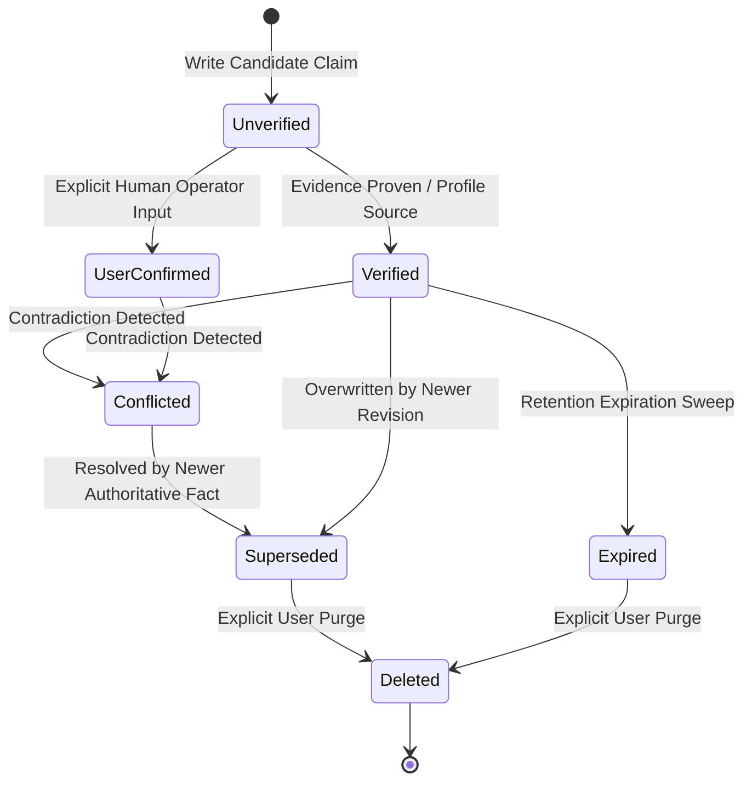

# AUTONOM Memory Lifecycle & Retention (Stage 15)

## 1. Lifecycle States

---

## 2. Retention Policies

Configured retention durations are enforced by the `ExpirationManager`:
- `PERMANENT`: Durable knowledge (verified education, career history, core preferences).
- `ONE_YEAR` / `NINETY_DAYS` / `THIRTY_DAYS`: Time-limited project or market intelligence records.
- `WORKFLOW` / `TASK` / `SESSION`: Ephemeral working context swept at session close.

---

## 3. Secure Cascading Deletion

When an operator deletes a memory record:
1. Primary record is marked `is_deleted = True`.
2. Dense vector is immediately purged from the in-memory `VectorStore`.
3. Entry is deleted from the SQLite `memory_fts` full-text index.
4. An immutable audit record is logged in `memory_access_events`.
5. Future queries completely exclude the purged content.
