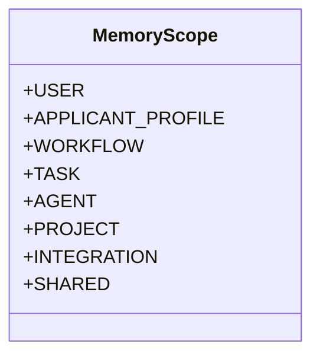

# AUTONOM Memory Schema & Scopes (Stage 15)

## 1. Schema Specifications

All memories are persisted into the primary SQLite database with deterministic referential integrity.

### `memory_records`
| Column | Type | Constraints | Description |
| :--- | :--- | :--- | :--- |
| `id` | VARCHAR(64) | PRIMARY KEY | Unique identifier (`mem_<uuid12>`) |
| `memory_type` | VARCHAR(32) | NOT NULL, INDEX | `working`, `episodic`, `semantic`, `procedural` |
| `title` | VARCHAR(256) | NOT NULL | Human-readable title or subject |
| `content` | TEXT | NOT NULL | Full textual payload of the claim or experience |
| `summary` | TEXT | NOT NULL | Condensed summary for fast previews |
| `owner_scope` | VARCHAR(32) | NOT NULL, INDEX | Primary boundary (`applicant_profile`, `user`, etc.) |
| `scope_id` | VARCHAR(128) | NOT NULL, INDEX | Specific entity or project ID |
| `source_type` | VARCHAR(64) | NOT NULL | `user_statement`, `verified_profile`, `task_execution`, etc. |
| `source_ref` | VARCHAR(256) | NOT NULL | URI or ID reference to primary artifact |
| `provenance_json` | JSON | NOT NULL | Author, workflow ID, task ID, timestamps |
| `verification_status`| VARCHAR(32) | NOT NULL, INDEX | `verified`, `user_confirmed`, `unverified`, etc. |
| `confidence_category`| VARCHAR(32) | NOT NULL | `high`, `medium`, `low`, `unrated` |
| `sensitivity_category`| VARCHAR(32) | NOT NULL, INDEX| `public`, `internal`, `personal`, `sensitive`, `secret` |
| `visibility_policy` | VARCHAR(32) | NOT NULL | `scoped`, `shared`, `private` |
| `created_at` | DATETIME | NOT NULL, INDEX | UTC creation timestamp |
| `updated_at` | DATETIME | NOT NULL | UTC last modification timestamp |
| `last_accessed_at` | DATETIME | NOT NULL | UTC last retrieval touch timestamp |
| `expires_at` | DATETIME | NULL, INDEX | UTC expiration deadline |
| `superseded_by` | VARCHAR(64) | NULL | Pointer to newer authoritative memory |
| `version` | INTEGER | NOT NULL | Incremental revision counter |
| `embedding_model_id`| VARCHAR(64) | NOT NULL | Model used for vector indexing |
| `embedding_status` | VARCHAR(32) | NOT NULL, INDEX | `pending`, `completed`, `failed` |
| `content_checksum` | VARCHAR(64) | NOT NULL, INDEX | SHA-256 hash of normalized text |
| `is_deleted` | BOOLEAN | NOT NULL, INDEX | Soft-deletion flag |
| `metadata_json` | JSON | NOT NULL | Extensible metadata key-values |

---

## 2. Memory Scopes

Access control strictly segregates memory across eight scopes:

- **`applicant_profile`**: Career history, verified technical skills, project portfolios, and interview answers.
- **`project`**: Codebase conventions, architecture decision records (ADRs), and research artifacts.
- **`workflow`**: Directed acyclic graph execution context and step outputs.
- **`user`**: Explicit human operator preferences and instructions.
- **`shared`**: Cross-agent validated procedures and public factual references.
