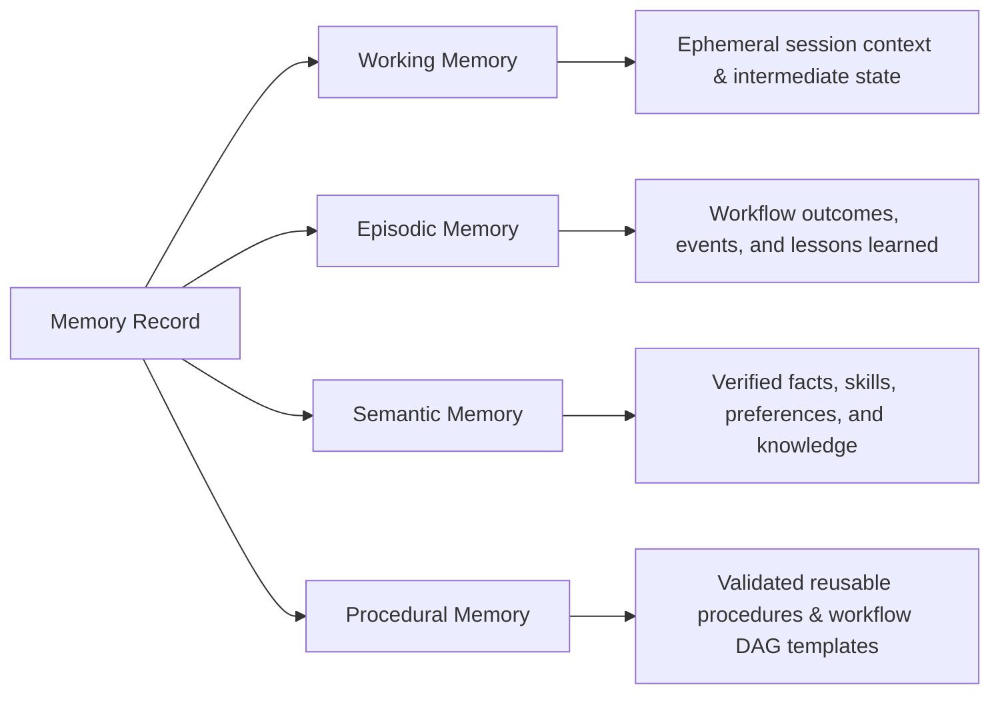

# AUTONOM Memory Types (Stage 15)

## 1. Memory Taxonomy

AUTONOM implements four distinct cognitive memory types, each designed for specific retention policies, retrieval mechanisms, and epistemic reliability:

---

## 2. Working Memory

- **Purpose**: Tracks active task directives, intermediate reasoning steps, scratchpad outputs, and current operational constraints.
- **Retention**: Transient; bounded to the active workflow session or task execution lifecycle.
- **Eviction**: Automatically cleared or transitioned when a task finishes. Not persisted permanently unless consolidated into an episodic outcome or verified fact.

---

## 3. Episodic Memory

- **Purpose**: Records meaningful events from previous autonomous executions, including successes, verified failure root causes, user corrections, and recovery interventions.
- **Provenance**: Backed by authoritative `workflow_id` and `task_id` references.
- **Usage**: Before initiating a similar task, the Supervisor and Planning Agent query episodic experiences to avoid known tool limitations or repeated errors.

---

## 4. Semantic Memory

- **Purpose**: Holds durable, verified facts and knowledge, such as candidate professional skills, user-confirmed work preferences, project specifications, and document evidence.
- **Epistemic States**: `verified`, `user_confirmed`, `evidence_supported`, `unverified`.
- **Integrity**: Model-generated interpretations cannot become verified facts without explicit provenance or human confirmation.

---

## 5. Procedural Memory

- **Purpose**: Validated, reusable workflow patterns and execution templates.
- **Structure**:
  - `procedure_id`: Canonical unique identifier.
  - `capability_id`: Target capability binding.
  - `steps`: Ordered decomposition of executable actions and parameter templates.
  - `preconditions` & `expected_outputs`: Invariants for execution.
  - `required_permissions`: Explicit Stage 14 permissions required to run the procedure.
- **Safety**: Procedural memories never execute arbitrary code; all steps must pass through the deterministic Stage 14 `ToolExecutionGateway`.
