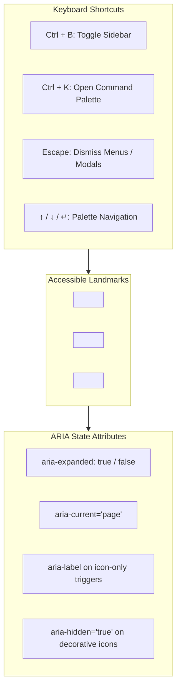

# AUTONOM — Navigation Accessibility & Keyboard Control

## 1. Accessibility Compliance & Architecture

The AUTONOM navigation architecture is engineered in compliance with **W3C WAI-ARIA 1.2 Authoring Practices** and **Windows Accessibility Guidelines**, providing full access via keyboard, screen readers, and high-contrast desktop themes.

---

## 2. Accessible Landmarks & ARIA Semantic Roles

1. **Main Navigation Landmark**:
   - Encapsulated in `<aside aria-label="Main Navigation">`.
   - Category group disclosures declare `<button aria-expanded="true/false" aria-label="[CATEGORY] category">`.
   - Item sub-menus declare `<button aria-expanded="true/false" aria-label="Toggle [ITEM] sub-menu">`.
2. **Current Page Indication**:
   - Active routes receive `aria-current="page"`.
   - Active parent items with active children receive high-contrast visual indicators while remaining accessible.
3. **Breadcrumb Landmark**:
   - Encapsulated in `<nav aria-label="Breadcrumb">` containing `<ol>` and `<li>` elements.
   - The trailing active crumb receives `aria-current="page"` and is non-clickable.
4. **Icon-Only Buttons & Tooltips**:
   - In collapsed rail mode, all icon buttons possess descriptive `aria-label` attributes (`aria-label="Jobs & Applications"`, `aria-label="Expand sidebar (Ctrl+B)"`, `aria-label="Settings"`).
   - Tooltips are linked via Radix primitives, remaining accessible to screen readers.

---

## 3. Global Keyboard Shortcuts

| Shortcut                       | Scope           | Action                                                            | Visual Affordance                           |
| ------------------------------ | --------------- | ----------------------------------------------------------------- | ------------------------------------------- |
| **`Ctrl + B`** / **`Cmd + B`** | Global Desktop  | Toggles sidebar between expanded (`240px`) and collapsed (`56px`) | Displayed in header collapse/expand tooltip |
| **`Ctrl + K`** / **`Cmd + K`** | Global Desktop  | Opens Command Palette search dialog                               | Displayed on header search pill             |
| **`Escape`**                   | Modal / Popover | Closes active flyout menu, tooltip, or Command Palette            | Displayed in Command Palette footer         |
| **`ArrowDown` (`↓`)**          | Command Palette | Moves selection down through search results                       | Indicated via `<kbd>` badge                 |
| **`ArrowUp` (`↑`)**            | Command Palette | Moves selection up through search results                         | Indicated via `<kbd>` badge                 |
| **`Enter` (`↵`)**              | Command Palette | Navigates to selected module and dismisses palette                | Indicated via `<kbd>` badge                 |
| **`Tab` / `Shift + Tab`**      | Navigation Tree | Traverses all interactive elements in logical DOM order           | High-contrast focus rings                   |

---

## 4. Focus Management & Visual Indicators

- **Focus Ring Styling**: All interactive buttons, links, and disclosure controls utilize high-contrast focus rings:
  `focus-visible:outline-none focus-visible:ring-1 focus-visible:ring-accent-primary`
- **Contrast Ratios**:
  - Text labels on surfaces maintain a minimum contrast ratio of `7:1` against `#0F1828` / `#121E30`.
  - Active highlights (`#338BDF` and `#51C8E8`) exceed `4.5:1` against dark backgrounds.
  - Category headings (`#7A8DAB`) maintain clear readability under technical desktop lighting conditions.
