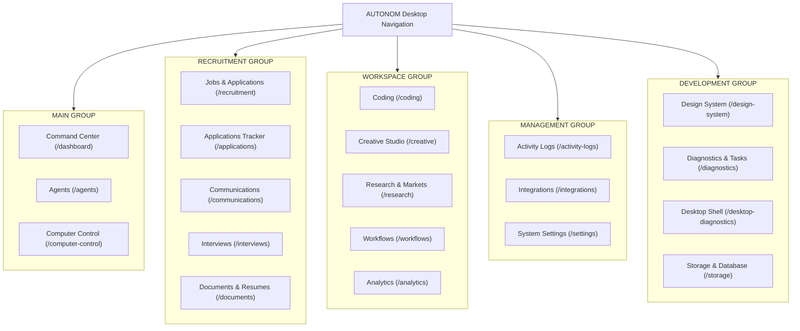

# AUTONOM — Navigation Architecture Specification

## 1. Executive Summary

Stage 07 establishes the complete navigation architecture for AUTONOM, the Windows 11 multi-agent autonomous desktop platform. Designed around the operational reality of human supervision over autonomous background systems, the navigation system provides instant situational awareness, rapid navigation across 16 top-level modules and 50+ child sub-routes, accessible keyboard workflows, and persistent UI state.

In strict adherence to AUTONOM engineering principles, the navigation architecture enforces an **Honest Roadmap and Zero Fabricated Data Policy**: modules scheduled for future stages render informative, structured `ModulePlaceholder` views with explicit stage attribution and scheduled sub-capabilities, never deceptive mock data or fabricated state.

---

## 2. Information Architecture & Group Hierarchy

The AUTONOM navigation hierarchy is organized into five functional groups:



### Group Definitions

| Group           | Identifier    | Purpose                                                                 | Order | Target User Focus                        |
| --------------- | ------------- | ----------------------------------------------------------------------- | ----- | ---------------------------------------- |
| **MAIN**        | `main`        | Primary command center, agent fleet supervision, computer control       | 1     | Real-time supervision & manual overrides |
| **RECRUITMENT** | `recruitment` | Autonomous job scouting, matching, application dispatch, communications | 2     | Flagship autonomous recruitment pipeline |
| **WORKSPACE**   | `workspace`   | Creative, engineering, research, workflow automation, and analytics     | 3     | Specialized agent workspaces & artifacts |
| **MANAGEMENT**  | `management`  | Audit logs, third-party MCP connectors, system configuration            | 4     | Governance, security, and credentials    |
| **DEVELOPMENT** | `development` | Real-time diagnostics, design tokens, desktop shell, database storage   | 5     | Engine telemetry & technical diagnostics |

---

## 3. Complete Route Registry

### 3.1 Group `main` (Core Operational Supervision)

| Module ID            | Route Path                      | Title                     | Availability | Roadmap Stage | Description                                                        |
| -------------------- | ------------------------------- | ------------------------- | ------------ | ------------- | ------------------------------------------------------------------ |
| `command-center`     | `/dashboard`                    | Command Center            | Implemented  | Stage 02–06   | Primary operational telemetry, active tasks, and service status    |
| `agents`             | `/agents`                       | Agents                    | Planned      | Stage 12      | Supervise, configure, and inspect the 24-agent autonomous swarm    |
| `agents-swarm`       | `/agents/swarm`                 | Swarm Overview            | Planned      | Stage 12      | Live 24-agent topology, agent health, and inter-agent buses        |
| `agents-specialists` | `/agents/specialists`           | Specialist Agents         | Planned      | Stage 12      | Deep inspection of Scout, Analyst, Tailor, Scribe, and QA agents   |
| `agents-budgets`     | `/agents/budgets`               | Token & Execution Budgets | Planned      | Stage 13      | Real-time token usage, model allocations, and budget kill-switches |
| `computer-control`   | `/computer-control`             | Computer Control          | Planned      | Stage 18      | OS-level UI automation, screen capture, mouse, keyboard drivers    |
| `cc-permissions`     | `/computer-control/permissions` | Permission Boundaries     | Planned      | Stage 18      | Bounded window scopes, safety sandboxes, and input locks           |
| `cc-live-session`    | `/computer-control/live`        | Live Automation Stream    | Planned      | Stage 18      | Real-time visual stream of active agent desktop automation         |

### 3.2 Group `recruitment` (Autonomous Job Pipeline)

| Module ID          | Route Path                 | Title                   | Availability | Roadmap Stage | Description                                                     |
| ------------------ | -------------------------- | ----------------------- | ------------ | ------------- | --------------------------------------------------------------- |
| `jobs`             | `/recruitment`             | Jobs & Applications     | Planned      | Stage 26      | Autonomous job discovery, match scoring, and submissions        |
| `jobs-discovery`   | `/recruitment/discovery`   | Job Discovery           | Planned      | Stage 26      | Scouted listings across LinkedIn, Indeed, Greenhouse, Lever     |
| `jobs-recommended` | `/recruitment/recommended` | Recommended Jobs        | Planned      | Stage 26      | Vector-similarity matched opportunities scored against profile  |
| `jobs-search`      | `/recruitment/search`      | Manual Search & Filters | Planned      | Stage 26      | Custom boolean queries, location filters, and salary thresholds |
| `applications`     | `/applications`            | Applications Tracker    | Planned      | Stage 27      | End-to-end recruitment pipeline, approvals, and status sync     |
| `apps-pipeline`    | `/applications/pipeline`   | Kanban Pipeline         | Planned      | Stage 27      | Visual Kanban board: Discovered → Drafted → Submitted → Offer   |
| `apps-approvals`   | `/applications/approvals`  | Pending Approvals       | Planned      | Stage 27      | Human-in-the-loop gate for sensitive application submissions    |
| `communications`   | `/communications`          | Communications          | Planned      | Stage 36      | Email parsing, interview invitations, follow-ups, rejections    |
| `comms-inbox`      | `/communications/inbox`    | Recruitment Inbox       | Planned      | Stage 36      | Synthesized inbox with agent email classifications              |
| `interviews`       | `/interviews`              | Interviews              | Planned      | Stage 40      | Calendar sync, technical prep briefs, and company profiles      |
| `documents`        | `/documents`               | Documents & Resumes     | Planned      | Stage 28      | Dynamic LaTeX/PDF resume tailoring and portfolio generation     |

### 3.3 Group `workspace` (Creative & Engineering Workspaces)

| Module ID   | Route Path   | Title              | Availability | Roadmap Stage | Description                                                           |
| ----------- | ------------ | ------------------ | ------------ | ------------- | --------------------------------------------------------------------- |
| `coding`    | `/coding`    | Coding Workspace   | Planned      | Stage 30      | Autonomous software development, test generation, and Git sync        |
| `creative`  | `/creative`  | Creative Studio    | Planned      | Stage 31      | Asset generation, presentations, and vector/raster graphics           |
| `research`  | `/research`  | Research & Markets | Planned      | Stage 32      | Autonomous web research, paper synthesis, and market analysis         |
| `workflows` | `/workflows` | Workflow Engine    | Planned      | Stage 33      | Multi-step DAG workflow builder and scheduled automation runs         |
| `analytics` | `/analytics` | System Analytics   | Planned      | Stage 34      | High-level metrics, agent productivity, and match score distributions |

### 3.4 Group `management` (Governance & Administration)

| Module ID               | Route Path                      | Title               | Availability | Roadmap Stage | Description                                                      |
| ----------------------- | ------------------------------- | ------------------- | ------------ | ------------- | ---------------------------------------------------------------- |
| `activity-logs`         | `/activity-logs`                | Activity Logs       | Planned      | Stage 20      | Immutable append-only audit trail of all agent actions           |
| `integrations`          | `/integrations`                 | Integrations & MCP  | Planned      | Stage 21      | Model Context Protocol servers, LLM API keys, and email accounts |
| `settings`              | `/settings`                     | System Settings     | Implemented  | Stage 04–05   | System configuration, desktop controls, database, and security   |
| `settings-desktop`      | `/settings/desktop`             | Desktop & Startup   | Implemented  | Stage 05      | Close-to-tray, autostart on Windows boot, and process supervisor |
| `settings-storage`      | `/settings/storage`             | Storage & Data      | Implemented  | Stage 04      | SQLite database management, online snapshots, and restoration    |
| `settings-diagnostics`  | `/settings/diagnostics`         | Backend Diagnostics | Implemented  | Stage 03      | Real-time task dispatch, SSE event streaming, and worker pool    |
| `settings-desktop-diag` | `/settings/desktop-diagnostics` | Desktop Diagnostics | Implemented  | Stage 05      | Native Tauri host inspection, sidecar supervisor state           |

### 3.5 Group `development` (Engine Telemetry & System Design)

| Module ID             | Route Path             | Title               | Availability | Roadmap Stage | Description                                                    |
| --------------------- | ---------------------- | ------------------- | ------------ | ------------- | -------------------------------------------------------------- |
| `design-system`       | `/design-system`       | Design System       | Implemented  | Stage 06      | Showcase of 20 design tokens, components, charts, and palettes |
| `diagnostics`         | `/diagnostics`         | Diagnostics & Tasks | Implemented  | Stage 03      | Real-time background task execution and worker inspection      |
| `desktop-diagnostics` | `/desktop-diagnostics` | Desktop Shell       | Implemented  | Stage 05      | Tauri 2 runtime supervision, process tree, and sidecar metrics |
| `storage`             | `/storage`             | Storage & Database  | Implemented  | Stage 04      | SQLite tables, schema migrations, and secure credentials       |

---

## 4. Routing & Breadcrumbs Algorithm

### Route Resolution

All desktop routing operates under `HashRouter` (`/#/dashboard`, `/#/recruitment`, etc.) to prevent webview file-resolution 404s when packaging under Windows Tauri 2.

The navigation system provides the following helper algorithms in `apps/desktop/src/config/navigation.ts`:

1. `getAllNavigationItems()`: Generates a flattened search index of all top-level modules and child sub-routes for instant fuzzy search in the Command Palette (`Ctrl+K`).
2. `getBreadcrumbsForPath(pathname: string)`: Resolves the full hierarchical breadcrumb path from the route:
   ```ts
   // Example: pathname = "/recruitment/discovery"
   // Returns:
   [
     { label: 'AUTONOM', path: '/dashboard' },
     { label: 'Jobs & Applications', path: '/recruitment' },
     { label: 'Job Discovery', isCurrent: true },
   ];
   ```
3. `findNavigationByPath(pathname: string)`: Resolves the active `NavigationItem`, `NavigationChildItem`, and `NavigationGroup` for metadata extraction, badge rendering, and title projection.

---

## 5. Zero Fabricated Data Policy

In strict conformance with AUTONOM engineering principles:

- **No Mock Data**: No fake job listings, fabricated candidate applications, or mock agent states are injected into placeholder views.
- **Honest Module Placeholders**: Unimplemented routes render `ModulePlaceholder.tsx`, which explicitly surfaces:
  - Exact target roadmap stage (e.g. `Stage 26`).
  - Route path and category.
  - Comprehensive capability description.
  - Planned sub-capabilities grid with direct link exploration.
  - Quick actions to return to Command Center or inspect active Diagnostics.
