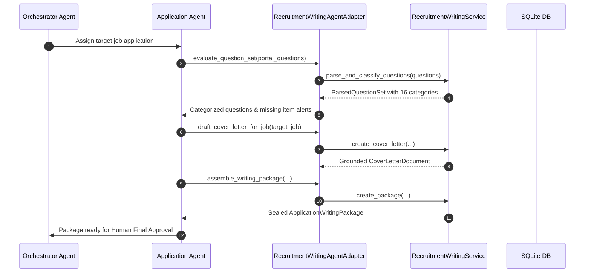

# Recruitment Writing Agent Integration

## AUTONOM Stage 24 — Recruitment Writing Intelligence Engine

---

### Overview

AUTONOM's recruitment workflows are powered by autonomous multi-agent teams (Application Agent, Sourcing Agent, Verification Agent, Document Reviewer). The **RecruitmentWritingAgentAdapter** provides high-level programmatic interfaces for recruitment agents to query writing assets, generate drafts, evaluate application readiness, and inspect missing facts.

---

### Agent Query Capabilities

Recruitment agents invoke the adapter to perform:

1. **`get_agent_writing_snapshot(profile_id)`**:
   - Compiles a complete summary of available writing assets: active cover letters, parsed question sets, approved answer templates, and pending packages.
   - Summarizes verified skills, employment tenure, and recent achievements for agent reasoning.

2. **`draft_cover_letter_for_job(job_metadata, archetype, tone)`**:
   - Allows the Application Agent to request an initial grounded cover letter draft for an open position.
   - Returns structured content blocks and fact-validation report.

3. **`evaluate_question_set(questions, job_metadata)`**:
   - Classifies candidate screening questions.
   - Evaluates whether required answers can be automatically resolved from the applicant's profile.
   - Identifies items requiring human confirmation (`sensitive_guards`).

4. **`check_application_package_readiness(package_id)`**:
   - Assesses whether an application package has unresolved blocking issues, missing information, or ungrounded assertions.
   - Returns a structured readiness scorecard for the Orchestrator Agent.

---

### Multi-Agent Interaction Model

---

### Strict Agent Constraints

- **No Autonomous Submission**: Recruitment agents are prohibited from submitting packages to external web forms without explicit user approval.
- **No Attestation Forgery**: Agents cannot sign legal attestations or override sensitive question guards.
- **Fact Immutability**: Agents cannot modify verified canonical profile claims; if an agent discovers missing data, it must flag a missing-information notice to the user.
