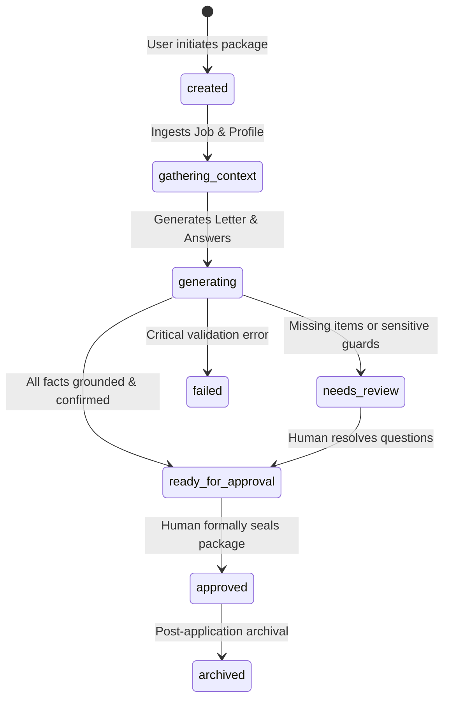

# Recruitment Writing Packages

## AUTONOM Stage 24 — Recruitment Writing Intelligence Engine

---

### Overview

An **Application Writing Package** is an immutable, sealed collection of all written application materials tailored for a specific job application. It serves as the single source of truth for downstream application automation, agent review, and human submission.

---

### Package Contents & Structure

An `ApplicationWritingPackage` aggregates:

1. **Target Job Context**: Employer name, job title, job description raw text, portal URL, and application deadline.
2. **Profile Snapshot**: Immutable JSON snapshot of the applicant's profile at the moment of package creation, preventing race conditions if the candidate edits their general profile later.
3. **Resume Reference**: Pointer to the approved Stage 23 resume version (`resume_id`, `version_number`, and artifact paths).
4. **Cover Letter Document**: The approved Stage 24 cover letter document, selected template, and exported DOCX/PDF artifact references.
5. **Screening Questions & Answers**: Complete set of parsed screening questions paired with approved, validated answers.
6. **Missing Items List**: Explicit enumeration of application requirements that could not be satisfied from available profile facts.
7. **Sensitive Attestation Record**: Cryptographically logged confirmations for work authorization, sponsorship, compensation, and legal declarations.
8. **Validation Report**: Fact-checking report proving zero-hallucination compliance.
9. **Cryptographic Seal**: SHA-256 digest computed across the entire bundle.

---

### Package Lifecycle States

---

### Cryptographic Sealing

Before an application package can be approved, the `WritingPackageManager` computes an overall content digest:

$$\text{Package Hash} = \text{SHA256}(\text{ProfileSnapshot} \parallel \text{ResumeHash} \parallel \text{CoverLetterHash} \parallel \text{AnswersDigest})$$

Once marked `approved`, the package becomes read-only. Any subsequent modification requires creating a new package version, maintaining an inviolable audit trail for all job applications.
