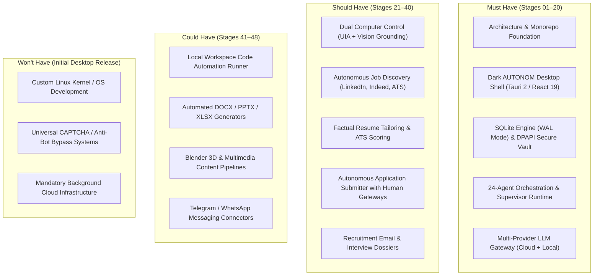

# AUTONOM — Requirements Specification

## 1. Executive Summary

AUTONOM is an autonomous, desktop-based multi-agent artificial intelligence application designed natively for Windows 11. The system acts as a highly capable personal executive and technical autonomous agent, specializing initially in **end-to-end recruitment operations (job discovery, ranking, application submission, resume tailoring, and interview prep)**, while scaling into a **general-purpose autonomous desktop assistant** (coding, computer control, research, document creation, and multimedia automation).

---

## 2. Functional Requirements (FR)

### 2.1 Core Multi-Agent Orchestration

- **FR-001: Hierarchical Agent Supervision**: The system shall feature a Supervisor Agent capable of breaking high-level user intents into directed acyclic task graphs (DAGs), assigning sub-tasks to 23 specialized agents, monitoring execution, and arbitrating conflicting outputs.
- **FR-002: Dynamic Agent Activation**: Agents shall be activated on-demand rather than running continuously, preserving memory and compute on local hardware.
- **FR-003: Self-Reflection & Fault Recovery**: When a specialist agent encounters an execution failure (e.g., HTTP timeout, missing DOM element, rate limit), the Recovery Agent shall diagnose the failure and execute an appropriate fallback strategy without crashing the workflow.
- **FR-004: Execution Lineage & Auditability**: Every decision, prompt, model response, tool invocation, and state transition shall be immutably recorded in local storage with millisecond timestamps and causal parent links.

### 2.2 Flagship Job Automation & Career Operations

- **FR-005: Multi-Source Job Discovery**: The system shall periodically search and scrape supported job boards (LinkedIn, Indeed, Glassdoor), direct applicant tracking systems (Greenhouse, Lever, Workday), and corporate career portals based on user career preferences.
- **FR-006: Semantic Fit Scoring & Gap Analysis**: The Job Matching Agent shall evaluate scraped job listings against the user's verified career profile, computing a multi-dimensional match score (skills, experience, seniority, compensation, location) and identifying missing qualifications.
- **FR-007: Truthful, Factual Resume Tailoring**: The Resume Agent shall reorder, emphasize, and format verified user achievements into targeted resumes and cover letters for specific job postings. Under no circumstance shall the system invent, exaggerate, or hallucinate credentials, dates, skills, or achievements.
- **FR-008: Autonomous Application Form Completion**: The Application Agent shall navigate ATS portals, map form fields to user profile attributes, supply approved answers to screening questions, attach tailored resumes, and execute submissions.
- **FR-009: Human-in-the-Loop Submission Gateways**: High-consequence actions (final application submission, legal attestations, salary agreements) shall require explicit user authorization unless explicitly granted advance approval for trusted employers.
- **FR-010: Recruitment Communications & Scheduling**: The Communications Agent shall monitor recruitment email threads via IMAP/OAuth, identify interview invitations, extract scheduling links, and prepare interview preparation dossiers.

### 2.3 Dual-Modality Computer Interaction

- **FR-011: Structural Automation (Primary)**: The Structural UI Agent shall interact with software via Windows UI Automation (UIA) COM trees and Playwright browser DOMs, reading controls deterministically and invoking patterns (Value, Invoke, Selection) without hijacking the mouse cursor.
- **FR-012: Visual Automation (Fallback)**: When structural access is unavailable (e.g., custom canvas, remote desktops, non-standard controls), the Visual Grounding Agent shall capture display frames, process bounding boxes via vision models and OCR, and inject human-like mouse/keyboard events via Windows `SendInput`.
- **FR-013: Adaptive Capture & Resource Throttling**: The visual capture pipeline shall dynamically adjust frame rates (from 0.5 FPS during idle polling to 10 FPS during active interaction) to conserve GPU/CPU cycles.
- **FR-014: Post-Action State Verification**: After every input action (click, form fill, keystroke), the Verification Agent shall assert that expected UI state transitions occurred (e.g., modal opened, button disabled, confirmation message rendered).

### 2.4 Extended General-Purpose Automation

- **FR-015: Sandboxed Code Execution**: The Coding Agent shall execute scripts, run test suites, inspect Git repositories, and edit source code within a designated local workspace directory.
- **FR-016: Document & Spreadsheet Authoring**: The system shall autonomously generate and edit PDF, DOCX, XLSX, and PPTX documents with structured formatting, charts, and formulas.
- **FR-017: Multi-Provider Model Gateway**: The agent runtime shall support local quantized models (GGUF/ONNX via Ollama/llama.cpp) and cloud APIs (OpenAI, Anthropic, Google Gemini) with automatic fallback and cost/token tracking.
- **FR-018: Model Context Protocol (MCP) Integration**: The system shall act as an MCP client, discovering and executing tools and resources hosted by local or remote MCP servers.

---

## 3. Nonfunctional Requirements (NFR)

### 3.1 Performance & Responsiveness

- **NFR-001: Desktop UI Latency**: All user interface interactions (navigation, card toggles, filtering) shall respond within 50ms.
- **NFR-002: Cold Startup Time**: The desktop application shall reach interactive status in less than 2.5 seconds on the target reference machine.
- **NFR-003: Backend IPC Throughput**: Inter-process communication between Tauri and the Python backend shall support at least 1,000 requests/second with sub-5ms round-trip latency.

### 3.2 Target Hardware Profile & Resource Budget

The primary target workstation is a standard mid-range mobile engineering laptop:

- **Processor**: 8-core / 16-thread modern x86_64 CPU (e.g., Intel Core i7-13700H or AMD Ryzen 7 7840HS).
- **RAM**: 16 GB DDR5 System Memory.
- **GPU**: NVIDIA GeForce RTX 4050 Laptop GPU (6 GB VRAM).
- **Storage**: Fast NVMe SSD.
- **NFR-004: Memory Confinement**: When operating locally:
  - Base desktop UI + Tauri shell: < 120 MB RAM.
  - Python agent runtime: < 250 MB RAM (idle).
  - Active local quantized LLM (e.g., 8B Q4_K_M): < 5.2 GB VRAM.
  - Only one primary model shall be loaded into GPU VRAM at any time.

### 3.3 Operating System & Compatibility

- **NFR-005: Windows 11 Native Architecture**: AUTONOM shall integrate seamlessly with Windows 11 (build 22000+), utilizing native Windows UI Automation, Desktop Duplication API, Windows Data Protection API (DPAPI), Windows Toast Notifications, and System Tray.
- **NFR-006: Zero External Daemon Requirement**: Launching the core application shall NOT require Docker, PostgreSQL, Redis, or WSL. All persistence shall use embedded SQLite.

### 3.4 Security & Privacy

- **NFR-007: Cryptographic Isolation**: All sensitive credentials (API keys, OAuth refresh tokens, session cookies) shall be encrypted at rest using Windows DPAPI. Plaintext secrets must never appear in logs or memory dumps.
- **NFR-008: Prompt-Injection Isolation**: Content ingested from external untrusted sources (job descriptions, web pages, recruiter emails) shall be quarantined and sanitized before inclusion in agent context windows. External text must never be executed as authoritative system instructions.
- **NFR-009: Emergency Kill Switch**: A global keyboard shortcut (`Ctrl+Shift+Esc` or dedicated hotkey) shall immediately disengage mouse/keyboard injection and pause all running agents in < 50ms.

---

## 4. Priority Matrix (MoSCoW)

---

## 5. Constraints & Boundaries

1. **Anti-Bot & Terms of Service Compliance**: AUTONOM explicitly respects external access controls. When a CAPTCHA, Cloudflare verification, or multi-factor authentication prompt is encountered, the agent pauses and delegates the challenge to the human user.
2. **Absolute Truthfulness**: Under no circumstance will the system fabricate user background information.
3. **Local Sovereignty**: All user personal data, application records, and resumes belong exclusively to the user and remain stored locally on their machine.
