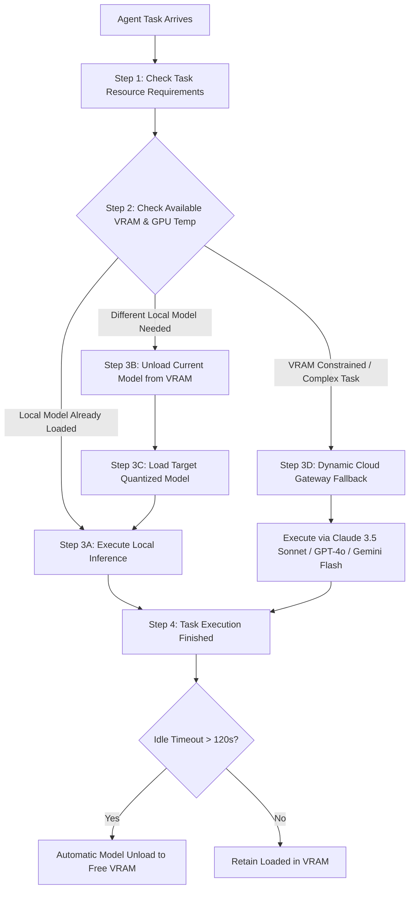

# AUTONOM — Local Hardware Strategy & Resource Budget

## 1. Reference Workstation Specification

All local AI modeling, desktop UI rendering, browser automation, and computer control pipelines are designed against the following mobile engineering baseline:

- **GPU**: NVIDIA GeForce RTX 4050 Laptop GPU (6,144 MB GDDR6 VRAM, ~96-bit bus, Ada Lovelace architecture).
- **RAM**: 16 GB DDR5 System Memory.
- **CPU**: 8-core / 16-thread modern x86_64 CPU (e.g., Intel Core i7-13700H or AMD Ryzen 7 7840HS).
- **OS**: Windows 11 (64-bit).

---

## 2. Resource Budget Allocation

> [!NOTE]
> The figures below represent engineering estimates based on architecture parameters and target operational ceilings. Actual benchmarks will be recorded in Stage 49.

### 2.1 System RAM Budget (Total: 16,384 MB)

| Component                                      | Target Baseline Allocation | Operational Peak Ceiling | Notes & Optimization                                  |
| :--------------------------------------------- | :------------------------- | :----------------------- | :---------------------------------------------------- |
| **Windows 11 OS & System Services**            | 4,000 MB                   | 5,500 MB                 | Background OS tasks, DWM, antivirus.                  |
| **Tauri Desktop Shell + WebView2**             | 120 MB                     | 250 MB                   | React 19 UI, minimal bundle, asset caching.           |
| **Python Agent Backend (FastAPI / aiosqlite)** | 180 MB                     | 450 MB                   | Async event loop, in-memory task queues.              |
| **Playwright Browser Process (Single Page)**   | 250 MB                     | 750 MB                   | Headless/headed Chromium context with 1 active tab.   |
| **Screen Capture & OpenCV Vision Pipeline**    | 80 MB                      | 200 MB                   | Downsampled 1080p frame buffers.                      |
| **Reserved / Free Memory Buffer**              | 3,000 MB                   | 4,000 MB                 | Essential headroom preventing Windows swap thrashing. |
| **Total Allocated RAM**                        | **~7,630 MB**              | **~11,150 MB**           | **Comfortably within 16 GB limit.**                   |

---

### 2.2 GPU VRAM Budget (Total: 6,144 MB)

The 6 GB VRAM ceiling strictly forbids keeping multiple 7B+ LLMs loaded simultaneously. AUTONOM adopts a **Single Active Model** architecture.

| Scenario                          | Model Architecture          | Quantization Format | Target VRAM Usage | Available VRAM Margin |
| :-------------------------------- | :-------------------------- | :------------------ | :---------------- | :-------------------- |
| **Desktop Idle / Non-LLM Work**   | None (OS DWM Only)          | N/A                 | ~450 MB           | 5,694 MB              |
| **Fast Reasoning / Extraction**   | Llama 3.2 3B / Qwen 2.5 3B  | Q4_K_M (GGUF)       | ~2,100 MB         | 3,594 MB              |
| **Primary Local Agent Reasoning** | Llama 3.1 8B / Qwen 2.5 7B  | Q4_K_M (GGUF)       | ~4,900 MB         | 794 MB (Adequate)     |
| **Local Vision Grounding**        | Qwen 2.5-VL 3B / Florence-2 | Q4 / FP16           | ~2,800 MB         | 2,894 MB              |
| **Blender 3D Render (Headless)**  | Cycles / Eevee Next         | N/A                 | ~1,800 MB         | 3,894 MB              |

---

## 3. Local Model Architecture & Management Rules

### 3.1 Single-Active-Model Invariant

- **Rule 1**: Only **ONE** primary LLM or Vision Model is loaded into GPU VRAM at any given time.
- **Rule 2**: If the Agent Swarm shifts from a text-only task (e.g., resume tailoring) to a visual task (e.g., UI coordinate grounding), the text model is unloaded before the vision model is initialized.

### 3.2 Memory-Aware Dynamic Routing

- Small, routine tasks (e.g., job field classification, email intent categorization) route to lightweight local 3B models or fast cloud models (e.g., `gemini-2.5-flash` / `gpt-4o-mini`).
- High-complexity planning and multi-page resume synthesis can fall back to cloud providers when local VRAM is constrained or battery-saver mode is active.

### 3.3 Automatic Idle Unloading

- A configurable idle timer (default: 120 seconds) automatically evicts inactive models from GPU VRAM back into system storage.
- This guarantees the user's laptop retains full GPU performance for gaming, 3D work, or video editing when AUTONOM is not actively thinking.

### 3.4 Hardware Utilization Probing

- The `/api/system` endpoint periodically polls:
  - GPU Core Temperature & Fan Speeds.
  - VRAM Allocated vs. Total (via `pynvml` or native Windows DXGI).
  - System Battery vs. AC Power status (throttles continuous scraping when on battery).
