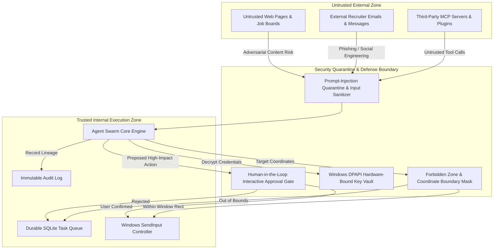
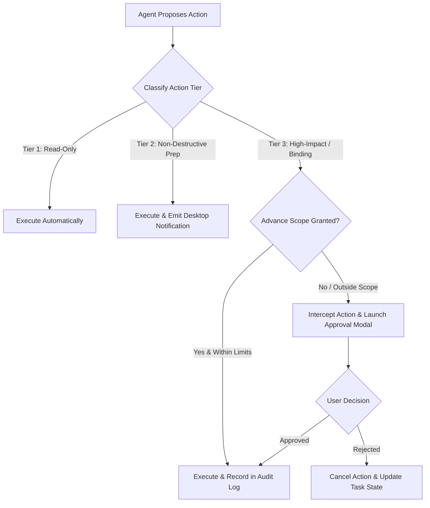

# AUTONOM — Security Architecture & Threat Model

## 1. Security Architecture Principles

AUTONOM operates with substantial privileges on the local Windows 11 system (native process execution, screen capture, mouse/keyboard input injection, browser automation). With this capability comes an absolute requirement for defense-in-depth, strict isolation, cryptographic safety, and verifiable human control.

### Core Security Guarantees

1. **Least-Privilege Execution**: Components execute with only the permissions required for their specific role.
2. **Deterministic Cryptographic Protection**: Secrets are bound to the local machine and user identity via Windows DPAPI.
3. **Non-Fabrication Invariant**: Agents are strictly prohibited from generating false career claims, falsified dates, or fabricated achievements.
4. **Non-Bypassable Human-in-the-Loop Gateways**: High-consequence operations (application submission, financial spend, external communications) enforce non-bypassable approval gates.
5. **No Universal Bypass**: AUTONOM never attempts to bypass Windows elevation (UAC), application protections, login verification, MFA, or anti-bot CAPTCHAs.

---

## 2. Threat Model & Trust Boundaries

### 2.1 Threat Analysis Matrix

| Threat Category                           | Potential Attack Vector                                                                                                | Impact   | Architecture Countermeasure                                                                                                                                           |
| :---------------------------------------- | :--------------------------------------------------------------------------------------------------------------------- | :------- | :-------------------------------------------------------------------------------------------------------------------------------------------------------------------- |
| **Prompt Injection**                      | Adversarial text in job descriptions or recruiter emails instructing the agent to execute shell commands or leak data. | High     | Ingested external text is strictly wrapped in quarantined XML/JSON data envelopes. System prompts mandate that enveloped content is passive data, never instructions. |
| **Credential Theft**                      | Malware or rogue process reading API keys or session cookies from disk.                                                | Critical | Secrets encrypted using Windows DPAPI (`CryptProtectData`) combined with AES-256-GCM. Plaintext is never stored on disk.                                              |
| **Runaway Automation**                    | Rapid loop sending hundreds of applications or erroneous mouse clicks.                                                 | High     | Rate limiters (max 25 apps/day), execution timeouts (max 5 min/task), and an instant hardware hotkey kill switch (`Ctrl+Shift+Esc`).                                  |
| **Accidental System Destruction**         | Agent clicking system settings, close buttons, or executing dangerous shell commands.                                  | High     | Target window coordinate clipping mask; blacklisted system windows; workspace directory confinement for shell/git execution.                                          |
| **Reputational Damage via Hallucination** | Agent inventing skills or degrees on resumes to match a job description.                                               | Critical | Strict validation gate cross-referencing all generated statements against user's verified career profile. Zero tolerance for unverified claims.                       |

---

## 3. Cryptographic Secure Storage & Windows DPAPI

### 3.1 Key Derivation & Storage Flow

1. **Root Protection**: Windows Data Protection API (DPAPI) encrypts application master keys using the logged-in user's Windows Security Identifier (SID) and hardware entropy.
2. **Intermediate Protection**: Key Derivation Function (HKDF-SHA256) derives task-specific 256-bit symmetric keys.
3. **Data Protection**: Secrets stored in SQLite `credentials` table use **AES-256-GCM**:
   - 96-bit randomly generated initialization vector (IV) per entry.
   - 128-bit authentication tag validating ciphertext integrity and preventing tampering.
   - Ciphertext stored as raw BLOB.
4. **Memory Hygiene**: In-memory plaintext buffers are explicitly zeroed immediately after API dispatch.

---

## 4. Autonomy Policy & 3-Tier Governance Matrix

AUTONOM enforces strict tiered autonomy:

| Tier       | Category                   | Allowed Actions                                                                                              | Enforcement Rule                                                                                                                                 |
| :--------- | :------------------------- | :----------------------------------------------------------------------------------------------------------- | :----------------------------------------------------------------------------------------------------------------------------------------------- |
| **Tier 1** | Read-Only & Discovery      | Job search, web scraping, resume parsing, match scoring, email header checking.                              | **Fully Autonomous**: Executes within background task queue.                                                                                     |
| **Tier 2** | Preparation & Drafting     | Tailoring resume ASTs, generating cover letters, drafting form answers, saving draft in portal.              | **Autonomous with Notification**: User notified via desktop stream; drafts saved locally.                                                        |
| **Tier 3** | High-Impact & Irreversible | Final application submission, legal/diversity attestations, sending external emails, financial transactions. | **Mandatory Approval Gateway**: Intercepted by Supervisor; requires explicit user sign-off unless advance authorization scope is actively valid. |

---

## 5. Non-Fabrication Guarantee & Truthfulness Gate

1. **The Verified Profile Invariant**: The user's `ApplicantProfile`, `VerifiedSkill`, and `ProjectEvidence` tables in SQLite represent the immutable boundary of truth.
2. **Pre-Submission AST Cross-Check**:
   - Before any tailored resume, cover letter, or application form is finalized, the **Verification Agent** performs a bi-directional verification check.
   - Every skill, employer, date range, and accomplishment bullet point in the generated document must resolve back to a primary key in `project_evidence` or `verified_skills`.
   - If an unverified claim is detected, the verification status fails immediately, the document is rejected, and an alert is raised to the user.

---

## 6. Anti-Bot Ethics & Human Handoff Protocol

1. **No CAPTCHA Bypassing**: AUTONOM does NOT incorporate CAPTCHA solvers, proxy rotators for evasion, or anti-bot bypass scripts.
2. **Handoff Sequence**:
   - Playwright or Visual Grounding Agent detects a CAPTCHA challenge (reCAPTCHA, hCaptcha, Cloudflare Turnstile) or Multi-Factor Authentication (MFA) requirement.
   - The automation loop immediately transitions the task state to `Paused`.
   - A high-priority Windows Action Center notification is dispatched: `"Human Action Required: Please solve verification in browser"`.
   - Once the user solves the challenge in the visible browser window, they click `"Resume"` in the AUTONOM desktop UI, and automation resumes smoothly.

---

## 7. Emergency Disengage Kill Switch

- **Global Hook**: Low-level Windows keyboard hook registered via Tauri native layer.
- **Trigger**: `Ctrl+Shift+Esc` (or user-configurable shortcut).
- **Execution**:
  1. Instantly unhooks the `SendInput` mouse and keyboard injection pipeline.
  2. Sets all active agent tasks to `Paused`.
  3. Displays an emergency banner across the desktop UI.
  4. Releases all mouse cursor locks and keyboard modifiers.
  5. Latency to full disconnect: **< 50 milliseconds**.
