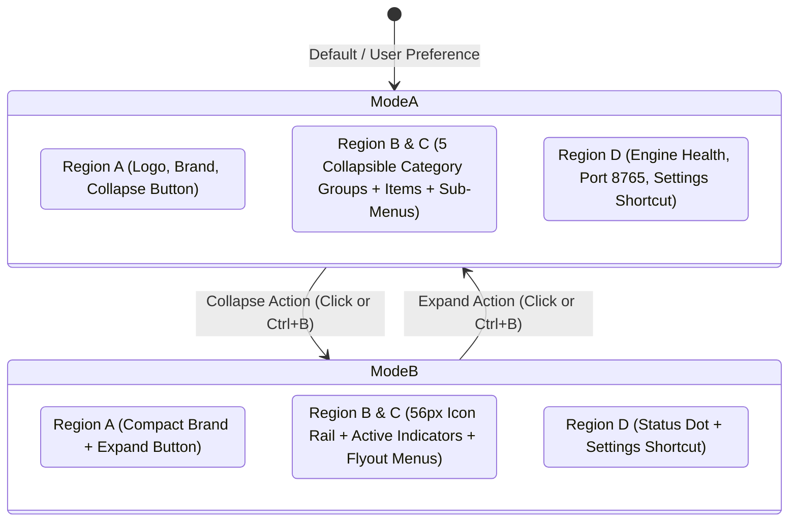

# AUTONOM — Expandable & Collapsible Sidebar Design

## 1. Overview & Operational Philosophy

The AUTONOM sidebar is designed around the reality that users **supervise autonomous background agents** rather than manually conducting repetitive manual operations. The sidebar provides continuous situational feedback while allowing the operator to switch instantly between a comprehensive expanded command navigation mode and a minimal, unobtrusive icon rail.

---

## 2. Layout Modes & Physical Geometry

### Mode A: Expanded Sidebar (Default)

- **Width**: `240px` (`w-60 min-w-[240px]`).
- **Primary Regions**:
  - **Region A (Header)**: Height `48px` (`h-12`). Contains terminal icon, `AUTONOM` brand mark, build badge `v0.1`, and `PanelLeftClose` toggle button with tooltip ("Collapse sidebar (Ctrl+B)").
  - **Region B & C (Primary & Secondary Navigation)**: Scrollable vertical list with dark sleek scrollbar (`scrollbar-thin`). Contains:
    - Uppercase category headers (`MAIN`, `RECRUITMENT`, `WORKSPACE`, `MANAGEMENT`, `DEVELOPMENT`) with disclosure carets.
    - Top-level items with 16px icons, text titles, availability badges, and chevron disclosures for items with sub-menus.
    - Indented sub-menu accordions (`ml-4 pl-2 border-l border-border/40`) displaying child links.
    - Distinctive active highlight: `bg-accent-primary/15 text-accent-primary font-semibold border-l-2 border-accent-primary`.
    - Active parent highlight: If a child route is active, parent displays `border-l-2 border-accent-primary/60`.
  - **Region D (Footer)**: Height `auto` (`p-2`). Contains:
    - Real engine connection status badge (`CONNECTED (8765)` with glowing emerald dot, or `CONNECTING...`, or `DISCONNECTED`).
    - Service uptime counter (`uptime_seconds`).
    - Settings shortcut button and AUTONOM multi-agent system attribution.

### Mode B: Collapsed Sidebar (Icon Rail)

- **Width**: `56px` (`w-14 min-w-[56px]`).
- **Primary Regions**:
  - **Region A (Header)**: Compact centered `PanelLeftOpen` button with tooltip ("Expand sidebar (Ctrl+B)").
  - **Region B & C (Rail Navigation)**: Centered 36x36px icon buttons (`h-9 w-9` touch/click targets).
    - Items without children: Standard `NavLink` with Radix `Tooltip` showing title and shortcut.
    - Items with children: Wrapped in `SidebarFlyout` with subtle bottom-right indicator pip (`bg-accent-cyan/80`).
    - Active route indicator: Left blue bar (`w-0.5 rounded-r bg-accent-primary`) and glowing primary background.
  - **Region D (Footer)**:
    - Status dot with Tooltip showing connection state and port (`Backend: CONNECTED (8765)`).
    - Compact Settings icon button with Tooltip.

---

## 3. Flyout Menus for Collapsed Mode (`SidebarFlyout.tsx`)

When the sidebar is in collapsed rail mode, items with sub-pages reveal an accessible flyout menu upon click:

- **Portalled Rendering**: Uses Radix Popover (`@radix-ui/react-popover`) portalled directly to `document.body`. This guarantees flyouts are never clipped by the sidebar's `overflow-y-auto` container.
- **Positioning**: `side="right" align="start" sideOffset={8} avoidCollisions={true}`. Ensures the flyout docks perfectly alongside the rail and shifts vertically to stay fully within the desktop viewport.
- **Visual Structure**:
  - Flyout Header: Module icon, title, roadmap badge (e.g. `Stage 26`), and capability summary.
  - Quick Actions: Direct "Overview" parent link.
  - Child Sub-pages: Full scrollable list of child routes with badges and arrow affordances.
- **Dismissal**:
  - Navigating to any link automatically closes the flyout.
  - Pressing `Escape` closes the flyout and returns focus to the trigger icon.
  - Clicking outside or opening another flyout dismisses the active one.

---

## 4. State Persistence Architecture (`sidebarStore.ts`)

Navigation state is managed via Zustand with `persist` middleware backed by `localStorage`:

- **Storage Key**: `autonom_sidebar_state`.
- **Persisted Fields**:
  - `isExpanded` (boolean): Sidebar mode (expanded vs collapsed).
  - `expandedGroups` (`string[]`): Category groups expanded in expanded mode.
  - `expandedItems` (`string[]`): Top-level items with open child accordions.
- **Transient Isolation (`partialize`)**:
  - `activeFlyout` (`string | null`): Flyout popover open in rail mode is explicitly transient and NOT persisted to prevent unexpected floating windows on application launch.
  - `isCommandPaletteOpen` (`boolean`): Modal dialog state is explicitly transient.
- **Resilience Against Corruption**:
  - Corrupted or invalid JSON data in `localStorage` is safely caught; the store gracefully falls back to sensible system defaults (`isExpanded = true`, all default groups open).
