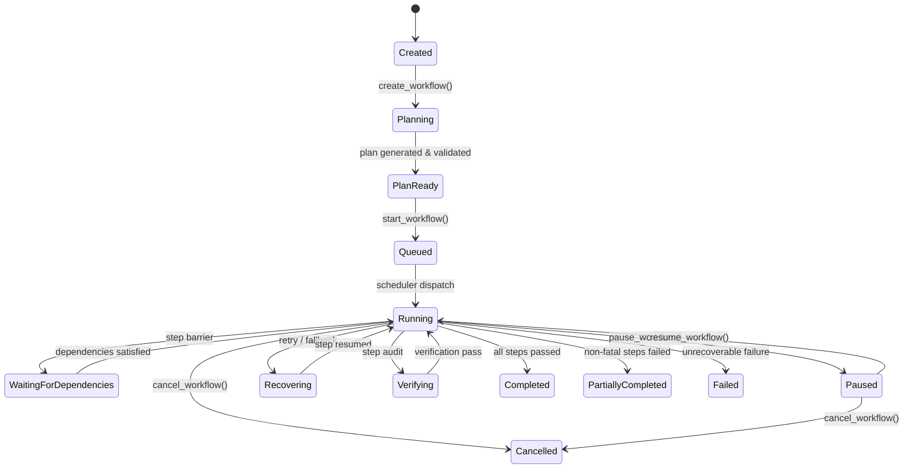

# Supervisor Agent Architecture (Stage 12)

## 1. Role and Core Mandate

The **Supervisor Agent** (`supervisor`) is the central workflow authority in AUTONOM. It provides master coordination over multi-agent workflows, managing lifecycle transitions, plan generation handoff, task dispatching, user governance, pause/resume/cancel controls, and startup crash reconciliation.

---

## 2. Workflow Lifecycle State Machine

The Supervisor Agent strictly enforces 14 workflow lifecycle states:

### Active States (`is_active == True`):
- `PLANNING`
- `QUEUED`
- `RUNNING`
- `WAITING_FOR_DEPENDENCIES`
- `RECOVERING`
- `VERIFYING`

### Terminal States (`is_terminal == True`):
- `COMPLETED`
- `PARTIALLY_COMPLETED`
- `FAILED`
- `CANCELLED`

---

## 3. Operational Methods

The Supervisor Agent exposes clean async coordination interfaces:

- `create_workflow(request: WorkflowCreateRequest) -> WorkflowResponse`:
  Creates the workflow record in SQLite, extracts initial input bindings, prompts the Planning Agent to generate a versioned DAG plan, saves steps and dependencies, and marks the workflow `PLAN_READY`.

- `start_workflow(workflow_id: str, background: bool = True) -> WorkflowResponse`:
  Retrieves the active plan, instantiates `WorkflowContext`, launches the `ExecutionScheduler` asynchronously or synchronously, and tracks background completion tasks.

- `pause_workflow(workflow_id: str) -> WorkflowResponse`:
  Signals the workflow's `pause_event` (`asyncio.Event`), pausing dispatch between stages while leaving in-flight operations safe.

- `resume_workflow(workflow_id: str) -> WorkflowResponse`:
  Clears the `pause_event`, resuming step scheduling.

- `cancel_workflow(workflow_id: str) -> WorkflowResponse`:
  Sets the `cancel_event`, cleanly aborting non-terminal steps and recording cancellation audit events.

- `replan_workflow(workflow_id: str, request: WorkflowReplanRequest) -> WorkflowResponse`:
  Increments the plan version (`version=2, 3...`), preserves executed step outputs, and asks the Planning Agent for a revised DAG.

- `reconcile_active_workflows() -> int`:
  Executed on backend startup (`service_container.initialize()`) to gracefully transition orphaned in-flight workflows (`running`, `verifying`, `recovering`) to `paused` with clear explanatory messages.
