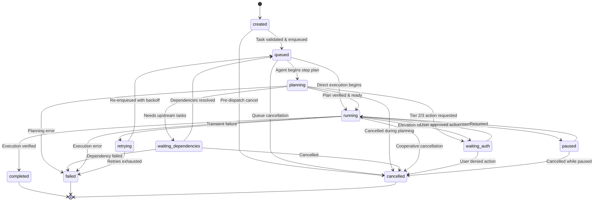

# AUTONOM — Task Execution Infrastructure & State Machine (Stage 03)

This document specifies the execution engine, task state machine, handler registry, cooperative cancellation protocol, and progress reporting in **AUTONOM**.

---

## 1. 11-State Durable Task State Machine

AUTONOM enforces an immutable 11-state task lifecycle. Every state transition is validated against a deterministic transition graph; invalid transitions immediately raise an `InvalidTaskTransitionError` (HTTP 409). Terminal states (`completed`, `failed`, `cancelled`) are permanent.

### State Transition Diagram



### Deterministic Transition Table

| Source State           | Valid Target States                                                      |
| :--------------------- | :----------------------------------------------------------------------- |
| `created`              | `queued`, `cancelled`                                                    |
| `queued`               | `planning`, `running`, `cancelled`                                       |
| `planning`             | `waiting_dependencies`, `running`, `waiting_auth`, `failed`, `cancelled` |
| `waiting_dependencies` | `queued`, `failed`, `cancelled`                                          |
| `running`              | `waiting_auth`, `paused`, `retrying`, `completed`, `failed`, `cancelled` |
| `waiting_auth`         | `running`, `cancelled`                                                   |
| `paused`               | `running`, `cancelled`                                                   |
| `retrying`             | `queued`, `failed`                                                       |
| `completed`            | _(Terminal — none)_                                                      |
| `failed`               | _(Terminal — none)_                                                      |
| `cancelled`            | _(Terminal — none)_                                                      |

---

## 2. Execution Context & Cooperative Cancellation

### 2.1. `TaskExecutionContext`

Every task execution receives an isolated context object (`app/execution/context.py`):

```python
class TaskExecutionContext:
    task_id: str
    task_type: str
    payload: dict[str, Any]
    correlation_id: str | None

    async def report_progress(self, progress: float, message: str | None = None, details: dict | None = None)
    def is_cancelled() -> bool
    def raise_if_cancelled()
    def request_cancellation()
```

### 2.2. Cancellation Contract

- Cancellation is **cooperative and deterministic**: workers and handlers regularly invoke `ctx.raise_if_cancelled()` or check `ctx.is_cancelled()`.
- If cancelled, `TaskCancelledError` is raised, rolling back partial state and immediately transitioning the task to `cancelled`.
- If a task exceeds its configured `timeout_seconds`, `asyncio.wait_for` raises `asyncio.TimeoutError`, which the manager wraps into `TaskTimeoutError` (transitioning the task to `failed`).

---

## 3. Handler Registry & Extensibility

Tasks are executed by subclassing `TaskHandler` (`app/execution/handlers.py`):

```python
class TaskHandler(ABC):
    task_type: str

    @abstractmethod
    async def execute(self, ctx: TaskExecutionContext) -> dict[str, Any]:
        """Executes the task asynchronously, reporting progress to ctx."""
        pass
```

### Registered Handlers (Stage 03)

1. `compute.echo`: Validates payload schema, logs execution, and synchronously returns input attributes.
2. `test.sleep_progress`: Simulates multi-step computer automation actions with incremental sleep periods, cooperative cancellation checks, and live progress event emission (`task.progress`).
