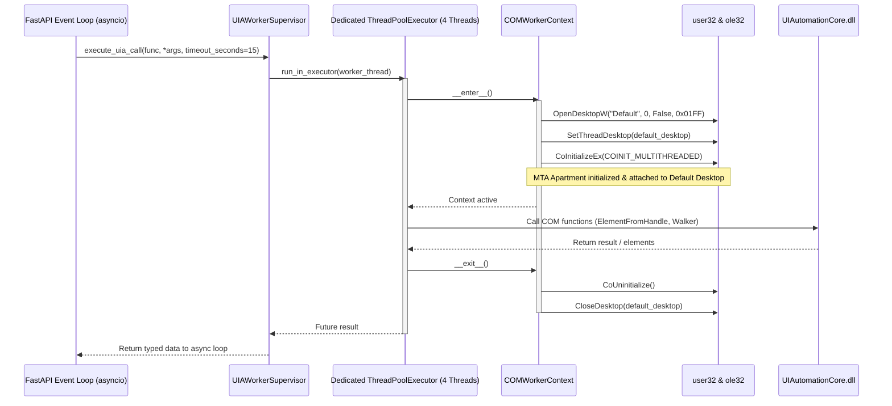

# UI Automation COM Threading & Concurrency Architecture (Stage 17)

## 1. Concurrency Challenges with Windows COM

Integrating Microsoft UI Automation into a modern asynchronous Python backend (FastAPI / `asyncio`) presents several severe engineering hurdles:

1. **Thread Apartment Affinity**:
   - COM components require explicit apartment initialization: Single-Threaded Apartment (STA) or Multi-Threaded Apartment (MTA).
   - Calling `CoInitializeEx(COINIT_MULTITHREADED)` on Python's main thread fails if another library (or the runtime) already called `CoInitialize` in STA mode, yielding `RPC_E_CHANGED_MODE (-2147417850)`.
   
2. **Blocking Network / RPC Calls**:
   - UIA operations (`ElementFromHandle`, `GetFirstChildElement`, `GetNextSiblingElement`) make synchronous inter-process calls via Windows Local Procedure Calls (ALPC).
   - If an application is busy, hanging, or presenting a modal loop, a UIA call will block the thread until a timeout expires. Running this on FastAPI's main event loop would freeze all API endpoints and WebSocket streams.

3. **Window Station & Desktop Isolation**:
   - Background worker processes and developer environments often run inside sandboxed or non-interactive desktops (e.g., `exebox-...` on `WinSta0`).
   - If a COM worker thread is bound to an isolated desktop, UIA queries against interactive user windows fail with `COMError: (-2147220991, 'An event was unable to invoke any of the subscribers')` or return empty trees.

---

## 2. Dedicated MTA Worker Architecture

To solve all three challenges simultaneously, AUTONOM implements the **`UIAWorkerSupervisor`** pattern:



---

## 3. Implementation Details

### `COMWorkerContext` (`app/computer/uia/com_runtime.py`)

```python
class COMWorkerContext:
    """Context manager for dedicated MTA worker threads."""
    def __enter__(self):
        # 1. Attach thread to interactive Default desktop before creating any hooks
        self._desktop = user32.OpenDesktopW("Default", 0, False, 0x01FF)
        if self._desktop:
            user32.SetThreadDesktop(self._desktop)
        
        # 2. Initialize COM in Multi-Threaded Apartment mode
        comtypes.CoInitializeEx(comtypes.COINIT_MULTITHREADED)
        return self

    def __exit__(self, exc_type, exc_val, exc_tb):
        # 3. Cleanly uninitialize COM and close desktop handle
        try:
            comtypes.CoUninitialize()
        finally:
            if self._desktop:
                user32.CloseDesktop(self._desktop)
```

### Worker Health Telemetry

`UIAWorkerSupervisor` continuously tracks:
- `max_workers`: Default 4 threads.
- `active_workers`: Currently executing COM jobs.
- `total_jobs_executed`: Cumulative operations dispatched.
- `failed_jobs_count`: Failures or timeouts caught.
- `last_heartbeat`: Timestamp of latest pool activity.
- `status`: `"healthy"` or `"degraded"` if failure thresholds are exceeded.
