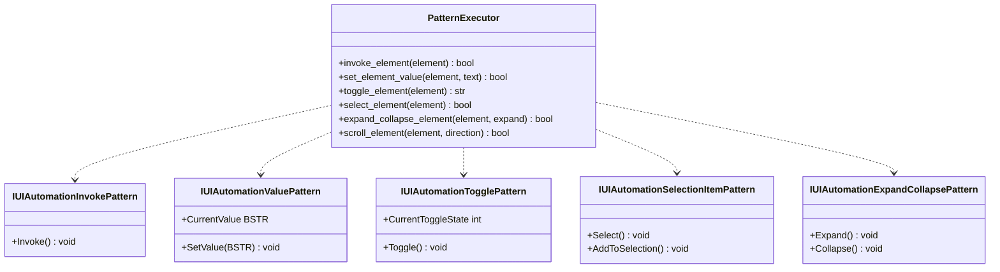

# Microsoft UI Automation Engine Specification (Stage 17)

## 1. Introduction

AUTONOM's structural control of Windows applications is anchored in the **Microsoft UI Automation (UIA)** framework, the modern accessibility and programmatic interface introduced in Windows Vista and maintained through Windows 11.

UIA exposes every graphical control—whether built in Win32, Windows Forms, WPF, WinUI 3, Electron, Chromium Embedded Framework, or Qt—as a hierarchical node in an accessibility tree with standardized attributes and control patterns.

---

## 2. COM Interfaces & Binding

The engine utilizes `comtypes` to bind directly to the native `UIAutomationCore.dll` library.

### Key Interfaces

- **`IUIAutomation` / `CUIAutomation`**: The root factory interface providing entry points:
  - `ElementFromHandle(hwnd)`: Converts a native Win32 window handle into the root `IUIAutomationElement` for that window.
  - `GetRootElement()`: Returns the global desktop root element.
  - `ControlViewWalker`: Navigates only controls that are relevant to human end-users (skipping pure layout and decorative containers).
  - `RawViewWalker`: Navigates every element in the visual tree without filtering.
  - `CreatePropertyCondition(property_id, value)`: Creates search criteria.
  - `CreateAndCondition(cond1, cond2)`: Combines query filters.

---

## 3. Control Type Mappings

UIA standardizes controls into numeric IDs ranging from `50000` to `50038`. AUTONOM normalizes these into human-readable strings for API consumers and LLM reasoning:

| Control Type ID | Standard Name | Typical Actions |
| :--- | :--- | :--- |
| `50000` | Button | `InvokePattern`, click |
| `50001` | Calendar | Selection, Value |
| `50002` | CheckBox | `TogglePattern` |
| `50003` | ComboBox | `ExpandCollapsePattern`, `ValuePattern` |
| `50004` | Edit | `ValuePattern`, text typing |
| `50005` | Hyperlink | `InvokePattern` |
| `50006` | Image | Read attributes, click |
| `50008` | ListItem | `SelectionItemPattern` |
| `50011` | MenuItem | `InvokePattern`, `ExpandCollapsePattern` |
| `50012` | ProgressBar | Read RangeValue |
| `50013` | RadioButton | `SelectionItemPattern` |
| `50014` | ScrollBar | `ScrollPattern` |
| `50016` | TabItem | `SelectionItemPattern` |
| `50018` | ToolBar | Container traversal |
| `50020` | Text | Text reading |
| `50032` | Window | `WindowPattern`, activate, minimize, maximize |
| `50033` | Pane | Container traversal |

---

## 4. Control Pattern Execution

Rather than emulating mouse clicks at coordinates, AUTONOM queries for and triggers semantic **Control Patterns**:

### Pattern Mapping

1. **`InvokePattern` (ID: 10000)**:
   - For buttons, links, and actionable controls.
   - Triggers the control's native activation event without requiring mouse cursor relocation.

2. **`ValuePattern` (ID: 10002)**:
   - For single-line edits, search bars, inputs, and form controls.
   - Programmatically sets text via `SetValue(BSTR)`.

3. **`TogglePattern` (ID: 10015)**:
   - For checkboxes, toggle switches, and checkable buttons.
   - Cycles between `On` (1), `Off` (0), and `Indeterminate` (2).

4. **`SelectionItemPattern` (ID: 10010)**:
   - For list items, radio buttons, combo box dropdown entries, and tabs.
   - Directly selects the target item via `Select()`.

5. **`ExpandCollapsePattern` (ID: 10005)**:
   - For combo boxes, tree nodes, and accordion menus.
   - Expands or collapses container views.

6. **`ScrollPattern` (ID: 10004)**:
   - For scrollable viewports, lists, and document panes.
   - Performs small or large vertical and horizontal scroll operations.
