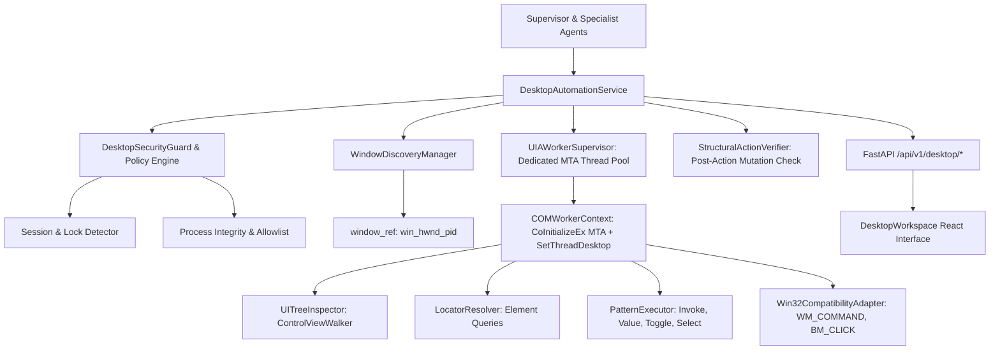

# Windows Structural UI Automation Architecture (Stage 17)

## 1. Overview & Purpose

Stage 17 establishes AUTONOM's **Windows Structural UI Automation Engine**, enabling autonomous and semi-autonomous interaction with native Microsoft Windows desktop applications.

While Stage 16 introduced Chromium browser automation via Playwright, modern knowledge work—especially enterprise recruitment workflows, ATS portals, localized desktop utilities, document processors, and administrative tooling—routinely requires direct operating system automation. 

Rather than relying on brittle, resolution-dependent computer vision coordinate clicking, Stage 17 implements **structural accessibility automation** powered by Microsoft UI Automation (UIA) and native Win32 APIs.

---

## 2. Core Architectural Principles

1. **Strictly Structural vs. Visual Interaction**:
   - Primary interaction relies on Microsoft UI Automation element trees (`IUIAutomationElement`), control type mappings (50000–50038), and standardized control patterns.
   - Secondary interaction falls back to deterministic Win32 window messages (`WM_GETTEXT`, `WM_SETTEXT`, `BM_CLICK`, `CB_SETCURSEL`) for legacy applications.
   - Screen coordinates and mouse movements are bounded to verified control rects rather than blind pixel offsets.

2. **Dedicated MTA Worker Thread Model**:
   - COM UI Automation requires Multi-Threaded Apartment (MTA) concurrency.
   - Dedicated worker threads (`UIAWorkerSupervisor`) ensure that synchronous blocking COM RPC calls never block the FastAPI async event loop and protect against cross-thread COM affinity deadlocks.
   - Each worker thread attaches directly to the interactive Windows `Default` desktop (`SetThreadDesktop`) to eliminate headless sandbox isolation.

3. **Deterministic Lifetime & Stale Handle Guard**:
   - Windows HWND handles can be recycled by the operating system when applications close and spawn.
   - AUTONOM implements compound window references: `window_ref = win_{hwnd}_{pid}`.
   - Every operation cryptographically and procedurally re-validates that the window handle exists (`IsWindow`) and that its owning process ID has not changed (`GetWindowThreadProcessId`).

4. **Fail-Closed Security & Integrity Boundaries**:
   - Actions are strictly denied if Windows is locked (`OpenInputDesktop` check), if the screen is non-interactive, or if the global Emergency Stop is triggered.
   - Execution is restricted to pre-authorized application allowlists (`DEFAULT_ALLOWED_APPS`), preventing arbitrary or dangerous executable manipulation.
   - High-integrity / SYSTEM token applications are rejected unless explicit elevated user authorization is recorded.

---

## 3. Subsystem Breakdown

| Subsystem | Primary Python Class / Module | Purpose |
| :--- | :--- | :--- |
| **Session Manager** | `DesktopSessionManager` (`windows/sessions.py`) | Detects active interactive session, lock state, desktop name, and screen resolution. |
| **Window Discovery** | `WindowDiscoveryManager` (`windows/windows.py`) | Enumerates top-level desktop windows via `EnumDesktopWindows`, resolves `window_ref`, and tracks window bounds. |
| **Process Discovery** | `ProcessDiscoveryManager` (`windows/processes.py`) | Discovers running executables, maps PIDs, publishers, and security allowlist flags. |
| **COM Runtime** | `COMWorkerContext` (`uia/com_runtime.py`) | Manages thread MTA initialization, `SetThreadDesktop` attachment, and `UIAutomationClient` type library binding. |
| **Worker Supervisor** | `UIAWorkerSupervisor` (`uia/workers.py`) | Manages 4-worker thread pool offloading COM calls with timeout guards. |
| **Tree Inspector** | `UITreeInspector` (`uia/trees.py`) | Bounded traversal of accessibility tree with depth, node limits, truncation flags, and token estimation. |
| **Locator Resolver** | `LocatorResolver` (`uia/locators.py`) | Resolves accessible elements by `automation_id`, `name`, `control_type`, and `class_name`. |
| **Pattern Executor** | `PatternExecutor` (`uia/patterns.py`) | Dispatches typed actions (`Invoke`, `Value`, `Toggle`, `SelectionItem`, `ExpandCollapse`, `Scroll`). |
| **Win32 Adapter** | `Win32CompatibilityAdapter` (`win32/adapter.py`) | Fallback messaging adapter for legacy Win32 controls. |
| **Keyboard Adapter** | `FocusedKeyboardAdapter` (`actions/keyboard.py`) | Dispatches keystrokes and Unicode strings exclusively to verified active foreground windows. |
| **Security Guard** | `DesktopSecurityGuard` (`security/guard.py`) | Enforces Emergency Stop, lock state gates, and fail-closed integrity boundaries. |
| **Action Verifier** | `StructuralActionVerifier` (`actions/verifier.py`) | Verifies post-action state mutations (value changes, toggle flips, focus shifts). |
| **Desktop Service** | `DesktopAutomationService` (`service.py`) | Central facade coordinating discovery, inspection, execution, history, and tasks. |

---

## 4. Integration with Supervisor & Multi-Agent Engine

The Windows Structural UI Automation engine integrates seamlessly with Stage 12 Orchestration and Stage 13 Specialist Agents:
- **`windows_computer_agent`**: Operates at the OS and application level (launching apps, managing window layouts, coordinating multi-app desktop flows).
- **`structural_ui_agent`**: Operates at the accessibility tree level (discovering controls, reading form fields, populating values, clicking submit buttons).
- **Supervisor Agent**: Plans and routes cross-modality workflows—for instance, pulling an ATS candidate profile in Playwright (Stage 16), opening a corporate HR spreadsheet in Excel (Stage 17), and syncing recruitment records.
