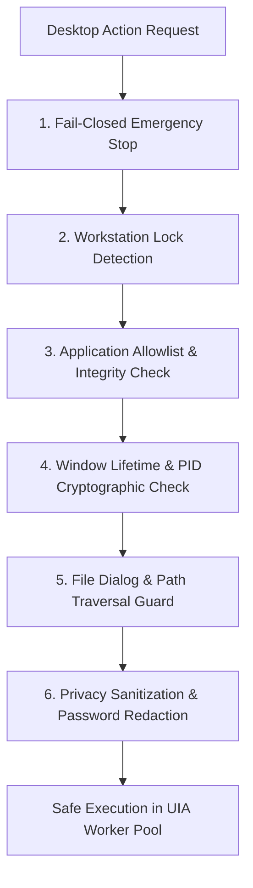

# Windows Automation Security, Boundaries & Guardrails (Stage 17)

## 1. Security Threat Model

Autonomous desktop control possesses high system authority. An unconstrained or compromised desktop agent presents severe risks:
1. **Unauthorized System Modification**: Tampering with system binaries, system settings, or security configurations.
2. **Path Traversal & Data Destruction**: Writing to Windows root directories or deleting critical data via automated file dialogs.
3. **Session Spoofing & Recycled HWND Manipulation**: Interacting with an application after it has been replaced by a different window.
4. **Credential & Sensitive Data Leakage**: Ingesting passwords, API keys, or credit card numbers from UI controls into LLM prompt logs.
5. **Headless & Screen-Lock Bypasses**: Executing actions when the user has locked their workstation.

---

## 2. Security Defense Mechanisms

AUTONOM implements defense-in-depth across six distinct security boundaries:

### 1. Fail-Closed Emergency Stop
- Integrated with Stage 14 `EmergencyStopController`.
- Triggered by user UI button or global keyboard panic killswitch (`Pause / Break`).
- When active, `DesktopSecurityGuard.assert_automation_allowed()` throws `PermissionError`, terminating all desktop operations immediately.

### 2. Workstation Lock Detection
- Queries `user32.OpenInputDesktop(0, False, DESKTOP_ENUMERATE)`.
- If Windows is locked or displaying the secure UAC desktop, `OpenInputDesktop` returns `NULL` and `GetLastError()` returns `5 (ERROR_ACCESS_DENIED)`.
- Automation fails closed immediately.

### 3. Application Allowlists & Integrity Levels
- Validates executable name against `DEFAULT_ALLOWED_APPS` (e.g., `notepad.exe`, `windowsterminal.exe`, `explorer.exe`, `calc.exe`).
- Disallowed applications return `403 Forbidden`.
- Inspects Windows process token integrity levels via `GetTokenInformation(TokenIntegrityLevel)`. Rejects elevated SYSTEM or administrator processes unless explicit supervisor clearance is established.

### 4. Window Lifetime & PID Verification
- Validates `window_ref = win_{hwnd}_{pid}` on every call.
- Validates `IsWindow(hwnd)` and asserts that `GetWindowThreadProcessId` matches the original PID to prevent recycled window handle attacks.

### 5. File Dialog Safety Guard (`FileDialogSafetyGuard`)
- Detects common Win32 dialogs (`#32770`).
- Strictly rejects any path traversal characters (`".."`) before resolving.
- Prohibits target paths in `C:\Windows`, `C:\Program Files`, `C:\Program Files (x86)`, and `C:\Windows\System32`.

### 6. Privacy Filter & PII Redaction (`PrivacyFilter`)
- Automatically flags `Edit` controls whose name or `automation_id` contains `"password"`, `"pwd"`, `"secret"`, `"token"`, or `"pin"`.
- Values in password controls are redacted to `"[REDACTED_PASSWORD]"`.
- Regular expression scanners scrub credit card numbers and Social Security Numbers before logs are persisted or emitted to the event bus.
