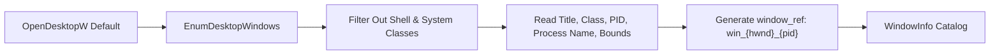

# Window Discovery & Lifetime Tracking Specification (Stage 17)

## 1. Top-Level Window Enumeration

Discovering native Windows desktop applications requires enumerating top-level windows on the interactive user desktop (`WinSta0\Default`).

AUTONOM implements `WindowDiscoveryManager` in `app/computer/windows/windows.py` using the native Win32 `EnumDesktopWindows` API:

### Excluded Windows Shell Classes

To prevent LLM agents and users from polluting reasoning with internal Windows system elements, the enumerator automatically excludes internal shell classes:
- `Progman` (Desktop wallpaper / icons manager)
- `WorkerW` (Desktop rendering worker)
- `Shell_TrayWnd` (Windows Taskbar)
- `Shell_SecondaryTrayWnd` (Multi-monitor secondary taskbars)
- `ThumbnailDeviceHelperWnd`
- `ForegroundStaging`

---

## 2. Cryptographic and Deterministic Handle Validation: `window_ref`

In Win32 architecture, window handles (`HWND`) are opaque 32-bit or 64-bit integers managed by the kernel table. When a window closes, Windows can immediately recycle that HWND value and assign it to an entirely unrelated, newly created window.

If an AI agent issues an action to an HWND after the user closes an application, it could accidentally perform destructive operations in a completely different program that received the recycled HWND.

### Solution: Compound Reference Validation

AUTONOM invents the **`window_ref`** standard:
$$\text{window\_ref} = \text{"win\_" } + \text{hwnd} + \text{"\_" } + \text{pid}$$

Before every tree inspection, pattern execution, or window state modification:
1. The engine unpacks `hwnd` and `expected_pid`.
2. It calls `user32.IsWindow(hwnd)` to verify handle vitality.
3. It calls `user32.GetWindowThreadProcessId(hwnd, &actual_pid)`.
4. If `actual_pid != expected_pid`, the handle has been recycled. The engine aborts immediately, marks the reference stale, and returns an error without executing the action.

---

## 3. Window State Management

The `WindowStateManager` executes native state modifications via `user32.ShowWindow` and message posting:

- **Activate (`WindowManageAction.ACTIVATE`)**: Restores if iconic, calls `SetForegroundWindow`, attaches input threads via `AttachThreadInput` if needed to bypass Windows focus-stealing prevention.
- **Minimize (`WindowManageAction.MINIMIZE`)**: Calls `ShowWindow(hwnd, SW_MINIMIZE)` and verifies with `IsIconic(hwnd)`.
- **Maximize (`WindowManageAction.MAXIMIZE`)**: Calls `ShowWindow(hwnd, SW_MAXIMIZE)` and verifies with `IsZoomed(hwnd)`.
- **Restore (`WindowManageAction.RESTORE`)**: Calls `ShowWindow(hwnd, SW_RESTORE)`.
- **Close (`WindowManageAction.CLOSE`)**: Safely posts `WM_CLOSE` to the window message queue. This allows the application to prompt to save unsaved documents rather than forcefully terminating the process.
